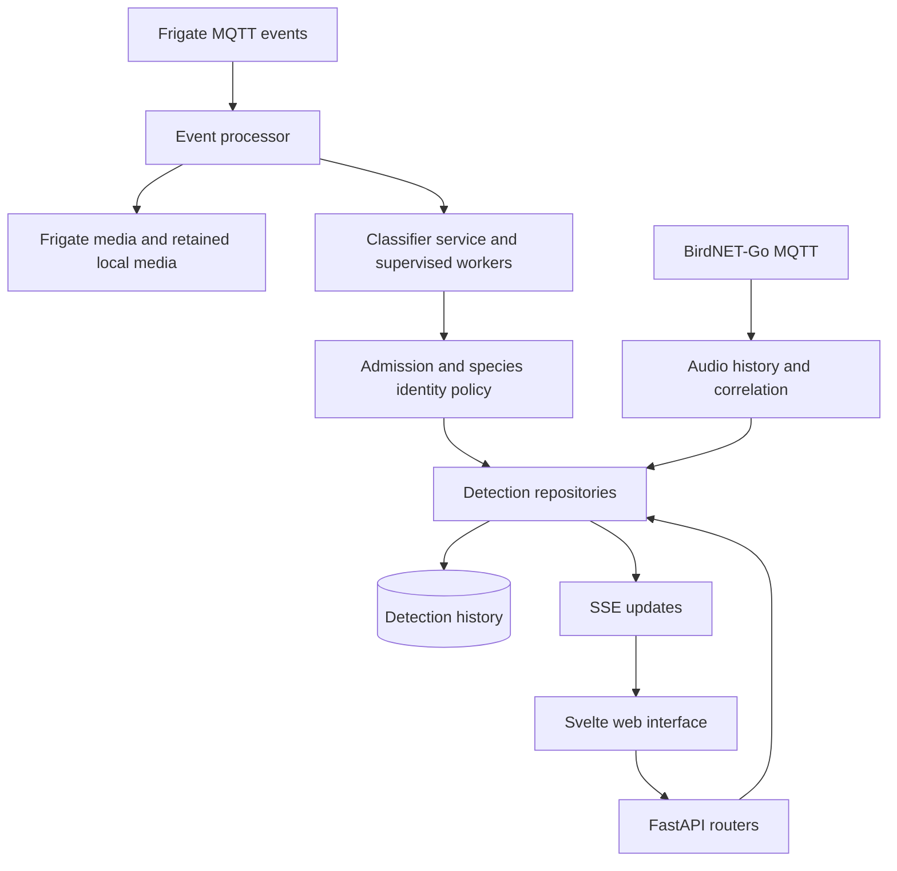

# YA-WAMF architecture

YA-WAMF receives Frigate camera events over MQTT, identifies the pictured species,
and keeps a durable history with locally retained media. BirdNET-Go audio can
corroborate a visual identification; it also has its own stored history. The web
interface shows visits, their individual captures, heard calls and the pipeline's
measured state.

This page explains the current architecture. Use [the development workflow](DEVELOPMENT.md)
to start work and [CLAUDE.md](CLAUDE.md) for the engineering contract. Behaviour is
defined by code and tests, not by an older guide or release description.

## Request and event flow

Frigate events are untrusted input. A Frigate event ID is unique in history, so
repeated delivery does not create duplicate detection rows. Replays can improve
permitted automatic classification fields, while owner corrections and existing
evidence follow explicit preservation rules. Camera events, classified captures,
grouped visits and counted birds in one frame are different units; do not use one
as an undocumented substitute for another.

Notifications, weather, taxonomy and optional AI analysis are separate services.
A transient upstream or media failure must not be presented as a successful
classification or silently erase the existing record. Live work and background
work have bounded admission, queues and recovery. See
[video analysis](docs/features/video-analysis.md) and [diagnostics](docs/troubleshooting/diagnostics.md)
for their operational behaviour.

## Component boundaries

| Area | Responsibility |
|---|---|
| `backend/app/main.py` | Application lifecycle, service startup and shared HTTP/SSE wiring. |
| `backend/app/routers/` | HTTP composition, authentication dependencies and typed request/response contracts. |
| `backend/app/services/` | Classification, policy, media, worker supervision, integrations and orchestration. |
| `backend/app/repositories/` | Async database access. Keep network/inference work outside held database connections. |
| `backend/app/models/` | Pydantic API models; `config_models.py` defines configuration sections. |
| `backend/app/database.py` | Pooled `aiosqlite` access, migration execution and history restore points. |
| `backend/migrations/` | Detection-history Alembic stream. |
| `backend/migrations_catalog/` | Independent species-catalogue Alembic stream. |
| `apps/ui/src/lib/api/` | Typed frontend API client and generated OpenAPI types. |
| `apps/ui/src/lib/pages/`, `components/`, `stores/` | Svelte 5 views, shared controls and application state. |
| `apps/ui/src/lib/i18n/` | Translated user-facing strings. |
| `apps/ui/browser-tests/` | Rendered production-component fixtures with substituted APIs/media. |
| `apps/telemetry-worker/` | Optional anonymous telemetry service, with local tests. |
| `custom_components/yawamf/` | Home Assistant integration. |

Production repositories use async SQLite; SQLAlchemy metadata describes migrations.
The presence of SQLAlchemy in migration tooling does not make runtime repositories
an ORM layer. Keep domain decisions pure where possible, with repositories handling
persistence and routers composing the HTTP response.

## Persistence and species identity

The container has two persistent mounts:

| Mount | Contents |
|---|---|
| `/config` | Saved settings and credentials, plus the default media-cache directory. |
| `/data` | Detection history (`speciesid.db`), species catalogue (`species_catalog.db`), models, manual-observation uploads and migration restore points. |

The history and catalogue are separate databases with independent Alembic heads.
Neither migration stream depends on the other's revisions, and there are no
cross-database foreign keys. An opaque `species_id` connects detection identity
to catalogue identity. Catalogue enrichment must preserve owner history and name
overrides rather than replacing a live database with a seed file.

Registered classifier outputs are stored in their original order in the catalogue,
bound to the exact model checksum. Complete mappings take precedence over text
label files. New integrated models install without `labels.txt`; custom or legacy
models retain the file fallback when no complete catalogue mapping exists.
Classification results carry the artifact identity that produced them, including
from subprocess workers, so a concurrent model switch cannot credit another model.

Photographs and generated visit media are retained locally within configured age,
per-species and size limits; Frigate event-clip copies are optional. Hiding a capture
is reversible, while hard deletion, finite history retention and database reset
permanently remove data. Favourites and the optional species floor have different
protection rules for photographs and clips. See [Data settings](docs/setup/configuration.md#data)
and [upgrading safely](MIGRATION.md).

## Model and runtime contracts

ONNX classifiers can use ONNX Runtime CPU/CUDA or Intel OpenVINO. TFLite uses the
available LiteRT/TFLite implementation. The default subprocess mode keeps inference
in supervised workers with separate live/background capacity. Each worker can
hold a model copy, so increasing worker counts trades memory for concurrency.
In-process mode shares a model with the app and has its own quarantine/recovery
contract; it is not equivalent to worker isolation.

Image packaging, device visibility, a saved provider preference and the actual
loaded provider are distinct. A host-visible accelerator still needs compatible
model output. Current eligibility binds finite-output CPU comparisons to the
artifact, runtime dependencies, image family and host hardware. A compatibility
pass is not a species-accuracy measurement, and reference-host evidence is not a
promise for another machine.

Preprocessing belongs to the checkpoint contract: colour order, tensor layout,
normalization, resize/crop rounding, dimensions and extra inputs can change the
answer. DINOv2 uses saved feeder coordinates at runtime with neutral metadata when
missing; it receives no date or location uncertainty. NaFlex has a native-aspect
contract rather than a fixed square resize. See
[model conversion](docs/conversions/birder-model-conversion.md),
[model evaluation](docs/features/model-evaluation.md),
[the October model catalogue](docs/features/model-catalogue-2026-10.md), and
[hardware acceleration](docs/setup/hardware-acceleration.md).

## UI and API contracts

The frontend uses Svelte 5 runes, strict TypeScript, the shared control styles in
`apps/ui/src/app.css` and translated strings. Derived state belongs in `$derived`;
`$effect` is reserved for synchronization with external systems. Diagnostic flows
share the staged `DiagnosticDialog`; loading, empty, failed and planned states
must remain distinguishable.

Generate frontend types from OpenAPI when an API contract changes. Owner-only
writes require owner authorization. The session cookie authorizes read-only media
and SSE, not every API route; the API reference documents exact boundaries.
Secrets are redacted in ordinary responses and preserved on partial writes.
Configuration exports contain real secrets and must be protected.

Use [the API reference](docs/api.md), [configuration reference](docs/setup/configuration.md),
[code quality standard](docs/standards/code-quality.md),
[UI standard](docs/standards/ui-ux.md), and
[layout patterns](docs/standards/layout-patterns.md) rather than copying old endpoint
examples or building a separate control style.

## Validation and deployment

Python 3.12 and Node.js 22 match CI. Backend regression/coverage, both migration
streams, frontend checks/unit tests/build, Chromium component fixtures, telemetry
local tests and documentation consistency have maintained gates. Wider WebKit/mobile
matrices, hardware probes and sustained-load runs provide different evidence; they
do not replace normal tests. Follow [testing](docs/development/testing.md).

The recommended deployment is the monolithic root `Dockerfile` and
`docker-compose.monolith.yml`. The full, CPU, Intel, and CUDA image families preserve
the same volume contract; unsuffixed tags select full. The ARM64 Raspberry
Pi image is a separate CPU-only best-effort path. The legacy split layout is kept
for existing installations. See [Getting started](docs/setup/getting-started.md)
and [release workflow](docs/development/releasing.md).

Future work belongs in [ROADMAP.md](ROADMAP.md) and actionable GitHub issues.
Historical review reports describe their tested revision; they are not a current
list of missing capabilities. Implemented changes wait as fragments in
[changelog.d/](changelog.d/README.md), plus older entries under **Unreleased** in
[CHANGELOG.md](CHANGELOG.md), until a release is actually published.
