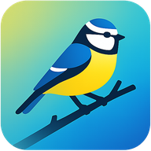
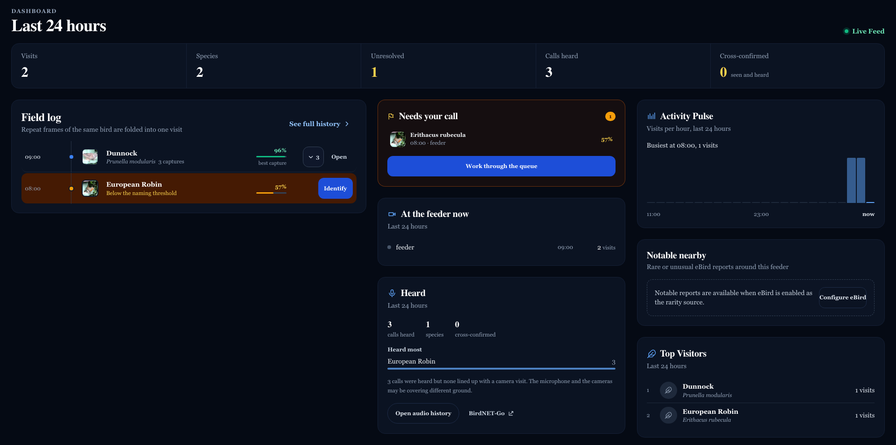

<p align="center">
  
</p>
<h1 align="center">Yet Another WhosAtMyFeeder (YA-WAMF)</h1>
<p align="center"><strong>AI-powered bird feeder classification for Frigate NVR</strong></p>
<p align="center">
  <a href="#documentation">Docs</a> •
  <a href="#quick-start">Quick Start</a> •
  <a href="https://yetanotherwhosatmyfeeder.pownet.uk">Live Demo</a>
</p>

YA-WAMF identifies birds in [Frigate NVR](https://frigate.video/) events using local models.
It keeps photographs and visit history, can match BirdNET-Go calls, and offers a read-only
view you can share.

This branch documents the current development build. For published behavior and upgrade notes,
see the [latest stable release](https://github.com/Jellman86/YetAnother-WhosAtMyFeeder/releases/latest).
New development features require a matching `dev` image.

<p align="center">
  
</p>

## What you can do

- **Identify locally:** choose a model and validate it on your CPU, Intel GPU/NPU or NVIDIA GPU.
  RoPE ViT-B14 remains the default; [coverage and hardware support vary by model](docs/features/ai-models.md).
- **Review the evidence:** explore seen visits and heard calls, inspect individual captures,
  correct species and count birds in a photograph. See [Explorer](docs/features/explorer.md).
- **Keep important visits:** star a favourite to archive available media; manage ordinary
  photographs and clips with [retention controls](docs/features/favourites.md).
- **Use more frames:** optional [video analysis](docs/features/video-analysis.md) compares sampled
  frames when Frigate retained a usable clip.
- **Add your own sightings:** classify and save a photograph or clip through
  [Add observation](docs/features/manual-observations.md).
- **Review garden visitors:** current `dev` offers a [Garden animals beta](docs/features/garden-animals.md). Animals appear in the Explorer beside your birds, stored apart from bird history, with independent camera opt-in, grouped motion reviews, an adjustable animal threshold and owner-reviewed SpeciesNet suggestions.
- **Connect other services:** [BirdNET-Go](docs/integrations/birdnet-go.md),
  [Home Assistant](docs/integrations/home-assistant.md), notifications and optional community-science exports.
- **Share deliberately:** choose which history, camera names and media guests can see in
  [Security settings](docs/features/authentication.md).

## Quick Start

For automatic camera ingestion, you need Docker Compose, Frigate with bird detection/MQTT enabled,
and a broker reachable from YA-WAMF. New installs should use the monolithic container.
For Raspberry Pi, use the separate [best-effort ARM64 guide](docs/setup/raspberry-pi.md);
physical Pi hardware has not yet been validated by the maintainer.

**1. Download the stack files.**

```bash
mkdir ya-wamf && cd ya-wamf
curl -O https://raw.githubusercontent.com/Jellman86/YetAnother-WhosAtMyFeeder/main/docker-compose.monolith.yml
curl -O https://raw.githubusercontent.com/Jellman86/YetAnother-WhosAtMyFeeder/main/.env.example
cp .env.example .env
```

**2. Edit `.env` for your network and host user.**

```env
YAWAMF_MONALITHIC_TAG=latest
DOCKER_NETWORK=frigate
FRIGATE_URL=http://frigate:5000
MQTT_SERVER=mosquitto
MQTT_PORT=1883
TZ=Europe/London
PUID=1000
PGID=1000
```

Replace `PUID` and `PGID` with the numbers from `id -u` and `id -g`. The named Docker network
must already exist. Service names such as `frigate` and `mosquitto` require that shared network;
reachable LAN addresses also work. Set `MQTT_AUTH`, `MQTT_USERNAME` and `MQTT_PASSWORD` if required.

Unsuffixed tags use the full compatibility image. Smaller CPU, Intel and CUDA images and device
passthrough are covered in [Hardware Acceleration](docs/setup/hardware-acceleration.md).

**3. Prepare writable storage and start.**

```bash
mkdir -p config data/models
sudo chown -R "$(id -u):$(id -g)" config data
sudo chmod -R u+rwX,g+rwX config data
docker compose -f docker-compose.monolith.yml up -d
```

**4. Open `http://YOUR_SERVER_IP:9852`.**

Complete setup, create an owner password and test the Frigate/MQTT connection. Download and
validate a model in **Settings → Detection → Model Manager**. A compatibility pass proves that
it runs and agrees with the CPU baseline; it does not measure species accuracy. Check your first
saved visit in Explorer and **Settings → Health**.

If setup fails, follow [Getting Started](docs/setup/getting-started.md) or
[Diagnostics & Logs](docs/troubleshooting/diagnostics.md). Keep authentication enabled before
exposing the app outside your trusted network. Public Access is a separate, read-only choice.

## Documentation

The [documentation hub](docs/index.md) routes you to the task you need:

- [Setup and configuration](docs/setup/configuration.md), [environment overrides](docs/setup/environment-variables.md)
  and [split-to-monolith migration](docs/setup/migrate-split-to-monolith.md).
- [Model choices](docs/features/ai-models.md), [accuracy evidence](docs/features/model-accuracy.md)
  and [hardware compatibility checks](docs/features/model-evaluation.md).
- [Integrations](docs/index.md#-integrations), [notifications](docs/features/notifications.md)
  and [privacy boundaries](PRIVACY.md).
- [Upgrading and rollback](MIGRATION.md), [support](SUPPORT.md) and [known gaps](ISSUES.md).
- [API reference](docs/api.md), [contributing](CONTRIBUTING.md) and [development workflow](DEVELOPMENT.md).

To update a Compose-managed installation, back up `/config` and `/data`, read the release's
upgrade notes, then pull and recreate the service with the same volumes. Do not delete history
or reset settings to try a different model. Existing split installations should follow the
migration guide before changing deployment layout.

## Live instance and project

The [public demo](https://yetanotherwhosatmyfeeder.pownet.uk) runs development builds and may be
unavailable during testing. If you share your own guest dashboard, feel free to link it in an issue
or discussion.

This is a personal project built with help from AI coding assistants, inspired by
[WhosAtMyFeeder](https://github.com/mmcc-xx/WhosAtMyFeeder). Reports, recordings and retests help
improve it; thank you to the [contributors](CONTRIBUTORS.md) and the Frigate and BirdNET-Go projects.
See [Security](SECURITY.md) for vulnerability reporting. Licensed under [MIT](LICENSE).
