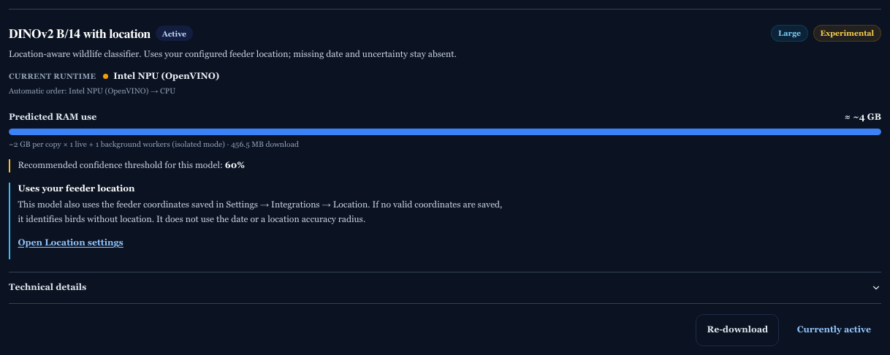

# AI Models & Performance

YA-WAMF supports multiple classifier models, allowing you to balance speed, memory usage, taxonomy scope, and identification accuracy.

## Choose and validate a model

You can manage models directly from **Settings → Detection → Model Manager**. The current lineup includes:

- Wildlife-wide ONNX models for broad species coverage
- Birds-only regional and global models with different species coverage
- A legacy TFLite fallback for very constrained CPU-only systems
- Separately managed bird-crop detector tiers for generated thumbnails and automatic localization

The [model release catalog](https://github.com/Jellman86/YetAnother-WhosAtMyFeeder/releases/tag/models)
lists each artifact's download size, input resolution, estimated model working-set RAM, provider
contract, and measured Quark latency. RAM figures are planning estimates rather than measured peak
container RSS; leave at least 1–2 GB for YA-WAMF and the operating system, with additional headroom
when Frigate shares the host.

MogaNet-S EU, ConvNeXt-V1 Tiny EU, RegNet-Y-8G EU, and UniFormer-S EU are retired comparison
models. The current development build does not list, download, validate, or activate them. YA-WAMF leaves an
existing model directory untouched for rollback, but replaces a saved retired selection at startup:
an installed ConvNeXt Large is preferred, with bundled MobileNet as the fail-safe. The legacy
release assets remain available to pre-3.0 applications until the planned 3.0 asset retirement.

> **Platform note:** Raspberry Pi compatibility is currently a best-effort ARM64 target and has not yet been validated on physical Pi hardware in this project environment.

### Validate before you select (post-install gate)

A downloaded model is *installed* (files present) but not yet *validated* (proven to run on your
specific hardware). Setting up a model runs through one guided wizard — the same staged dialog used
by the connection tests — with three stages:

1. **Download** — fetches the model with live progress shown in the dialog (skipped when the model
   is already downloaded).
2. **Validate and tune on this hardware** — intersects the running image, host probe, and model
   contract; then tests ONNX CPU/CUDA and OpenVINO CPU/GPU/NPU as applicable. Each provider runs in
   an isolated process, must produce finite output matching the CPU baseline, and reports median
   per-frame inference latency. The measured passing order becomes this installation's recommendation.
3. **Enable for selection** — makes the model active, restoring the previous model if validation
   fails. Only after activation succeeds is the still-eligible recommendation applied.

A model that has never been validated on this host shows **Validate to enable** instead of **Use
this model**, and the API rejects activating it (`409`). The model already running and bundled
models are grandfathered, so upgrading never blocks a working install. Validation works on every
image flavor and tests only providers that image actually owns. Evidence is scoped to the model
artifact, inference runtime/kernel, visible accelerator hardware, and exact image flavor, so a
change to any of those requires new proof even for a shared provider such as CPU. The
same [provider compatibility sweep](model-evaluation.md) backs the setup wizard, Model Manager, and
Detection Diagnostics.

## Inference Providers (CPU / CUDA / Intel OpenVINO)

For ONNX models, YA-WAMF supports a provider selector under
**Settings → Detection → Inference Provider**:

- `Auto` (recommended): uses the selected model's measured passing order on this installation and
  otherwise remains within its globally safe provider contract.
- `CPU`: ONNX Runtime CPU execution.
- `NVIDIA CUDA`: ONNX Runtime with CUDA; initialization can use an available CPU fallback when CUDA is unavailable.
- `Intel GPU (OpenVINO)`: OpenVINO GPU plugin; initialization can try OpenVINO CPU when the GPU is unavailable.
- `Intel CPU (OpenVINO)`: OpenVINO CPU execution.
- `Intel NPU (OpenVINO)`: OpenVINO NPU execution for a model validated on this host.

The selected image must package the provider: full packages every supported
x86 family, `-cpu` packages ONNX CPU, `-intel` packages ONNX CPU plus OpenVINO,
and `-cuda` packages ONNX Runtime CUDA plus its CPU execution provider. Image
choice never proves the hardware works. See
[Hardware Acceleration](../setup/hardware-acceleration.md) for tags, device
passthrough, and safe switching.

### Initialization fallback and runtime faults

Provider initialization can try another available route when acceleration is unavailable. A
successful load does not prove that the route can finish a live workload within its deadline.

- An unavailable selected provider can use an available fallback. If no route loads or completes
  safely, the failure remains visible rather than being reported as successful classification.
- The UI shows:
  - **Image** and **Packaged** providers
  - **Selected** provider
  - **Active** provider
  - **Backend** (`onnxruntime` or `openvino`)
  - **Fallback** reason or an image/provider mismatch warning
- A provider/image mismatch does not rewrite the saved selection. The current
  image can try an available CPU route; switching to a matching image restores
  access to the saved provider, subject to host and model validation.
- CUDA and OpenVINO availability are probed separately from model loading, then validated again during runtime initialization.
- **Selected** is the saved preference; **Active** describes loaded workers. If no worker has loaded
  yet, the UI marks the provider as planned rather than claiming it is active. The Detection tab
  refreshes this status after validation, activation and saving, periodically while visible and
  when you return to the browser. An explicit unsaved provider choice is kept; an untouched field
  follows a newly saved server preference so a later unrelated save cannot switch it back.

Confirmed native worker crashes have a separate policy. Their exact profile is quarantined,
including across restarts; the app does not silently retry it inside the server process. A
quarantined accelerator profile can attempt the same model in a shared isolated CPU recovery
worker, with queueing, cold load and inference inside the workload deadline. CPU may also be
unavailable, quarantined or too slow, and recovery can fail visibly. Successful recovery does not
clear the original crash evidence or make the installation healthy. See
[confirmed native worker crashes](../troubleshooting/diagnostics.md#confirmed-native-worker-crashes).

### Available Tiers

See [Model Accuracy & Benchmarks](model-accuracy.md) for dated accuracy panels. Coverage, download
size and memory estimates are listed in the [model release](https://github.com/Jellman86/YetAnother-WhosAtMyFeeder/releases/tag/models).

| Model | Position |
|---|---|
| **RoPE ViT-B14 (224 px)** | Default wildlife-wide classifier; 10,000 outputs. |
| **ConvNeXt Large** | Larger wildlife-wide alternative; compare on your own feeder images. |
| **EVA-02 Large** | Large comparison model. The reporter's sustained Intel GPU/backfill fault in [#490](https://github.com/Jellman86/YetAnother-WhosAtMyFeeder/issues/490) remains unconfirmed; another host's passing check does not close it. |

#### Birds-Only Families: Small Birds / Medium Birds
- Region-aware family entries that resolve to EU or North America candidate assets based on your configured location.
- Their regional output vocabularies exclude many species present in wildlife-wide models; compare coverage and accuracy on your own birds.
- `Small Birds` targets lower RAM and faster inference.
- `Medium Birds` is the larger regional option.

#### Advanced Birds-Only Options
- **FocalNet-B EU Medium:** 707-species European birds-only model with validated CPU, Intel CPU,
  Intel GPU, and Intel NPU support.
- **FlexiViT Israel Birds:** compact model with 550 Israel-checklist bird classes, including rarities, with CPU,
  Intel CPU, and Intel NPU validation. Intel GPU is offered only after the exact installation
  passes the isolated CPU-equivalence sweep.

The four retired EU comparison architectures are intentionally not part of this tier. Their
benchmark rows remain in [Model Accuracy & Benchmarks](model-accuracy.md) as historical evidence
for the catalogue decision, not as current recommendations.

#### October experimental options

[October classifier additions](model-catalogue-2026-10.md) compares DINOv2 with location, the new
336 px Wildlife and EU RoPE checkpoints, Arabian Peninsula RoPE DeiT3, NaFlex EU and Israel,
Parallel ViT EU and BioCLIP 2.5. These are additional choices, not an automatic replacement for
existing selections. The page gives their coverage, download sizes, memory estimates and
host-gated provider limits.

DINOv2 uses the saved feeder coordinates at inference time. Set them in **Settings → Integrations
→ Location**, or in the setup wizard's model step, before validating. A complete `(0, 0)` is valid;
a missing location is explicitly represented as absent. The setup wizard saves coordinates before
the check, blocks incomplete pairs, and shows the provider it will save on **Continue**. Changing
the saved location reloads classifier workers. Date metadata remains absent.

Registered classifiers obtain their ordered labels from the species catalogue, bound to the exact
weights checksum and output width. All 18 registered classifier artifacts have published mappings;
the eight October additions do not download `labels.txt`. Unknown or incompletely mapped custom
models retain their file fallback. Do not repair a registered model by substituting another model's
label list.

#### Legacy TFLite (MobileNet V2)

CPU-only, low-memory legacy option with 965 outputs. Hidden by default in Model Manager.

#### Crops, photographs and video

**Settings → Detection → Models → Bird finder** chooses which detector locates birds in full
frames before they are identified and counted. It does not name species. The choice is saved by
**Apply Settings** with the rest of the page. The CPU-friendly **Fast** detector remains the
automatic fallback. Each option shows its download size, estimated RAM, and the device it runs on:
a graphics or NPU device only after it passed a device check on this host, otherwise the CPU. When
it is on the CPU, the card names the graphics or NPU devices it could use here, and the chosen
finder offers **Check *devices* for *finder***. That check covers only the finder, compares each
device with the CPU on bird photos and does not change the identification model.

A host kernel, driver or image update makes earlier device results stale. After startup, YA-WAMF
re-checks the chosen finder once on this host's own recent bird snapshots, but only on graphics or
NPU devices that finder passed before. A finder that never passed on an accelerator here still
needs the owner's check. If no bird snapshots are saved yet, the re-check waits for a later restart.

- **Standard (YOLOX-Tiny)** is the default. It is small and quick, but misses many birds that are
  small in a wide frame.
- **Wide frame (RF-DETR Nano)** reads the whole frame and four overlapping tiles. It finds far more
  small and distant birds, at the cost of a 103 MB download and about five detector passes per
  frame. Until it is downloaded, the standard finder stays in use.

Classifier crop policy is automatic;
a detector score is not a species confidence score. The hardware sweep checks detectors separately
from classifiers. See [Model Evaluation](model-evaluation.md#provider-compatibility-and-the-post-install-gate).

For automatic best-available photographs, counted birds, **Regenerate snapshots and recount birds**,
and **Score again**, use [Deep Video Analysis](video-analysis.md). Photo work and species analysis
are separate outcomes; several agreeing frames still do not prove the species is correct.

## Frigate sublabel fallback

If **Trust Frigate sublabels** is enabled, YA-WAMF still runs the selected local model first. The
Frigate label is a fallback when media is unavailable, local inference produces no usable result, or
the local prediction does not clear policy. Frigate's sublabel confidence is kept separate from its
bird-object detector score, and YA-WAMF does not echo a fallback label straight back to Frigate.

## Behavioral Analysis (LLMs)
For advanced insights, YA-WAMF can send high-confidence snapshots to a Large Language Model (LLM) to generate a "Naturalist Note".

- **Default Provider:** Google Gemini
- **Settings UI recommendation:** `gemini-3.1-flash-lite`
- **Other current presets in the UI:** OpenAI `gpt-5.6`, Claude `claude-opus-4-8`, and OpenRouter `google/gemini-3.1-flash-lite`
- **OpenRouter behavior:** the UI shows a few presets, but accepts any non-empty OpenRouter model ID.

The LLM analyzes the image context (weather, behavior, plumage) and provides a short, educational summary of what the bird is doing. This feature requires an API key.

Use **Settings → AI → Test AI Connection** to check credentials, vision support and a representative
five-frame request before analysing detections. The dialog keeps failures and retry guidance
visible. A successful connection test is not a latency benchmark or a guarantee against later
provider outages. Optional AI analysis sends selected images to the configured external provider.
