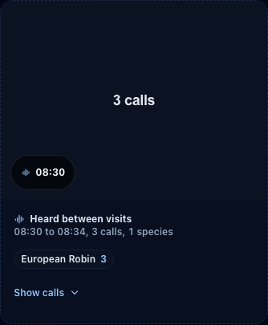
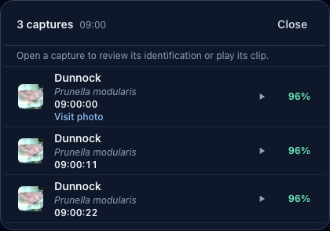

# Explore and review visits

Use **Explorer** to find a camera visit, listen to calls from the same part of the day and check
what was photographed. A camera visit groups nearby captures of the same species on one camera;
it is not a count of distinct individual birds.

## Show what was seen and heard

1. Open **Explorer** and choose a time range. Use **Cameras** and the other filters to narrow the
   camera visits when needed.
2. Turn on **Heard calls** above the list to include stored BirdNET-Go calls between the visits.
   It starts off and this device remembers the choice.
3. Each heard band gives its time span and species counts. Choose **Show calls** for the strongest
   call of each species, then play it or move through its spectrogram. Arrow keys move the
   playhead one second.
4. Open a visit to inspect its captures. A capture with several species says **Multiple species**
   and shows a chip for each species; open it to inspect each bird.

Calls that confirm a camera visit are counted on that visit rather than repeated in a heard band.
A nearby call is supporting context, not proof that the photographed bird made it. While calls are
shown inline, the separate **Audio History** link steps aside.

Heard bands require time order. They are hidden with a camera filter, with visit-only filters
(**Favourites**, **Hidden**, **Multiple species**, **Matching call**), or with a group of species;
choose a single species to see its calls. The page explains the active restriction. If calls are
truncated, narrow the date range. If a spectrogram or clip has expired upstream, the visit and
stored call information remain available. A call-loading failure does not remove camera visits.

## Keep, reload and share a view

The address of the Explorer states its filters: the visitors (birds, Garden animals or both), the
Garden review state, the time window with any custom dates, the species, the camera,
**Favourites**, **Audio matches**, **Multiple species**, **Hidden**, whether visits or captures are
shown, and the page. Reloading the page, or opening a copied link, shows the same view.

- A custom window is labelled **From** and **To**, and its filter token names the dates, for
  example **1 Oct to 28 Oct**. The year is added when it is not this year. A pinned date format in
  Settings is used instead.
- Each change replaces the address rather than adding a history entry. **Back** returns to the
  page you opened the Explorer from, not to each filter you tried on the way, and **Forward**
  returns to the Explorer with the filters you left it with.
- A link is checked before use. A value the filters could not hold, such as an impossible date, a
  window that ends before it starts or a page that is not a whole number, is ignored and the rest
  of the link applies. Your next change rewrites the address without it.
- **Hidden**, **Multiple species** and the Garden review state are owner filters. A link cannot
  turn them on for a public visitor.
- A shared clip link keeps its own part of the address while you change filters.
- **Clear all** removes the filters from the address. How results are shown (visits or captures)
  stays, as it does on screen.

## Loading, failures and empty pages

The Explorer never reports an empty history or a count it has not measured:

- While the first page loads, placeholder cards or rows stand where the results will appear, and
  the count stays blank. They stand still when your device asks for reduced motion.
- While a newer page or filter loads, the results already shown are dimmed and marked busy until
  the new ones arrive.
- If the visits cannot be loaded, the page says **The visits could not be loaded. Your history is
  unchanged.** with **Try again**, and the count reads **Count unavailable**. Results already on
  screen stay, dimmed, beneath the message.
- An empty page under filters says the filters match nothing and offers **Clear all filters**;
  only an unfiltered empty page says no visits are recorded yet.
- Changing page returns to the top of the results and moves focus to the count, which a screen
  reader announces.

## Select several captures

Owners can choose **Multi-select** to act on several captures at once. Selection works on
individual captures, so visits are shown as captures while it is on. Each card shows an empty
circle that fills with a check, and a ring, when chosen; the photo and name stay clear. A screen
reader hears each card as a toggle such as "Select Dunnock, 21:40, pressed". The bar above the
results counts what is chosen, for example **2 captures selected**.

Public visitors see only the audio, camera labels, photographs and history that the owner shares.
Turning **Heard calls** on cannot bypass those [public-access settings](authentication.md#public-access-the-guest-view).
Media is proxied; a BirdNET-Go token is not sent to the browser.

## Check a doubtful identification

The Leaderboard's **Needs a check** opens a sheet of suspect species and their photographed visits.
These flags identify records worth checking; absence from nearby eBird reports is not proof of a
wrong species, and a confident model can still be wrong.

1. Review the crops under **What the camera saw**. Visits start selected; leave out any you do not
   want to change.
2. Confirm the existing species, choose the suggested alternative or search by common or
   scientific name. The picker also offers this feeder's regular visitors.
3. For a non-bird, confirm **It really is…** when appropriate or use **Not a bird** to hide the
   selected visits. Hiding is recoverable and does not delete the original records.
4. Continue through the species and read the final summary. **Skip for now** leaves a decision
   for later.

A rename applies to every capture of the selected visits, including visits with more than 50
captures. It also teaches personalised identification, so the sheet offers no undo for a rename.
Check the selected scope before applying an answer. Owner confirmations and corrections are
protected from routine automatic reclassification.

For a single photo, **Find more birds** and **Scan again** keep counting separate from its primary
identification. See [video and photo evidence](video-analysis.md#check-a-photograph-and-count-the-birds).
To keep an important capture and its available media, see [Favourites](favourites.md).
