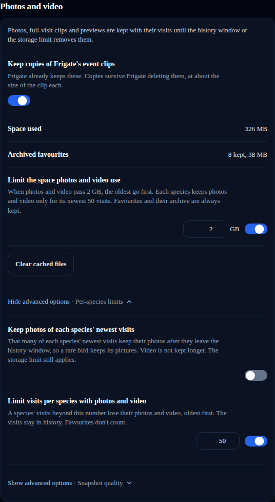

# Favourites

A favourite is a visit you want to keep. Pressing the star on a detection does three things:

1. keeps the detection row out of age-based cleanup;
2. archives the visit's photograph and clip into a place no cache operation touches;
3. tells you, on the record, whether that archive is actually there yet.

## What the star says

Beside the star on a favourite you will see one of:

| State | Meaning |
| --- | --- |
| **Archiving photo and clip** | The archive worker is copying or fetching the assets. |
| **Archived, 3.2 MB** | The photograph and clip are on disk in the archive. |
| **Photo archived, no clip to keep** | The photograph is archived; Frigate had no clip for this visit (it was never recorded, or it had already rotated). This is a finished state, not an error. |
| **Nothing left to archive** | Neither the media cache nor Frigate had anything for this visit. The row is still kept. |
| **Archive failed** | Something that should have worked did not (a timeout, a full disk, a truncated download). The worker retries with backoff; **Try again** retries now. |

A favourite is only reported as archived once its files are written and the archive's manifest is
in place. An archive interrupted by a restart is finished by the worker's reconcile pass, which runs
at startup and every half hour and also picks up favourites made before this feature existed.

## Where the archive lives

`ARCHIVE_DIR` (default `/config/archive`), a sibling of `/config/media_cache` on the same
persistent volume. One directory per visit, named by its event id:

```
/config/archive/<frigate_event>/
    snapshot.jpg          the photograph as stored at the time (the crop, when there is one)
    snapshot.meta.json    where that photograph came from
    clip.mp4              Frigate's event clip, when Frigate still had it
    recording.mp4         the full clip recording, only if it was already cached
    manifest.json         what is here and when it was written
```

The photograph and clip routes serve the media cache when it has the file, then the archive, then
Frigate, so a favourite looks the same after a cache clear or after Frigate has rotated the event,
and choosing a different photograph for a favourite is archived again behind it.

A visit favourited while it is still happening shows **Archiving photo and clip** until Frigate has
written the clip, which it does after the event ends; the worker checks again on its half-hourly
pass. Under the missing-event policy's **Delete records YA-WAMF has no photo for** setting a
favourite is marked missing instead of deleted, so a Frigate rotation never removes a favourite or its archive.

## Finding a favourite in a grouped visit

A visit card leads with its favourite capture, using the best-scoring favourite when there are
several. The capture lists in Explorer and the field log mark each one **Favorited**. The
**Favourites** filter therefore does not hide the starred capture behind another visit photo.

## What removes an archive

Only these:

- **Unfavouriting** the visit. The confirmation names the size. The visit stays in history.
- **Deleting** the visit.
- **Delete all favourites** in **Settings → Storage & upkeep → Delete data**, and a **database reset**. Both say so.

Age cleanup, orphan cleanup, **Clear cached files**, the media integrity scan and the
missing-event policy never touch the archive.

## Backup and restore

Back up `/data` and `/config` together, including `/config/archive` (or your configured
`ARCHIVE_DIR`). This keeps detection history, the separate species catalogue, configuration and
favourite media in one consistent backup. Restore the archive to its configured path, not beside
the database merely because both are backed up. A directory without `manifest.json` is treated as
unfinished and re-acquired if the visit is still a favourite.

## The per-species floor

**Settings → Storage & upkeep → Per-species limits → Keep photos of each species' newest captures** protects the newest N stored
detections of each species, and their cached photographs, from age-based cleanup, however old
they are. This is applied to stored captures, not the Explorer's grouping of captures into visits.
It is off by default (stored as `0`). The floor is counted per canonical species, so a bird under two names has one floor, and
hidden visits neither count towards it nor are held by it. Clips are not held by the floor; they
follow the age window as before. The same setting is `MEDIA_CACHE__PER_SPECIES_MINIMUM`.

## Retention boundaries

With **Keep everything** (`maintenance.retention_days: 0`), age cleanup does not purge detections.
A positive retention period permanently deletes older visual and BirdNET-Go audio history;
favourites and the per-species floor protect the qualifying visual records described above.
Purged history cannot be recovered without a backup. Neither hiding a visit nor clearing ordinary
cached clips is the same as permanently deleting its database record or removing an archive.
Review the [data settings](../setup/configuration.md) before changing retention.

### Daily totals keep the counts

Cleanup keeps how many birds each day saw even after it deletes the captures. Before it removes
any capture from a day, it writes that day's captures and visits for each species, from the
stored captures, and seals the day. This applies to the scheduled cleanup and to **Purge old
records** alike: both delete through the same step, and if the totals cannot be saved nothing is
deleted and Health says "Retention paused". The Leaderboard's chart and each species' weekday and
month charts then count sealed days from these totals, so seasonal trends reach back past your
retention period. Photos, clips and individual records for those days are gone; the charts say
from which day their counts come from daily totals.

- A day is local to the instance's timezone (`TZ`), like the rest of the history, including zones
  half an hour or three quarters of an hour off UTC.
- A sealed day never changes again. Hiding, renaming or deleting a capture is a correction that
  changes the counts while the day is live. A day is sealed as soon as cleanup starts removing its
  captures, so corrections to the ones still stored on it (kept favourites, or the later captures
  on the oldest day kept) no longer change its totals.
- A capture Frigate no longer has, removed under **Delete records YA-WAMF has no photo for** for
  missing events, is kept as its own record in the same step as the delete. Its day stays live and correctable, and the lost
  capture still counts on it, today included, until cleanup folds it into the day's total.
- Totals start when you upgrade. A day that began before then may already have lost captures
  without a record (to an earlier cleanup or to missing-event deletes), so it is marked as
  possibly low, and the charts say so.
- Time of day and the hour-and-weekday grid count stored captures only: a daily total has no
  time. The grid says so when older days come from daily totals.
- **Delete all history** deletes the daily totals and lost-capture records too, and its
  confirmation says so.
- The ranked lists on the Leaderboard count sealed days from these totals too: the all-time list
  counts every sealed day, and the rolling day, week and month count each sealed day that lies
  wholly inside them. A window that opens part way through a sealed day counts only the captures
  still stored from that day. A species seen only on sealed days keeps its place, with no
  confidence or first and last sighting, because a total has no scores or times.
- A capture corrected or added after its day was sealed does not change that day's counts: a kept
  favourite re-tagged as another species still counts as the old one on the charts and the
  Leaderboard, and a capture backfilled into a sealed day is not counted.
- Downgrading YA-WAMF below the release that added daily totals deletes them, and they cannot be
  rebuilt: for days cleanup has already removed they are the only copy of the counts.

The per-species floor is age protection, not reserved disk space. **Limit captures per species with
photos and video** and **Limit the space photos and video use** can still evict ordinary cached media. Such eviction
keeps detection history and leaves archived favourites alone. Removed bytes cannot be restored
from YA-WAMF itself; do not assume Frigate still has them.



## Storage

**Settings → Storage & upkeep** shows archived favourites (count and size) apart from the cache size, and how
many could not be archived. The archive is never cleaned automatically, so its size is a choice
you make one star at a time.
