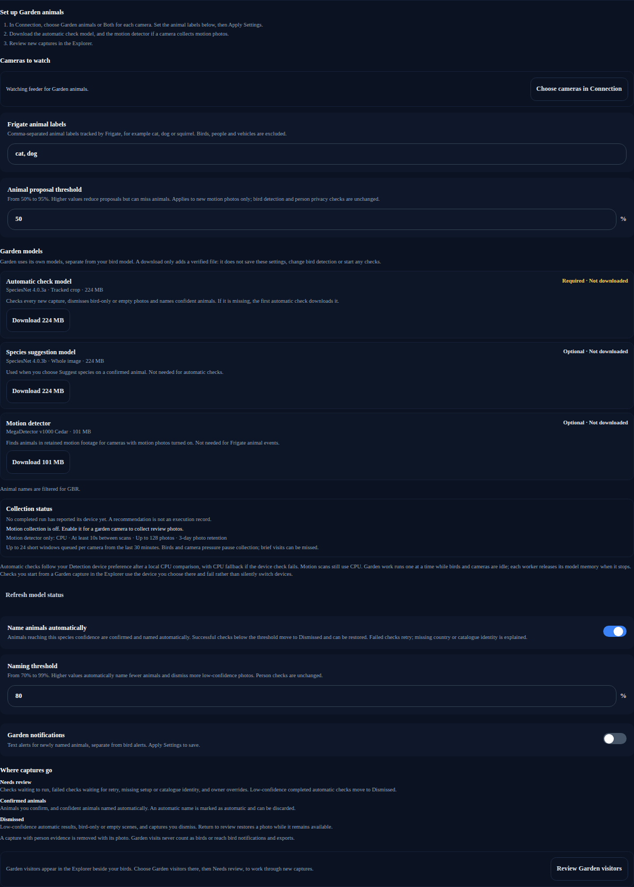
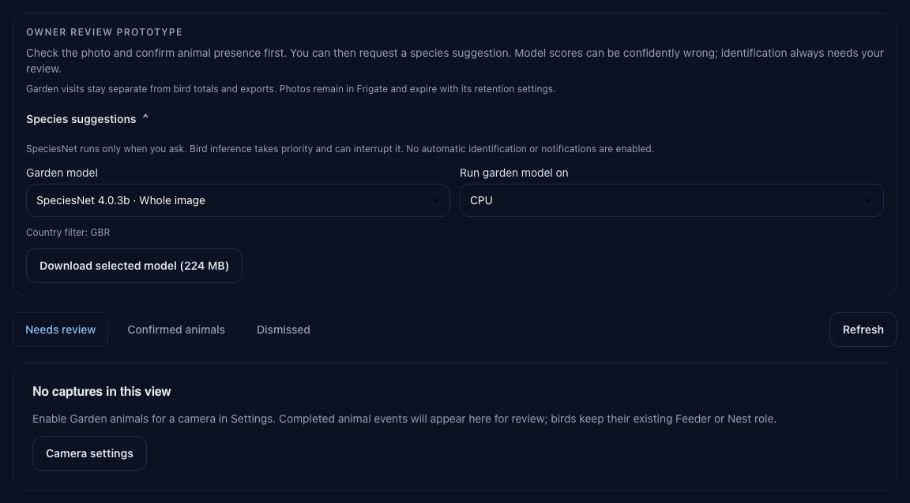

# Review garden animals

**Garden animals** is an owner-only beta feature. It collects
completed Frigate animal events separately from bird history. Confident animals are
confirmed and named automatically, as a bird above the naming threshold is; every
automatic name is marked as automatic and can be discarded. Owner-requested SpeciesNet
suggestions remain available for everything else.

New captures are checked automatically with the SpeciesNet tracked-crop model.
Confident bird-only, blank-scene or vehicle results move to **Dismissed** with
the automatic result shown on the capture. Open that view and choose **Return to
review** if the check is wrong. Restoring, confirming or dismissing a capture
overrides automatic checks for that capture, including after restart.
Existing captures from before this update keep their reviews and are not rechecked.

The required 224 MB tracked-crop model is the **Automatic check model** under
**Settings → Beta features → Garden models**. Download it there before your first
captures arrive; if you have not, it downloads and verifies automatically when an
enabled Garden camera has a new photo to check. Checks use CPU, one photo at a
time, while birds and Frigate cameras are idle. They use the detector's exact box;
missing boxes, mixed evidence and uncertain results stay in **Needs review**.
Model, download or runtime failures also stay there and retry no sooner than five
minutes later. The status under **Species suggestions** on the Garden page describes automatic work;
refresh to read updated results. No **Check photo** click is needed.

The [labelled pipeline comparison](../reviews/2026-10-23-garden-labelled-pipeline-validation.md)
records a small crop-versus-whole-image evaluation, including detector misses,
person false positives and the limits of the naming evidence.

A model result is not proof of absence. Automatic dismissal is reversible while
the photo remains available, under the same retention and photo-reclamation rules
as other dismissed captures. Recognised person evidence removes the capture and
its photo instead of placing it in Dismissed, preserving the privacy rules below.

It is off unless you turn it on in **Settings → Beta features** (or set
`SYSTEM__BETA_GARDEN_ANIMALS=true`). While it is off, Garden collects nothing new, the
motion scanner does not run, the sidebar item and camera options are hidden, and the
Garden API answers that the feature is switched off. Saved captures are kept, and a
later person event still removes any stored photo it covers.

Every Garden setting and model download lives under **Settings → Beta features**, with the
switch that turns it on. While it is off, that view lists what Garden needs and offers no
downloads. The **Garden animals** page is for daily review.

1. Turn on **Garden animals** in **Settings → Beta features**.
2. Under **Cameras to watch**, choose **Garden animals** for each camera you want to watch.
   The list comes from **Settings → Connection**; sync it there first if it is empty. A
   camera's **Feeder** or **Nest** bird role is independent and stays in Connection.
3. Set **Frigate animal labels** to labels your detector actually tracks. The default
   is `cat, dog`. Adding `squirrel` here cannot make a detector learn squirrels;
   Frigate must already track that label and publish completed events over MQTT.
4. Choose **Apply Settings**. **Garden models** then shows each Garden model's status.
   Choose **Download** for the **Automatic check model**, and for the **Motion detector**
   if a camera collects motion review photos.
5. Open **Garden animals** in the sidebar. Select **Needs review**, inspect the
   photograph, and choose **Confirm animal present** or **Dismiss capture**.
   **Return to review** restores a dismissed capture while its photo remains available.

## Garden animals in the Explorer

With Garden on, the **Explorer** shows each opted-in camera's animals beside its birds, placed by
time between the visits they fell between. A **Show** control chooses **Birds**, **Garden** or
**All**; **All** is the default, and this device remembers the choice like **Cards** and **List**.

- The Explorer shows confirmed animals and captures still waiting for review. Dismissed captures,
  whether you or the automatic check dismissed them, stay on the Garden page.
- Every Garden card and row says **Garden** in words, so an animal is never read as a bird. A
  capture that needs you is flagged in amber with its reason: whether an animal is there, or a
  suggested species that nobody has confirmed. The score is the species model's, and only appears
  once a species is named.
- Opening one shows its record: the photograph with the detector's box, the automatic check and
  its result, and the presence and species decisions. **Suggest species** runs the installed
  SpeciesNet model on the CPU; the Garden page still offers other models and devices. Bird actions
  such as scoring again, video scans and audio matching do not apply.
- Garden captures are stored apart from birds. Bird totals, leaderboards, notifications, exports
  and BirdWeather, eBird and iNaturalist reporting never count them.
- Under **All**, filters that only describe bird visits (a species, **Favourites**, **Hidden**,
  **Multiple species**, **Matching call**, confidence order, individual captures or multi-select)
  hide the Garden captures and the page says why. The date range, days on the page and camera
  filters apply to both. Under **Garden**, the bird filters are left out and the page says so.
- Like heard calls, each Explorer page owns the time between its visits, so no capture shows on
  two pages. When one page spans more than 200 captures, the page says so; choose **Garden** to
  page through them all.
- Garden photos stay owner-only, because Frigate can miss a person in an animal photograph. Guests
  see birds only.

### Garden models

Garden uses three models of its own. None of them is your bird classifier, and none is
listed as a bird model.

| Model | File | Size | Needed for |
|---|---|---|---|
| **Automatic check model** | SpeciesNet 4.0.3a, tracked crop | 224 MB | Required. Checks every new capture and names confident animals. |
| **Species suggestion model** | SpeciesNet 4.0.3b, whole image | 224 MB | Optional. **Suggest species** on a confirmed animal. |
| **Motion detector** | MegaDetector v1000 Cedar | 101 MB | Required only when a camera collects motion review photos. |

Each row shows **Downloaded**, **Not downloaded**, **Unavailable** (Garden data or the
Garden worker has failed) or **Status unknown** (the status could not be read). A
download is an explicit action with its own progress. It fetches the file, checks its
size and checksum, then replaces it atomically. It does not save other settings
changes, change the bird model or provider, switch the beta on or start any checks.
A failed download leaves nothing changed and offers **Retry download**. Garden runs
one operation at a time, so downloads wait while a check, scan or other download is
running; the view says so. There is no percentage progress: the server reports only
when the download has finished, which can take up to three minutes.

Automatic checks follow the device preference in **Settings → Detection**. Before an accelerator is used, its isolated result must agree with a CPU reference on this host. In **Auto**, Garden considers the NPU, Intel GPU and CUDA providers packaged by the image; a failed profile is skipped on later captures. An explicit unavailable or failed preference uses CPU. Motion scans still run on CPU. Each check loads its model in a separate
process and releases the memory afterwards; memory use has not been measured for this
beta. Checks you start on the Garden page use your requested processor and
fail rather than silently switch devices. Automatic naming and species suggestions need a
country in **Settings → Location**; the view says when it is missing.

**Where captures go** in the same view summarises the outcomes:

- **Needs review**: animals that were not named automatically, uncertain or mixed
  results, and checks that could not run.
- **Confirmed animals**: animals you confirm, and confident animals named automatically.
- **Dismissed**: captures you dismiss, and photos the check is confident show only a
  bird, nothing or a vehicle.

Recognised person evidence removes a capture and its photo instead.

The first confirmation records animal presence. Species identification has a separate review. Repeated MQTT
messages cannot create duplicate visits or undo your decision. Existing Frigate
history is not backfilled into this view.

Garden visits never enter bird totals, personalization, bird notifications,
BirdWeather, eBird or iNaturalist submissions. Bird labels, including custom bird
ingest labels, take precedence. People and vehicles cannot be configured as garden
labels. A later person or false-positive update removes its Frigate event capture from all views
and prevents a delayed animal message from restoring it, even after capture is
switched off. This relies on Frigate's labels; a missed person could still be in
an animal photograph, so the view and its media are always owner-only.

Frigate events without an advertised snapshot are skipped. **Needs review** omits
captures whose photo is known to be unavailable, without deleting or changing
their review metadata. Confirmed history remains visible after photo loss.
Frigate event photographs are requested for automatic checks and when viewed;
they can expire before their metadata. A failed download disables confirmation but does not discard the
capture: a network error is not proof that the photo is gone. Review metadata follows
**Settings → Data → Detection Retention** when automatic cleanup is enabled;
turning off Garden animals stops collection but preserves existing reviews.

## Collect candidates from motion recordings

If Frigate does not track the animals you want, optionally enable **Collect motion review
photos** for that camera under **Settings → Beta features**, then apply settings and
download the **Motion detector** under **Garden models** in the same view. This separate
MegaDetector v1000 Cedar model uses the species catalogue for its three outputs;
it needs no labels file.
It does not replace Frigate's bird detector or change bird classification settings.

Collection is off by default. One worker drains up to 24 queued recording windows
per camera, oldest first, taking turns between enabled cameras. Each window covers
up to ten seconds and samples three frames. After a completed window, remaining
queued footage allows scan starts five seconds apart to catch up. Collection
returns to a ten-second interval when caught up or paused. Both intervals include
processing time. Long scans finish and leave at least one second of rest before
another starts; failed scans retry thirty seconds after failure. Queues refill from
Frigate metadata and the saved completion cursor, so restarting does not replay
completed windows. Longer recordings resume from the cursor instead of losing
their remaining footage. Overlapping recording metadata is merged before sampling.
No new database queue or retained clips are needed.

Only completed motion recordings from the last thirty minutes are considered.
Frigate must retain that footage. Pressure or repeated failures can let older
windows fall outside this catch-up limit without being scanned. This samples
activity; it does not track animals or promise to find every visit. Even within
a scanned window, a brief visit can fall between the three sampled frames.

Frigate can include keyframe padding in the returned clip. Up to five extra seconds
are tolerated, but samples stay within the requested duration. Recording windows
and decoded frame offsets are retained separately; displayed visit times are approximate.
The panel reports waiting, failures, the last attempted scan and the latest checked
camera's remaining queue count and check time. A full queue can have further footage
waiting in Frigate. Refresh the page to read the latest state.

In **Settings → Beta features**, **Animal proposal threshold** adjusts Cedar's minimum animal
score for new motion photos (0.5 by default, configurable from 0.5 to 0.95).
A higher threshold reduces proposals but can miss small, distant or infrared animals;
it cannot eliminate confident errors such as feeders and toys. **Motion collection** on the
Garden page shows the saved value. Changing it does not reclassify existing photos or change bird thresholds or the person privacy veto.
Each new motion photo records the threshold used with its source evidence.

A proposal is dropped without a photo when the pixels inside its box change no more
than 1.4 times the area around it across the three sampled frames. This stops
fixtures such as feeders, ornaments and dark patches on the lawn, which Cedar can
re-propose every few minutes, from filling the review queue; the panel reports that
the detected shape did not move. On owner-reviewed footage this kept all 28 confirmed
visitors and rejected 97 of 104 dismissed fixture photos. An animal that stays
perfectly still for the whole window can be missed the same way.

Cedar runs on CPU with two inference threads and one video-decoding thread. It
yields to queued or running bird inference and stops if active Frigate cameras
fall behind. One garden operation runs at a time, with a 45-second motion-worker
deadline. Busy systems may collect no photos until pressure clears.

Candidates appear in **Needs review**, labelled **Candidate from retained motion
footage**. Each motion photo outlines the saved Cedar candidate before presence
confirmation. The box marks the detector's proposal; it is not an animal count or
proof that an animal is present. It stays visible if you dismiss a species suggestion.
Frigate event captures use their separate tracked-event path; a recorded SpeciesNet
crop is outlined after analysis when it matches the displayed photo dimensions.
The generic animal class includes birds, and toys or shadows can trigger
it. Confirm presence only after inspecting the photograph. A detected person in
any sampled frame rejects the recording. Known overlapping Frigate person events
also reject it, and later person updates erase overlapping motion evidence.
Person checks include the bounded padding around the requested recording window.
An unrelated false-positive bird, animal or vehicle event cannot erase an independent
motion review. Missing or overfull person history stops that scan. Recognition can miss
people; these photographs remain owner-only.

**Needs review** groups motion proposals around the same position on a camera into
one card, within a page of up to 128 captures. The group compares each box with the
first box and requires the same detector. Boxes group when intersection over union
is at least 75%, or when their top-left corners closely align and their extents
vary within bounded limits: at most twice the width or height, corner movement
within 15% of the smaller dimension, and at least 80% overlap along each smaller
dimension. This also groups repeated feeder proposals whose boxes alternate
between wide and tall. Comparisons stay against the first photo, so movement
cannot chain a group across the image. This is a review aid, not animal tracking: different visitors can occupy
the same position. **Previous photo** and **Next photo** show the original photos,
times and exact boxes; confirmation always applies only to the displayed photo.
**Dismiss capture** also applies only to that photo. A saved-review notification
confirms the action; another similar photo can remain in the same review card.
Frigate events and confirmed/dismissed history remain individual captures. The
**Needs review** footer counts original photos and review cards separately;
pagination advances through photos, not groups.

Use **Next photo** to scan a stack and **Confirm animal present** to keep individual
animal photos. Confirmation advances to the next remaining photo. The visible
**Dismiss remaining … photos** button dismisses the stack's remaining photos in
one action, with a notification showing how many were dismissed. Future captures,
other camera regions and already-confirmed captures are unaffected. **Undo group dismissal** restores still-available photos; changed reviews
or unavailable photos are skipped and counted. No photographs are deleted by grouping.
Dismissed motion photos can be reclaimed for new captures, so Undo is not permanent.

At most 128 motion photos of 512 KiB each are stored in the application database,
a 64 MiB photo budget. Clips are temporary and removed after each scan. Photos
expire three days after the recording; unconfirmed and dismissed motion captures
are then permanently removed. Confirmed history and identification metadata remain
subject to normal history retention. A recording cannot create another review or
undo a dismissal when the detector changes. Dismissed photos stay available for
**Return to review** until expiry or until a new candidate needs their space. At
the photo limit, the oldest dismissed photos are reclaimed first; pending and
confirmed photos are protected. A reclaimed capture stays in **Dismissed** until
expiry, with Restore unavailable and an explanation. If all photo slots belong to
pending or confirmed captures, collection waits for a dismissal or expiry.
Turning collection off does not immediately erase photos.

For a pending motion photo, **Check photo** offers an advisory assessment before
presence review. Download the **Automatic check model** (4.0.3a) under **Garden models**,
choose a provider under **Species suggestions** on the Garden page, then check the
displayed photo. The dialog outlines the exact crop
and may suggest a bird or a non-human mammal, or remain uncertain. It preserves
blank and other probability mass; human evidence withholds the suggestion.
No country is required. The manual result applies only to that photo and clears when
you close it or change photos. The manual check does not confirm, dismiss or save an identity;
you still make the review decision. Bird work retains priority.

To request a species suggestion, open **Species suggestions** above the history:

1. Set a recognised country name or ISO code in **Settings → Location**. Filtering
   runs locally; coordinates are not sent to the model.
2. Choose a garden model, about **224 MB** per variant, and download it under
   **Settings → Beta features → Garden models** if the Garden page says it is missing. The default
   **4.0.3b** uses the whole photograph with the model’s vertical border trim.
   **4.0.3a** requires Frigate’s tracked snapshot box or the retained motion detector
   box; it never guesses a crop.
3. Choose a provider supported by your image and hardware. CPU, Intel CPU/GPU/NPU
   and NVIDIA GPU are supported runtimes; unavailable hardware produces an error
   rather than a CPU fallback.
4. Open **Confirmed animals**, inspect the photo and select **Suggest species**.
   Check the proposed identity, score and input context. Choose **Confirm
   identification**, **Dismiss suggestion**, or leave it unreviewed.

Bird inference has priority. If it is busy or begins while SpeciesNet is running,
the garden request stops and can be retried later. One garden operation runs at a
time, with a two-minute native deadline. Loading the model for each request costs
more time than a warm inference, but its process and memory are released afterward.

The catalogue holds both models’ ordered outputs, canonical identities, taxonomy
and country rules; there is no runtime labels file. Country filtering can broaden
the winning species to its family or higher group. It never substitutes a local
runner-up. An animal group is not a species identification; uncertain results stay
unidentified. A model score is not measured accuracy: a Patio toy car produced a
confident cattle prediction during testing. Review every suggestion. Recognised
people erase the capture and any saved suggestion; this cannot guarantee that a
missed person is absent from a photograph.

If garden species data is unavailable, suggestions stay unavailable in this view.
Bird detection can still start and run. Restore the catalogue and restart the
application to restore garden suggestions.

Confirmation checks that Frigate still supplies the exact photo used by the model.
An expired or changed photograph cannot be used to confirm an old suggestion.
**Discard identification** revokes your identification confirmation without changing
animal presence. Dismissing animal presence also revokes its identification confirmation. No garden suggestions enable notifications or bird exports.

## Automatic naming

**Name animals automatically** in **Settings → Beta features** is on by default, with a
**Naming threshold** of 0.80 (from 0.7 to 0.99). When the automatic check finds an animal,
it reads SpeciesNet's top result from the same detector-crop pass; no second model run is
needed. If that result is a non-bird animal scoring at or above the threshold, after the
same country filtering and person rules as a suggestion, the capture moves to **Confirmed
animals** with the name **Named automatically**. A result filtered by country is named by
its plausible group, for example *cat family*.

Below the threshold, or without a recognised country in **Settings → Location**, the
capture stays in **Needs review** unnamed. Person evidence anywhere in the top results
removes the capture. Turn automatic naming off to review and name every animal yourself.

An automatic name is not an owner review. **Discard identification** removes the name
and keeps presence; **Dismiss capture** removes both. Either is final for that capture:
automatic checks never run on it again. Changing the threshold does not rename existing
captures. Automatic names never reach bird totals, notifications or bird exports.

A model score is not measured accuracy. The first night of automatic checks on one
camera was correct for all eight captures, but recall at night, on other cameras and
for other species is still being measured. The [developer replay](../development/garden-replay.md)
records the model checks and limitations tracked in
[#641](https://github.com/Jellman86/YetAnother-WhosAtMyFeeder/issues/641).

Automatic Garden device checks bind the installed crop weights, taxonomy package, image flavor,
and host/runtime/driver signature. Positive evidence is held only for the running application;
restart requires a fresh CPU comparison. Failed provider profiles are saved under native quarantine
and are not retried after restart or an unrelated taxonomy update. New model weights or runtime
identity permit another check. Never copy validation or quarantine records between hosts.

The first check can load the model twice, once for CPU and once for the candidate device.
Compilation can take longer than inference, and accelerators share memory and capacity with bird
work. Bird or camera activity interrupts the disposable worker before other Garden work starts.
If worker cleanup fails, Garden stops rather than starting a CPU fallback beside it. CPU fallback
preserves the same thresholds, person veto, naming policy and owner-review protections.

The [accelerator validation and hedgehog follow-up](../reviews/2026-10-24-garden-automatic-accelerators.md) records the tested hardware, numerical limits and remaining accuracy gaps.
