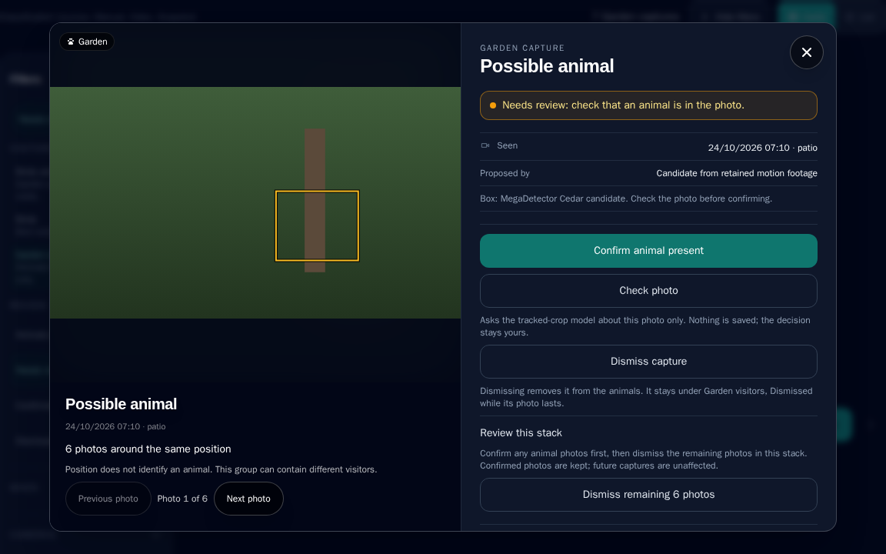

# Review garden animals

**Garden animals** is a beta feature. It collects
completed Frigate animal events separately from bird history. Confident animals are
confirmed and named automatically, as a bird above the naming threshold is; every
automatic name is marked as automatic and can be discarded. Owner-requested SpeciesNet
suggestions remain available for everything else.

New captures are checked automatically with the SpeciesNet tracked-crop model.
Confident bird-only, blank-scene or vehicle results move to **Dismissed** with
the automatic result shown on the capture. Open that view and choose **Return to
review** if the check is wrong. Restoring, confirming or dismissing a capture
overrides automatic checks for that capture, including after restart.
Owner-reviewed, confirmed and dismissed captures keep their reviews. Older pending automatic
results without an owner override are reconsidered once under the updated policy.

The required 224 MB tracked-crop model is the **Automatic check model** under
**Settings → Beta features → Garden models**. Download it there before your first
captures arrive; if you have not, it downloads and verifies automatically when an
enabled Garden camera has a new photo to check. Checks use the Detection device
preference, one photo at a time, while birds and Frigate cameras are idle. They use the detector's exact box;
missing boxes or unavailable checks stay in **Needs review** for retry. Completed
low-confidence results move to restorable **Dismissed** when automatic naming is enabled.
Model, download or runtime failures also stay there and retry no sooner than five
minutes later. **Collection status** under **Settings → Beta features → Garden models** describes
automatic work; refresh it to read updated results. No **Check photo** click is needed.

The [labelled pipeline comparison](../reviews/2026-10-23-garden-labelled-pipeline-validation.md)
records a small crop-versus-whole-image evaluation, including detector misses,
person false positives and the limits of the naming evidence.

A model result is not proof of absence. Automatic dismissal is reversible while
the photo remains available, under the same retention and photo-reclamation rules
as other dismissed captures. Recognised person evidence removes the capture and
its photo instead of placing it in Dismissed, preserving the privacy rules below.

It is off unless you turn it on in **Settings → Beta features** (or set
`SYSTEM__BETA_GARDEN_ANIMALS=true`). While it is off, Garden collects nothing new, the
motion scanner does not run, Garden visitors and camera options are hidden, and the
Garden API answers that the feature is switched off. Saved captures are kept, and a
later person event still removes any stored photo it covers.

Garden settings and model downloads live under **Settings → Beta features**, with the switch
that turns it on, in the order of the setup steps below. Which cameras watch for Garden animals
is chosen once per camera in **Settings → Connection → Cameras to watch**, beside the camera's
bird role. While Garden is off, Beta features lists what Garden needs and offers no downloads,
and each camera in Connection offers only **Off** or **Birds**. Daily review happens in the
**Explorer**. An old link to the former Garden animals page opens the Explorer's Garden review
instead.

1. Turn on **Garden animals** in **Settings → Beta features**.
2. In **Settings → Connection → Cameras to watch** (or **Choose cameras in Connection** under
   Beta features), choose **Garden animals** for a camera that should watch only for animals,
   or **Both** for one that watches for birds too. Sync the list from Frigate first if it is
   empty. A camera's **Feeder** or **Nest** role appears while it watches for birds;
   **Collect motion review photos** appears while it watches for Garden animals. At least one
   camera always watches for birds; see
   [Cameras to watch](../setup/configuration.md#cameras-to-watch) for how each choice is saved.
3. Back in **Beta features**, set **Frigate animal labels** to labels your detector actually
   tracks. The default is `cat, dog`. Adding `squirrel` here cannot make a detector learn
   squirrels; Frigate must already track that label and publish completed events over MQTT.
4. Choose **Apply Settings**. **Garden models** then shows each Garden model's status.
   Choose **Download** for the **Automatic check model**, and for the **Motion detector**
   if a camera collects motion review photos.
5. Open the **Explorer**, or choose **Review Garden visitors** in **Settings → Beta features**. In
   the filter rail choose **Garden** under **Visitors**, then **Needs review**. Open a capture, inspect the
   photograph, and either open **Manual override** and choose **Confirm animal manually**, or
   dismiss it with the crossed-out eye beneath the decisions, as on a bird record.
   Under **Dismissed**, **Return to review** restores a capture while its photo remains available.

## Garden animals on the Dashboard

With Garden on, the Dashboard's **Field log** shows the last 24 hours of animal visits on the same
thread as bird visits, placed by their most recent capture. It lists the same Garden entries as the
Explorer's **Animals and waiting for review**: confirmed animals and captures still waiting, with
dismissed captures left out. Each row says **Garden** in words, and one that needs you is flagged in
amber with its reason and a **Review** button. **Open** or **Review** shows the Garden record on the
Dashboard; a review there updates the log. The log shows the 12 most recent visits of either kind,
and the count beneath it includes the animal visits it left out. If Garden visits cannot be read,
the log says so under the birds instead of showing an empty garden. The Dashboard's visit, species
and review counts still count birds only. Garden rows are shown only to the owner.

## Garden animals in the Explorer

The open Explorer updates when a Frigate event or motion scan saves a new capture,
even while automatic identification is waiting. It also updates when an automatic
check saves a name, dismissal or retry result, or a later Frigate message revokes
a capture. An open record updates with it; a removed capture closes. Duplicate
event deliveries do not trigger repeated refreshes. Reconnecting the
live stream refreshes the current Garden view after a missed update. This private
update signal carries no capture details and is never delivered to guests.

With Garden on, the **Explorer** shows each opted-in camera's animals beside its birds, placed by
time between the visits they fell between. **Visitors** at the top of the filter rail chooses
**Both** (the default), **Birds** or **Garden**, and this device remembers the
choice like **Cards** and **List**. Under **Garden visitors**, **Review** chooses **Animals and
waiting for review**, **Needs review**, **Confirmed animals** or **Dismissed**. Both appear as
removable filters, and bird-only filters step aside while Garden visitors is chosen.

- The Explorer shows confirmed animals and captures still waiting for review. Dismissed captures,
  whether you or the automatic check dismissed them, are listed under **Review**, **Dismissed**, as
  an empty Garden view says.
- Wording follows who is reading. You read **Identified by you** and **Species confirmed by you**;
  a public visitor confirmed nothing, so reads **Identified by the owner** and **Owner confirmed**.
- Every Garden card and row says **Garden** in words, so an animal is never read as a bird. A
  capture that needs you is flagged in amber with its reason: whether an animal is there, or a
  suggested species that nobody has confirmed. The score is the species model's, and only appears
  once a species is named.
- Garden cards and rows read like bird ones: the animal crop fills the thumbnail, a
  named animal that needs nothing from you shows its scientific name, and the state is
  said in words only while it waits on you or has no name. A capture that came from a
  Frigate event has the bird rows' play control, which opens Frigate's clip in the same
  player while clips are enabled. Motion captures have no clip.
- Garden pages count complete entries, with the capture total shown separately.
  Grouping happens on the server before pagination. An animal's stay is one entry, as a bird's visit is: captures on the same camera, of the same
  animal (the same name, or both unnamed in the same review state), less than a minute apart, open
  together as **N captures in this visit**. Unconfirmed motion proposals instead stack by position
  and never merge by time, so a real animal is not hidden inside a stack of repeated feeder
  proposals. Every capture is still stored and reviewed on its own; grouping only changes how they
  are shown. There is no capture cooldown, which matches birds.
- Expand **N captures** on a Garden visit in the field log, Explorer card or list
  to inspect its individual photos before opening the record. Cards show the list
  above neighbouring cards; rows expand in place. Each capture shows its own
  name, state, score and time to the second. The visit photo and motion-footage
  captures are marked.
  Twenty captures load at a time; **Load more captures** continues within the same
  camera, time and review filters. Choosing one opens that exact photo in the
  visit, including beyond the record's first page. Failed reads offer **Retry**;
  saved reviews and live updates refresh open lists. These details remain owner-only.
  On a confirmed visit with up to 128 captures, the record's crossed-out eye is
  **Dismiss {count} captures in this visit** once its captures are loaded. This dismisses only those unchanged
  reviews; newer captures and concurrent owner corrections are kept. Larger visits
  can be dismissed one capture at a time. In Explorer, **Return captures to review**
  restores available photos to pending review without reconfirming the animal or
  species name. Dismissal keeps the history and original model result but removes
  saved crop previews, following the single-capture privacy behavior.
- Opening one shows its record, in the bird record's shape: the saved animal crop,
  or the original framed around trustworthy saved crop geometry, beside the
  identification. A named animal shows its catalogue name in your language, cased
  like a bird name, with its scientific name, a reference photograph, what the name
  was read from, and the species match. Its state is said once, for example
  **Confirmed and named automatically**, and is amber only when it waits on you.
  The facts, the family tree and a short species summary follow, then the decisions in
  one row as on a bird record (for example **Confirm {name}**, **Pick a different species**
  and **Dismiss suggestion**), then the crossed-out eye. As a bird record's hides its whole
  visit, it dismisses the whole entry: **Dismiss capture** for a single capture, **Dismiss
  {count} captures in this visit** for a visit, **Dismiss remaining {count} photos** for a
  stack. When the captures are not all loaded, there are more than 128, or they are in
  different review states, it is disabled and says why. One capture from a visit or stack
  is dismissed with **Dismiss capture** beside its photo position, as a bird's photo is
  removed from its strip. The family tree
  runs from the animal's class to its species using the SpeciesNet taxonomy; it does not
  count species worldwide or sightings at the feeder, because those figures are birds'. **Details**, closed by default, holds the model run, the
  automatic check for confirmed animals and retained capture evidence;
  until an animal is confirmed, the automatic check's result stays visible because
  it explains the state. Photos in a visit show their time to the second. Hover or focus on
  the crop to look at the whole photograph with its box; select it to keep that
  view open, then select again or press Escape to return to the crop. A photograph
  without trustworthy geometry stays whole. **Suggest species** runs the installed
  SpeciesNet model using the device selected in **Settings → Detection**. Model
  installation stays under **Settings → Beta features → Garden models**. The
  record has no model or accelerator selectors. Bird actions
  such as scoring again, video scans and audio matching do not apply.
  Reference photographs and summaries are looked up by the catalogue's scientific
  identity, not a bird-only search for the common name. Previously cached common-name
  articles are bypassed. If the identity or a matching reference is unavailable,
  the record keeps its identification and capture photo without an unrelated reference.
- On a confirmed capture, **Pick a different species** (or **Pick a species** when it has
  no name) searches common and scientific names
  in the local Garden catalogue. Choose a complete animal species, then **Save species**.
  This changes only the open capture, including when its original photo has expired;
  the other captures in its visit are unaffected. The name says **Identified by you**
  and has no model confidence. Visit grouping and species references use the corrected
  identity. The original model name, score, devices and image evidence remain in
  **Details**, and the saved crop stays unchanged.
- **Remove my species correction** returns to the stored model identification, if
  it has a standing name; it does not run the model again. Corrections and removals
  prevent automatic renaming, survive restarts and refresh other open owner views.
  A changed capture returns a conflict rather than overwriting another decision.
  Dismissing keeps the correction with its history; later person evidence removes it
  with the capture's private evidence. Corrections do not replay notifications, and
  a queued alert for the superseded model name is skipped. No model download or
  accelerator is needed; an unavailable local catalogue prevents a new correction.
  Human, background and higher-taxon entries cannot be chosen as species.
- Garden captures are stored apart from birds. Bird totals, leaderboards, notifications, exports
  and BirdWeather, eBird and iNaturalist reporting never count them.
- Under **Birds and Garden**, filters that only describe bird visits (a species, **Favourites**, **Hidden**,
  **Multiple species**, **Matching call**, confidence order, individual captures or multi-select)
  hide the Garden captures and the page says why. The date range, days on the page and camera
  filters apply to both. Under **Garden visitors**, the bird filters are left out and the page says so.
- In the mixed Explorer, a Garden entry belongs to the page containing its latest
  capture time. Its full membership stays together even if its first capture fell
  in the previous bird page's time span. Up to 200 Garden entries are shown beside
  a bird page; if there are more, the page says so. Choose **Garden visitors** to
  page through every entry using the page-size control.
- Records show a selectable strip of crop thumbnails for the visit or position
  stack, with the current photo marked. Each choice opens that capture and its own
  decisions. Records load at most 128 captures at a time; **Previous photos** and
  **More photos** move between these pages without splitting the visit or resetting
  the photo number. Left and right arrow keys also move between photos when no
  text field or device selector is being edited.
  A failed read offers **Retry**. Each opening rechecks the current history filters,
  photo availability and review state; removed or regrouped visits can become unavailable.
  Reviewing a photo changes only that original, and position-stack dismissal remains
  an explicit action on the complete loaded stack.
- With **Public access** on, guests also see confirmed Garden animals beside the birds, under the
  same history window, photograph, video and camera-name switches as bird detections. Guests never
  see captures waiting for review, dismissed captures, automatic check details or any review
  control. Frigate can miss a person in an animal photograph, so check a photo before you confirm
  it if you share photographs.

These screenshots use plain placeholder photographs.

### Garden models

Garden uses three models of its own. None of them is your bird classifier, and none is
listed as a bird model.

| Model | File | Size | Needed for |
|---|---|---|---|
| **Automatic check model** | SpeciesNet 4.0.3a, tracked crop | 224 MB | Required. Checks every new capture and names confident animals. |
| **Species suggestion model** | SpeciesNet 4.0.3b, whole image | 224 MB | Optional. **Suggest species** on a confirmed animal. |
| **Motion detector** | MegaDetector v1000 Cedar | 101 MB | Required only when a camera collects motion review photos. |

Each row shows **Downloaded**, **Not downloaded**, **Unavailable** (Garden data or the
Garden worker has failed) or **Status unknown** (the status could not be read). A
download is an explicit action with its own progress. It fetches the file, checks its
size and checksum, then replaces it atomically. It does not save other settings
changes, change the bird model or provider, switch the beta on or start any checks.
A failed download leaves nothing changed and offers **Retry download**. Garden runs
one operation at a time, so downloads wait while a check, scan or other download is
running; the view says so. There is no percentage progress: the server reports only
when the download has finished, which can take up to three minutes.

Automatic checks follow the device preference in **Settings → Detection**. Before an accelerator is used, its isolated result must agree with a CPU reference on this host. In **Auto**, Garden considers the NPU, Intel GPU and CUDA providers packaged by the image; a failed profile is skipped on later captures. An explicit unavailable or failed preference uses CPU. Motion scans still run on CPU. Each check loads its model in a separate
process and releases the memory afterwards; memory use has not been measured for this
beta. Checks you start from a Garden capture in the Explorer use the device you choose there and
fail rather than silently switch devices. Automatic naming and species suggestions need a
country in **Settings → Location**; the view says when it is missing.

If bird classification recovers successfully on its isolated CPU fallback, Garden
can use idle periods again. The bird pipeline remains visibly degraded and its
failed accelerator profile stays quarantined. Queued or running bird work, active
CPU recovery, shutdown, unfinished native cleanup and camera pressure still pause
Garden. This does not change which devices qualify for Garden's own models.

**Where captures go** in the same view summarises the outcomes:

- **Needs review**: checks waiting to run or retry, missing country/catalogue identity,
  and owner overrides. Automatic work says it is waiting, rather than asking for presence verification.
- **Confirmed animals**: animals you confirm, and confident animals named automatically.
- **Dismissed**: successful below-threshold automatic checks, captures you dismiss,
  and photos the check is confident show only a bird, nothing or a vehicle.

Recognised person evidence removes a capture and its photo instead.

The first confirmation records animal presence. Species identification has a separate review. Repeated MQTT
messages cannot create duplicate visits or undo your decision. Existing Frigate
history is not backfilled into this view.

Garden visits never enter bird totals, personalization, bird notifications,
BirdWeather, eBird or iNaturalist submissions. Bird labels, including custom bird
ingest labels, take precedence. People and vehicles cannot be configured as garden
labels. A later person or false-positive update removes its Frigate event capture from all views
and prevents a delayed animal message from restoring it, even after capture is
switched off. This relies on Frigate's labels; a missed person could still be in
an animal photograph, so captures waiting for review and dismissed captures, with their
media, are always owner-only. Guests see confirmed animals only.

Frigate events without an advertised snapshot are skipped. **Needs review** omits
captures whose photo is known to be unavailable, without deleting or changing
their review metadata. Confirmed history remains visible after photo loss.
Frigate event photographs are requested for automatic checks and when viewed;
they can expire before their metadata. A failed download disables confirmation but does not discard the
capture: a network error is not proof that the photo is gone. Review metadata follows
**Settings → Data → Detection Retention** when automatic cleanup is enabled;
turning off Garden animals stops collection but preserves existing reviews.

## Collect candidates from motion recordings

If Frigate does not track the animals you want, optionally enable **Collect motion review
photos** for that camera under **Settings → Connection → Cameras to watch** (it appears once the
camera watches for Garden animals), then apply settings and download the **Motion detector**
under **Garden models** in **Settings → Beta features**. This separate
MegaDetector v1000 Cedar model uses the species catalogue for its three outputs;
it needs no labels file.
It does not replace Frigate's bird detector or change bird classification settings.

Collection is off by default. One worker drains up to 24 queued recording windows
per camera, oldest first, taking turns between enabled cameras. Each window covers
up to ten seconds and samples three frames. After a completed window, remaining
queued footage allows scan starts five seconds apart to catch up. Collection
returns to a ten-second interval when caught up or paused. Both intervals include
processing time. Long scans finish and leave at least one second of rest before
another starts; failed scans retry thirty seconds after failure. Queues refill from
Frigate metadata and the saved completion cursor, so restarting does not replay
completed windows. Longer recordings resume from the cursor instead of losing
their remaining footage. Overlapping recording metadata is merged before sampling.
No new database queue or retained clips are needed.

Only completed motion recordings from the last thirty minutes are considered.
Frigate must retain that footage. Pressure or repeated failures can let older
windows fall outside this catch-up limit without being scanned. This samples
activity; it does not track animals or promise to find every visit. Even within
a scanned window, a brief visit can fall between the three sampled frames.

Frigate can include keyframe padding in the returned clip. Up to five extra seconds
are tolerated, but samples stay within the requested duration. Recording windows
and decoded frame offsets are retained separately; displayed visit times are approximate.
The panel reports waiting, failures, the last attempted scan and the latest checked
camera's remaining queue count and check time. A full queue can have further footage
waiting in Frigate. Refresh the page to read the latest state.

In **Settings → Beta features**, **Animal proposal threshold** adjusts Cedar's minimum animal
score for new motion photos, shown as a percentage (50% by default, configurable from 50% to
95%; saved as 0.5 to 0.95).
A higher threshold reduces proposals but can miss small, distant or infrared animals;
it cannot eliminate confident errors such as feeders and toys. The setting itself shows the saved value. Changing it does not reclassify existing photos or change bird thresholds or the person privacy veto.
Each new motion photo records the threshold used with its source evidence.

A proposal is dropped without a photo when the pixels inside its box change no more
than 1.4 times the area around it across the three sampled frames. This stops
fixtures such as feeders, ornaments and dark patches on the lawn, which Cedar can
re-propose every few minutes, from filling the review queue; the panel reports that
the detected shape did not move. On owner-reviewed footage this kept all 28 confirmed
visitors and rejected 97 of 104 dismissed fixture photos. An animal that stays
perfectly still for the whole window can be missed the same way.

Cedar runs on CPU with two inference threads and one video-decoding thread. It
yields to queued or running bird inference and stops if active Frigate cameras
fall behind. One garden operation runs at a time, with a 45-second motion-worker
deadline. Busy systems may collect no photos until pressure clears.

Candidates appear in **Needs review**, labelled **Candidate from retained motion
footage**. Each motion photo outlines the saved Cedar candidate before presence
confirmation. The box marks the detector's proposal; it is not an animal count or
proof that an animal is present. It stays visible if you dismiss a species suggestion.
Frigate event captures use their separate tracked-event path; a recorded SpeciesNet
crop is outlined after analysis when it matches the displayed photo dimensions.
The generic animal class includes birds, and toys or shadows can trigger
it. Confirm presence only after inspecting the photograph. A detected person in
any sampled frame rejects the recording. Known overlapping Frigate person events
also reject it, and later person updates erase overlapping motion evidence.
Person checks include the bounded padding around the requested recording window.
An unrelated false-positive bird, animal or vehicle event cannot erase an independent
motion review. Missing or overfull person history stops that scan. Recognition can miss
people; unreviewed motion photographs remain owner-only. Once confirmed, a motion photograph is
shared with guests when public access shares photographs.

The Explorer groups motion proposals around the same position on a camera into
one card, within a page of up to 128 captures under **Needs review**, and within the page's captures elsewhere. The group compares each box with the
first box and requires the same detector. Boxes group when intersection over union
is at least 75%, or when their top-left corners closely align and their extents
vary within bounded limits: at most twice the width or height, corner movement
within 15% of the smaller dimension, and at least 80% overlap along each smaller
dimension. This also groups repeated feeder proposals whose boxes alternate
between wide and tall. Comparisons stay against the first photo, so movement
cannot chain a group across the image. This is a review aid, not animal tracking: different visitors can occupy
the same position. Select a crop thumbnail to open its photo, time and decisions;
the whole-photo peek shows its exact box. Confirmation always applies only to the displayed photo.
**Dismiss capture** also applies only to that photo. A saved-review notification
confirms the action; another similar photo can remain in the same review card.
Frigate events and confirmed/dismissed history remain individual captures. The
Explorer counts original photos, and pagination advances through photos, not groups.

Open the card, select thumbnails to scan a stack and **Confirm animal present** to keep individual
animal photos. Confirmation advances to the next remaining photo. The visible
**Dismiss remaining … photos** button dismisses the stack's remaining photos in
one action, with a notification showing how many were dismissed. Future captures,
other camera regions and already-confirmed captures are unaffected. **Undo group dismissal** restores still-available photos; changed reviews
or unavailable photos are skipped and counted. No photographs are deleted by grouping.
Dismissed motion photos can be reclaimed for new captures, so Undo is not permanent.

At most 128 motion photos of 512 KiB each are stored in the application database,
a 64 MiB photo budget. Clips are temporary and removed after each scan. Photos
expire three days after the recording; unconfirmed and dismissed motion captures
are then permanently removed. Confirmed history, identification metadata and saved animal crops remain
subject to normal history retention and the crop budget below. A recording cannot create another review or
undo a dismissal when the detector changes. Dismissed photos stay available for
**Return to review** until expiry or until a new candidate needs their space. At
the photo limit, the oldest dismissed photos are reclaimed first; pending and
confirmed photos are protected. A reclaimed capture stays in **Dismissed** until
expiry, with Restore unavailable and an explanation. If all photo slots belong to
pending or confirmed captures, collection waits for a dismissal or expiry.
Turning collection off does not immediately erase photos.

For a pending motion photo, **Check photo** offers an advisory assessment before
presence review. Download the **Automatic check model** (4.0.3a) under **Garden models**,
choose the device in **Settings → Detection**, then check the
displayed photo. The dialog outlines the exact crop
and may suggest a bird or a non-human mammal, or remain uncertain. It preserves
blank and other probability mass; human evidence withholds the suggestion.
No country is required. The manual result applies only to that photo and clears when
you close it or change photos. The manual check does not confirm, dismiss or save an identity;
you still make the review decision. Bird work retains priority.

To request a species suggestion, open a confirmed animal in the Explorer:

1. Set a recognised country name or ISO code in **Settings → Location**. Filtering
   runs locally; coordinates are not sent to the model.
2. Choose a garden model, about **224 MB** per variant, and download it under
   **Settings → Beta features → Garden models** if the capture's record says it is missing. The default
   **4.0.3b** uses the whole photograph with the model’s vertical border trim.
   **4.0.3a** requires Frigate’s tracked snapshot box or the retained motion detector
   box; it never guesses a crop.
3. In **Settings → Detection**, choose a device supported by your image and hardware. CPU, Intel CPU/GPU/NPU
   and NVIDIA GPU are supported runtimes; unavailable hardware produces an error
   rather than a CPU fallback.
4. Under **Garden visitors**, choose **Confirmed animals**, open a capture and select **Suggest species**.
   Check the proposed identity, score and input context. Choose **Confirm** with the suggested
   name, **Dismiss suggestion**, or leave it unreviewed.

Bird inference has priority. If it is busy or begins while SpeciesNet is running,
the garden request stops and can be retried later. One garden operation runs at a
time, with a two-minute native deadline. Loading the model for each request costs
more time than a warm inference, but its process and memory are released afterward.

The catalogue holds both models’ ordered outputs, canonical identities, taxonomy
and country rules; there is no runtime labels file. Country filtering can broaden
the winning species to its family or higher group. It never substitutes a local
runner-up. An animal group is not a species identification; uncertain results stay
unidentified. A model score is not measured accuracy: a Patio toy car produced a
confident cattle prediction during testing. Review every suggestion. Recognised
people erase the capture and any saved suggestion; this cannot guarantee that a
missed person is absent from a photograph.

If garden species data is unavailable, suggestions stay unavailable in this view.
Bird detection can still start and run. Restore the catalogue and restart the
application to restore garden suggestions.

Confirmation checks that Frigate still supplies the exact photo used by the model.
An expired or changed photograph cannot be used to confirm an old suggestion.
**Discard identification** revokes your identification confirmation without changing
animal presence. Dismissing animal presence also revokes its identification confirmation. Garden suggestions never enable bird notifications or bird exports. Separate Garden alerts require an explicit opt-in.

## Automatic naming

**Name animals automatically** in **Settings → Beta features** is on by default, with a
**Naming threshold** of 80% (from 70% to 99%, saved as 0.7 to 0.99). When the automatic check finds an animal,
it reads SpeciesNet's top result from the same detector-crop pass; no second model run is
needed. If that result is a non-bird animal scoring at or above the threshold, after the
same country filtering and person rules as a suggestion, the capture moves to **Confirmed
animals** with the name **Named automatically**. A result filtered by country is named by
its plausible group, for example *cat family*.

Successful checks below the species threshold move to **Dismissed**, retaining their
photo and **Return to review** action. The configured species threshold is authoritative;
a separate coarse presence floor does not prevent an otherwise qualifying animal name.
Without a recognised country in **Settings → Location**, or a catalogue identity, the
capture stays pending with the missing requirement explained. Failed checks stay pending
and retry after five minutes; failures are never treated as low confidence. Person evidence anywhere in the top results
removes the capture. Turn automatic naming off to review and name every animal yourself.

An automatic name is not an owner review. **Discard identification** removes the name
and keeps presence; **Dismiss capture** removes both. Either is final for that capture:
automatic checks never run on it again. Changing the threshold does not rename existing
captures. Automatic names never reach bird totals, bird notifications or bird exports.

A model score is not measured accuracy. The first night of automatic checks on one
camera was correct for all eight captures, but recall at night, on other cameras and
for other species is still being measured. The [developer replay](../development/garden-replay.md)
records the model checks and limitations tracked in
[#641](https://github.com/Jellman86/YetAnother-WhosAtMyFeeder/issues/641).

Automatic Garden device checks bind the installed crop weights, taxonomy package, image flavor,
and host/runtime/driver signature. Positive evidence is held only for the running application;
restart requires a fresh CPU comparison. Failed provider profiles are saved under native quarantine
and are not retried after restart or an unrelated taxonomy update. New model weights or runtime
identity permit another check. Never copy validation or quarantine records between hosts.

The first check can load the model twice, once for CPU and once for the candidate device.
Compilation can take longer than inference, and accelerators share memory and capacity with bird
work. Bird or camera activity interrupts the disposable worker before other Garden work starts.
If worker cleanup fails, Garden stops rather than starting a CPU fallback beside it. CPU fallback
preserves the same thresholds, person veto, naming policy and owner-review protections.

The [accelerator validation and hedgehog follow-up](../reviews/2026-10-24-garden-automatic-accelerators.md) records the tested hardware, numerical limits and remaining accuracy gaps.

## Verify which device ran a model

In **Settings → Detection**, each bird finder shows its recommended device from the
host comparison. The chosen finder also shows its **Last completed run**, device,
time and CPU fallback, or explicitly says there is no execution report yet. The
recommendation can differ from the Detection preference because it selects the fastest
CPU-agreeing device for that finder. **Finder device** can save a different validated
choice independently of identification. If that choice becomes unavailable, the
accurate finder uses CPU. The scoped **Check devices** action remains
available after a successful check and does not change the identification model.

**Settings → Beta features → Garden models** separately shows the automatic check's
device preference and last completed execution. Open a capture to see the device and
time of its own automatic result. These are completed records, not a promise that a
model is currently loaded. Garden releases its worker after each operation.
Manual checks also follow the Detection device preference. Capture records show
the model, device, source, timestamps and retained checksums in the same read-only
terminal-style **Details** panel used by bird records. Historical CPU results
remain CPU results after a later NPU preference change. **Motion detector only: CPU** refers to Cedar
motion collection, not SpeciesNet animal identification.

When automatic naming is enabled, existing pending automatic checks from the older
policy are reconsidered once while hardware is idle. Confirmed, dismissed, blocked
and owner-overridden captures are excluded. No bird records are renamed. Pending
automatic work says **Waiting for automatic identification** rather than asking a
person to confirm presence. Manual confirmation remains available as an override.

## Send Garden notifications

Garden notifications are off by default and separate from bird alerts.

1. Save credentials and recipients under **Settings → Notifications**. Bird channel
   switches can remain off.
2. Under **Settings → Beta features**, enable Garden animals, then enable
   **Garden notifications** and select Discord, Telegram, Pushover or Email.
3. Select **Apply settings**. Configure an instance URL under Notifications if you
   want messages to link to your owner-only Garden history.

Only confirmed animals with an accepted species name qualify: either automatic
naming above your threshold or an owner accepting a species suggestion. Confirming
animal presence alone does not send an alert. The camera must still be enabled,
Garden and its notification switch must remain enabled, and the capture must be
no more than five minutes old when delivery starts. Enabling alerts does not replay
old history. Pending and dismissed captures do not qualify.

Messages share the animal name, camera, observation time and whether the name was
assigned automatically or confirmed by the owner with your selected providers.
They contain no photographs, snapshot URLs or session tokens. Links open private
Garden history and still require owner access. Garden uses saved channel credentials
and recipients, but has its own opt-in; bird filters, silent mode, cooldowns,
image choices and Frigate link targets do not apply. Pushover uses normal priority.

YA-WAMF saves at most one delivery attempt per channel for each currently grouped
visit. Repeated photos and restarts do not resend it. A later visit can send a new
alert. Failed or interrupted attempts are not retried automatically, because a
provider might have accepted a message before its response was lost.

The saved attempt counts under Garden notifications distinguish provider acceptance,
failure, unconfirmed attempts and skipped sends. Acceptance means the channel
accepted the message, not that its recipient read it. The delivery status refresh
only reads those counts; it sends no message. Turning off alerts stops subsequent
sends, but cannot recall messages already dispatched.

### Cropped previews

Explorer cards and list previews centre on the saved animal box with a little
surrounding context. The full photograph and its box remain in the capture record.
A photograph without valid recorded geometry stays full-frame; no animal box is
inferred just for display. Cropping changes the preview, not the saved photo or
species decision. Expired photographs remain unavailable under the existing
retention policy.

### Saved animal crops

Confirmed captures now collect a separate animal preview, rather than relying on
an upstream photograph or a temporary motion photo remaining available. Automatic
motion identification saves a valid crop with its name; manual confirmation starts
best-effort collection without delaying the confirmation. Idle collection also
fills missing crops for confirmed captures whose original photos are still available.
Expired source photos are never restored.

Each crop records the exact source checksum, source frame size, box, recording or
aligned snapshot time, and saved-image checksum. Motion crops use the saved detector
box and photo. Frigate crops require its clean best frame and matching snapshot
alignment; a JPEG of unknown crop/resize policy is not treated as a full frame.
Missing or unaligned source evidence leaves the capture confirmed without a crop.

A crop follows its capture: owner-only until confirmed, then shared with guests as the
capture's photograph is. Person/false-positive revocation, dismissal and history
retention remove them. A crop does not make an expired original available for model
checks, identification or restoring a dismissed capture. The record and thumbnail
strip prefer the saved crop. If it is unavailable, they use trustworthy geometry
on the original photo when possible, otherwise the whole original. An expired
original is explained explicitly; it is not replaced as model input by the saved
crop. The whole-photo peek is unavailable after original expiry. No full-frame box
is drawn on an already cropped image. Confirmed visits prefer their newest member with a saved crop, while their
membership, start/end times and per-photo review remain unchanged.

Storage holds at most 2,000 JPEG crops, each no larger than 512 pixels along its
long edge and 128 KiB (a maximum of 250 MiB of crop pixels). A new crop can reclaim
the oldest preview while retaining the visit and identification record. Evicted
previews are not automatically recreated in a loop. **Settings → Beta features →
Garden models → Collection status** shows the saved-crop count and budget.
The three-day full-photo expiry and separate 128-photo motion budget still apply.

Downgrading the saved-crop migration removes these derived previews while keeping
capture history, identifications and the separate temporary full photos.

### Owner-correction storage and rollback

Owner corrections are stored separately from model output in the history database.
The migration is idempotent and leaves existing captures, settings and original
predictions intact. Downgrading past the owner-correction migration drops those new
corrections; it retains the original capture and model history. Export a recovery
backup before deliberately downgrading a database that contains owner corrections.
