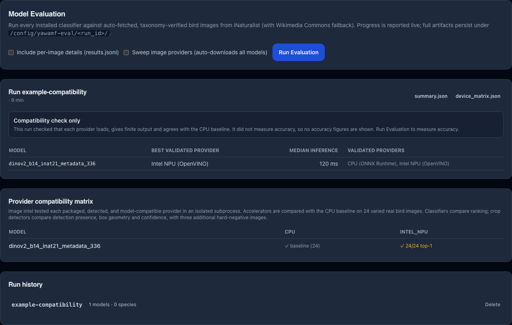

# Model Evaluation Harness

Use the owner-only **Model Evaluation** page at `/diagnostics/model-eval` to compare installed
classifiers on taxonomy-verified images or check which providers run correctly on your hardware.
Accuracy evaluation and compatibility checks answer different questions; a passing device check
does not establish correct species identification at your feeder.

## What it does

1. Builds a species panel: hand-curated 50-species **shared core** of common feeder birds plus a region-aware extension drawn from iNaturalist `species_counts` near the configured location (lat / lng from settings, falls back to shared core only when location is unset).
2. Fetches up to 3 taxonomy-verified images per species — **iNaturalist research-grade observations first, Wikimedia Commons fallback** when iNat returns fewer than the requested count. A photo larger than 1024 px on its longest side is stored at that size, so latency measures the model rather than a full-size upload (Wikipedia's lead images are often 3840 px).
3. When provider validation is enabled, validates every model's providers first. A model loads only on providers validated on this host, so validating afterwards would score a model on its CPU fallback.
4. For each installed classifier (detector models are skipped), activates the model through the live `ModelManager`, runs every fetched image through `ClassifierService.classify_async()` — the same pipeline production uses — and records the result.
5. Restores the originally-active model after the run finishes (even on failure).
6. Cleans up the image cache at the end of the run; **persistent artifacts are kept** until you delete the run from the UI.

The run detail provides **summary.json**, **runtime.json**, and **confusions.csv** download
buttons. Downloads use your current owner session and save the file in your browser; a failed or
expired session shows an error on the page. Sign in again if access has expired.

A compatibility check started from **Settings → Detection** or the setup wizard also appears in
the run history. It checks providers but does not score accuracy, so the page labels it
**Compatibility check only** and shows each model's best validated provider, that provider's
median inference time, and the providers that passed. It shows no accuracy columns and no mean or
p95 latency, because the run measured neither. Such a run writes only `summary.json` and
`device_matrix.json`, so those are the only downloads offered.



For a location-aware classifier such as DINOv2, normal in-app runs use the saved feeder location.
Record whether coordinates were present when comparing runs; the October public benchmark used
location absent. Coordinates are not a source of ground-truth species labels, and location-only
results cannot be compared directly with upstream scores measured with full metadata.

## Where the data lives

Each run writes a directory at `/config/yawamf-eval/<run_id>/` containing:

| File | Content |
|---|---|
| `summary.json` | headline metrics + per-model breakdown (top-1/3/5 accuracy, latency, abstention, shared-core vs regional split, sanity-check warnings) |
| `runtime.json` | per-model provider / device / startup benchmark / drift factor / `InferenceHealth` snapshot |
| `confusions.csv` | top wrong→right confusions per model, ranked by frequency |
| `results.jsonl` | per-image top-5 predictions with scores, output index, catalogue `species_id` and taxa_id resolution, plus the expected species and whether the model can name it — only when **Include per-image details** is checked |
| `device_matrix.json` | image-aware classifier and crop-detector provider compile, finite-output, CPU-agreement and median inference-latency results when provider validation is enabled |

The container mount means you can pull these straight off the host:

```bash
docker exec yawamf-monalithic cat /config/yawamf-eval/<run_id>/summary.json | jq .
```

## Reading the results

### Headline accuracy

A prediction is scored by species, not by label text. Its species comes from the species catalogue through the model's checksum and output index, the same identity live detections use, so a European model's "Common starling" counts as the panel's "European Starling". When the catalogue does not know the model, or a test species, the harness falls back to matching taxa_id, scientific name or common name.

A model can only name the species it has an output for. A European model has none for a Blue Jay, so every figure is reported twice:

- **`top1_accuracy`**, **`shared_core_top1`**, **`regional_top1`** — over every test image. Production threshold work usually compares against top-1.
- **`top1_accuracy_in_vocabulary`**, **`shared_core_top1_in_vocabulary`**, **`regional_top1_in_vocabulary`** (and top-3/top-5) — over the images of species the model can name. This is the fair cross-model number, and the one the page shows. `images_in_vocabulary` and `species_outside_vocabulary` (out of `panel_species`) say how much of the test set that covers; the page shows it under **Can name**. These are `null` when `vocabulary_known` is false.

Only a species the catalogue proves is outside the model's outputs is set aside. Some outputs have no catalogue identity (the European models' "Feral pigeon" and "Great bittern"); a species stays in the score when any of those could be it, by sharing its genus or the last word of its common name. A species whose membership is unknown still counts, so a miss is never hidden on a guess. Which species a model can name is decided from the test panel, not from the images that classified successfully.

### Latency

- **`mean_latency_ms`** / **`p95_latency_ms`** — observed inference time per image during the run.
- **`startup_benchmark_ms`** — what the model was measured at when it was first loaded (CPU baseline or accelerated). The startup self-test does not run in subprocess mode, so it is empty there and no drift ratio is computed.
- **`latency_drift_ratio`** = mean / startup_benchmark. A value above ~5 is unusual and surfaces as the `latency_drift_high` warning. This is the signature pattern from issue #33 (OpenVINO Intel GPU running at ~12 s/frame instead of ~600 ms).

### Warnings

| Code | What it means | What to do |
|---|---|---|
| `latency_drift_high` | measured mean > 5× the startup benchmark | suspect the accelerated provider — try toggling to CPU and rerun |
| `high_abstention` | model returned `Unknown` / `Background` on > 10% of images | check vocabulary coverage, catalogue readiness and preprocessing; a model may not include the feeder species |
| `low_shared_core` | top-1 < 50% on the shared-core species the model can name (on every shared-core species when its vocabulary is unknown) | inspect install readiness, catalogue or custom label mapping, and preprocessing |
| `partial_vocabulary` | the model cannot name some test species, usually because they are outside its region | informational — accuracy is shown on the species it can name |
| `provider_fallback_active` | requested an accelerated provider but actually running on CPU | first check **Image** and **Packaged** under **Settings → Detection → Runtime diagnostics**, then inspect `runtime.json` for a device or model fallback reason |
| `incomplete_install` | model is not ready, required config is missing, or neither a complete catalogue mapping nor required legacy labels is available | use Model Manager's repair download; catalogue-backed installs do not require `labels.txt` |
| `inference_health_unhealthy` | the `InferenceHealth` verdict for this model on the provider it ran on is `unhealthy` at run end | the runtime errored or timed out during the run; check classifier logs |
| `region_mismatch` | EU model evaluated against NA region (or vice versa) | informational — accuracy will look low but isn't a regression |

### Confusions CSV

Each row is `(expected_taxa, expected_common, predicted_taxa, predicted_common, count, mean_score)`. Sorted by frequency. Useful for spotting systematic biases — e.g. a model that consistently predicts "Purple Finch" for every "House Finch" suggests a vocabulary or training-set issue rather than a runtime problem.

## Scope and trade-offs

- A run temporarily changes the active model and provider and can compete with live detections.
  Schedule it for a quiet period, let it finish or cancel it through the UI, then check the restored
  model and actual worker provider in **Settings → Detection**. Do not reset your database to
  recover from a diagnostic run. Backfill can revisit available Frigate events without duplicating
  event IDs, but cannot recreate footage Frigate has already removed.
- Only one run at a time. Starting a second run while one is in progress returns 409 Conflict.
- Run history shows the most recent 20 runs; older runs persist on disk until manually deleted.
- Image fetch concurrency is capped at 5; iNat rate limits are the practical floor on overall wall-clock time.
- The shared-core species list is hand-maintained at `backend/app/services/eval/shared_core_species.json`. Add entries (sci name + common name) to grow coverage; `taxa_id` resolves at runtime.

## Repeatable crop-policy sweep

The feeder-specific CLI harness runs the same `ClassifierService` image-resolution path and can
compare automatic image preparation without changing saved Settings:

```bash
python backend/scripts/eval_feeder_model_harness.py \
  --manifest /config/yawamf-eval/panel/manifest.csv \
  --output-dir /config/yawamf-eval/crop-policy-eu/results \
  --models small_birds,medium_birds \
  --crop-modes on,off \
  --source-mode standard \
  --bird-model-region eu
```

Use `--bird-model-region na` for the NA variants. Crop and source overrides exist only in the harness
manager instance and are restored after every case group; `summary.json`, `results.csv`, and
`failures.csv` remain available for review. A forced crop-on run now fails if the detector cannot
load, inference fails, or no image is actually cropped, preventing a fail-soft production fallback
from becoming false benchmark evidence. The current decision rule and baseline measurements are
documented in [`../plans/2026-07-16-model-crop-policy.md`](../plans/2026-07-16-model-crop-policy.md).

## Provider compatibility and the post-install gate

A compatibility sweep tests the intersection of the selected model's reviewed providers, the
running image and visible hardware. Each provider runs in an isolated process and must produce
finite output agreeing with CPU on up to 24 representative images. Crop detectors additionally use
hard negatives and compare detection presence, box geometry and confidence. Failed rows remain in
`device_matrix.json`; they do not become recommendations.

Passing evidence is bound to the exact model artifact, runtime packages, kernel, hardware and image
flavour. Changing those requires revalidation. `Auto`, Model Manager and the setup wizard use the
same measured passing order. A failed repeat invalidates older proof for that model. See
[Validate before you select](ai-models.md#validate-before-you-select-post-install-gate) for the setup
steps, and [runtime diagnostics](../troubleshooting/diagnostics.md#-inference-acceleration-diagnostics)
when the actual worker provider differs from the saved preference.

## Maintainer workflows

These are separate from the normal in-app comparison. Use an isolated environment and preserve
failed runs and original image provenance:

- [Installed-model/provider gate](../development/testing.md#mandatory-local-modelprovider-gate): strict hardware checks and native-crash investigation.
- [Model conversion](../conversions/birder-model-conversion.md): preprocessing parity, output mapping, checksums and release packaging.
- `backend/scripts/eval_feeder_model_harness.py`: repeatable crop-on/off comparisons on reviewed feeder images.
- `backend/scripts/build_crop_field_manifest.py` and `eval_crop_detector_accuracy.py`: same-frame Frigate hints and real feeder negatives. Automatically inferred species are context, not ground truth.
- `backend/scripts/eval_crop_strategy_challenger.py`: downstream species results against the unchanged full frame and Frigate crop. Promotion evidence requires manual labels.
- `backend/scripts/probe_crop_candidate.py`: isolated screening of exported detector candidates before registry admission. A passing provider probe does not establish detector quality or redistribution rights.

## Label sources

Registered classifiers resolve ordered output identities through the species catalogue. See
[AI Models](ai-models.md#october-experimental-options) for checksum binding and custom-model fallback;
a missing `labels.txt` alone is not an incomplete catalogue-backed installation.
