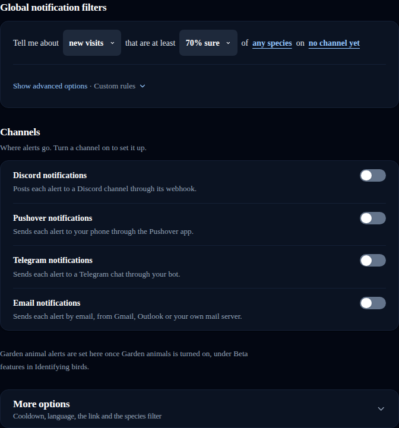

# Notifications

YA-WAMF sends detection alerts through Discord, Pushover, Telegram, and email.

## Notification history

The bell icon in the header opens the **Notifications** page (or press `g` then `j`). It shows one
history, filtered by category: **Everything**, **Birds**, **Updates**, **Jobs**, and **Errors**. The
**Jobs** and **Errors** categories are owner-only.

**Clear all notifications** empties the history on this browser at once. A toast then offers **Undo**
for ten seconds, which puts the cleared items back beside anything that arrived meanwhile.

The **Jobs** category separates queued, running, and recent work. Video analysis, best-quality
snapshots, full clips, and backfills stay distinct, so a queued item is never presented as a
running worker. A job that stops reporting for three quarters of an hour is shown as **stopped**,
with how far it got and when it went quiet, a grey bar that no longer moves, and its own
**Remove from this list**; it leaves the history a day after it stopped. The top progress bar counts such a job
as "not responding" for that window and then drops it.

The compact progress bar across the top of the application is reserved for prominent work you
started, such as a backfill or a manual analysis. Routine per-detection media work appears under
**Jobs** without keeping a permanent banner on screen. Jobs read current server state and fall back
to browser live updates, so opening a second tab does not create a second job or invent a separate
queue.

If live job status cannot be read, the page keeps the last known progress, shows a warning,
and retries automatically. **Try again** on a paused video-analysis lane reopens the circuit
breaker; it does not discard queued detections.

Opening Settings restores the last detection and weather backfill results without announcing
them again. A backfill observed running on that page announces its completion or failure once;
returning to Settings or reloading it does not replay the result.

For a support report, follow **Open Health** to the **Health** page and expand
**Diagnostics export**. **Capture bundle** saves a snapshot; **Download without saving** exports
one directly. Both request current server evidence, even with no browser errors. These actions
require owner access and do not send a report automatically. A saved bundle retains its original
capture time. See [Diagnostics](../troubleshooting/diagnostics.md#capture-current-evidence-for-a-report).

## Supported Platforms

### Discord
Sends rich embeds with snapshot previews to a Discord channel.

- **Webhook URL:** Create a webhook in your Discord server settings.
- **Bot username:** Custom name for the bot (default: "YA-WAMF").
- **Send the photo:** Includes the detection image. On by default; switch it off to send text
  only (`NOTIFICATIONS__DISCORD__INCLUDE_SNAPSHOT`).

### Pushover
Sends push notifications to your mobile device via the Pushover app.

- **User key:** Your user identifier.
- **API token:** Create a new application in Pushover to get this.
- **Priority:** Adjust the alert priority (-2 to 2).
- **Send the photo:** Attaches the detection image. On by default; switch it off to send text
  only (`NOTIFICATIONS__PUSHOVER__INCLUDE_SNAPSHOT`).

### Telegram
Sends messages or photos to a Telegram chat.

- **Bot token:** From `@BotFather`.
- **Chat ID:** The user or group ID to send messages to.
- **Send the photo:** Sends a photo message with a caption. On by default; switch it off to send
  just text (`NOTIFICATIONS__TELEGRAM__INCLUDE_SNAPSHOT`).

### Email
Send rich HTML emails with optional snapshots.

- **OAuth (Gmail/Outlook):** Authorize YA-WAMF to send email on your behalf.
- **SMTP:** Configure your server hostname, port, TLS, and optional auth.
- **From/To:** Set sender and recipient addresses.
- **Snapshots:** **Include snapshot image** attaches the detection image in the email.

## Linking back to the detection

Set **Instance address** under **Settings → Notifications → More options** to the address you use to open
YA-WAMF, for example `https://feeder.example.com`. Every notification then links to the detection
it announces, at `<address>/events?event=<id>`:

- **Discord:** the embed title opens the detection.
- **Pushover:** a **View detection** button.
- **Telegram:** a **View detection** button under the photo or message.
- **Email:** the **View in Dashboard** button opens the detection rather than the dashboard.

**Notification link opens** chooses the target. **This YA-WAMF** (the default) opens the detection
as above. **Frigate** opens the same tracked object in Frigate's Explore page instead, at
`<Frigate public URL>/explore?event_id=<id>`, using the **Public Frigate URL** saved under
**Settings → Cameras & connection → More options → Frigate details**; it needs Frigate 0.15 or newer.
With Frigate chosen and no public URL saved, notifications carry no link and the settings card says
so, with an **Open Connection** shortcut.
A preview line under the choice shows the exact address the next notification will carry.

Either address must start with `http://` or `https://`; saving one without a scheme is refused
with a message, because Discord and Telegram reject such a link and would drop the whole
notification with it.

Leave the field blank and notifications carry no link, as before. The link is only as reachable as
the address you enter: a LAN address works on your network only, and a public address works from
anywhere. Opening a detection needs the owner sign-in unless public access is enabled, so a link
opened on a phone that is not signed in shows the sign-in page first. The environment variable is
`NOTIFICATIONS__INSTANCE_URL`; the older email-only `NOTIFICATIONS__EMAIL__DASHBOARD_URL` is still
honoured when the newer one is unset.

## Filtering

**Settings → Notifications** states your filter as a sentence, and every highlighted part of it is
a control:

> Tell me about **new visits** that are at least **70% sure** of **any species** on **Discord**

### Minimum confidence
Only alert at or above this score (default `0.7`). Raise it to reduce alerts for lower-confidence
identifications. A high score does not guarantee that the identification is correct.

### Audio confirmed only
Alert only when the visual model identified a bird **and** BirdNET-Go heard the *same species*
within the configured correlation window. This requires supporting audio
evidence, but both models can still make mistakes. Visits without matching audio do not trigger
an alert. The sentence changes to **"70% sure and heard"** when it is on.

### Species filter
Three modes, chosen with the tiles under **Species filter** in **Settings → Notifications → More options**.
The species part of the sentence links there:

| Mode | Effect |
|---|---|
| **No species filter** | Notify for every species that passes the other filters. This is the default. |
| **Block selected species** | Notify for everything *except* the species you list. Use this to exclude frequent visitors. |
| **Only selected species** | Notify *only* for the species you list. Use this to watch for particular species. |

Species are matched on taxonomic identity rather than on display text, so a name change or a
different UI language does not quietly break your filter.

### Notification cooldown
A minimum gap in minutes between notifications, across all channels, set under **Settings →
Notifications → More options** (off by default, stored as `0`).
Use it to reduce notification frequency when the feeder is busy.

When enabled, only one delivery can begin at a time, even when separate visits
reach different delivery workers together. A delivery with no eligible channels,
or with no successful channel, leaves the next visit eligible. A completed channel
starts the cooldown even if another channel is cancelled. Turning the cooldown
off allows concurrent deliveries as before. This is local delivery admission;
it cannot guarantee whether a remote service accepted a request interrupted in transit.

## Notification Modes

Choose a delivery mode with the first highlighted part of the sentence in **Settings → Notifications**:

- **new visits** (Standard, the default): notify once a visit is confirmed.
- **confirmed visits** (Final-only): notify only when Frigate ends the event and video analysis
  (if enabled) completes. This choice also offers **Video fallback timeout override**.
- **every update** (Realtime): notify as early as possible and allow update notifications as the
  visit goes on.
- **silent**: disable all notifications. The sentence then reads "Stay silent and keep recording
  visits".

**Custom rules** is a fifth choice in the same menu, for owners who want their own triggers. It
sends **at most one alert per visit**, and its three switches are under the sentence:

- **When a visit starts** (`notify_on_insert`): send the alert when Frigate first reports the
  visit, if its name is sure enough by then.
- **Later, if no alert has gone** (`notify_on_update`): send the one alert when Frigate later
  updates the visit, if none went at the start, because the first switch is off or the name was not
  sure enough yet. It never sends a second alert.
- **Wait for the video check** (`delay_until_video`): hold the alert until the video check has
  confirmed the name, or for the seconds you set if it never answers.

The switches take effect only with custom rules. The four modes above set their own triggers and
ignore `notify_on_insert` and `notify_on_update`, so on those modes the switches are shown
disabled, with that reason. Custom rules cannot repeat an alert as a visit changes (only **every
update** does that) and cannot wait for Frigate to end the visit (only **confirmed visits** does).

Delayed video notifications wait for the associated photo work within the notification
timeout. They use the visit's accepted identification and current audio confirmation,
including manual corrections, rather than a video guess that the promotion rules
rejected. Deleted, hidden, blocked and unknown visits are checked again before delivery.

## Garden animals

While the Garden animals beta is on, its alerts about named animals are set in
**Settings → Notifications → Garden animal alerts**, marked Beta, beside the channels they
send through; the Garden card links there. By default they use your bird
channels, meaning the ones switched on and configured, and attach the animal photo.
You can choose channels for Garden alone instead. Bird filters, notification mode
and the cooldown above apply to birds only. See
[Send Garden notifications](garden-animals.md#send-garden-notifications) for when an
alert is sent, what it contains and who can open its link.

## How it Works

1. **Event Trigger:** A detection is processed and saved to the database.
2. **Filter Check:** The system checks your confidence, audio, and species filters.
3. **Dispatch:** If passed, the notification service dispatches async requests to all enabled platforms simultaneously.
4. **Rich Media:** If enabled, the service attaches the available photograph. A photo or video guess cannot override the visit's accepted species merely to provide an attachment.

## Setup

Go to **Settings → Notifications** to configure all of this. Saved webhooks, tokens, and
passwords display as `***REDACTED***` and are preserved when you save other settings, so you never
have to re-enter a working credential.
