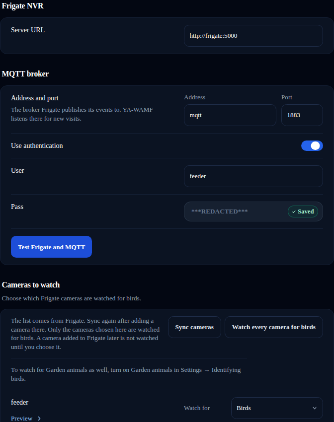
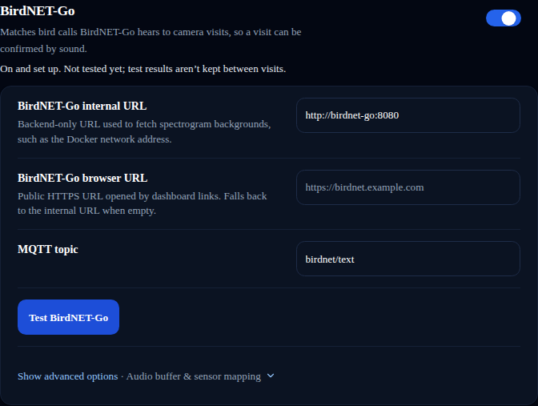
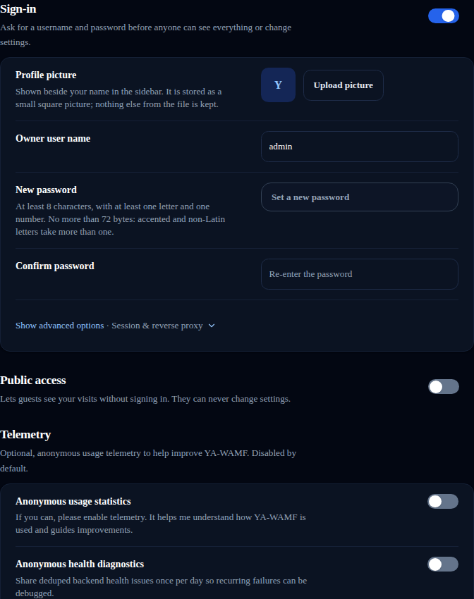
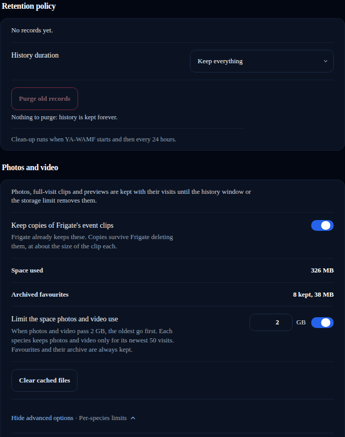
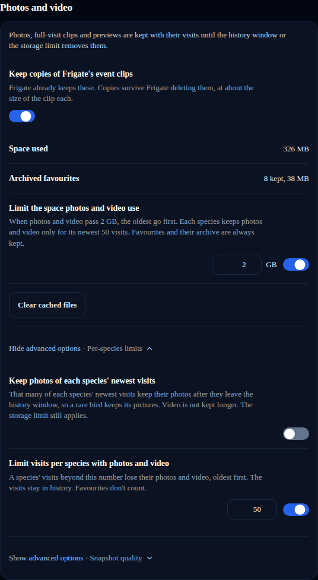
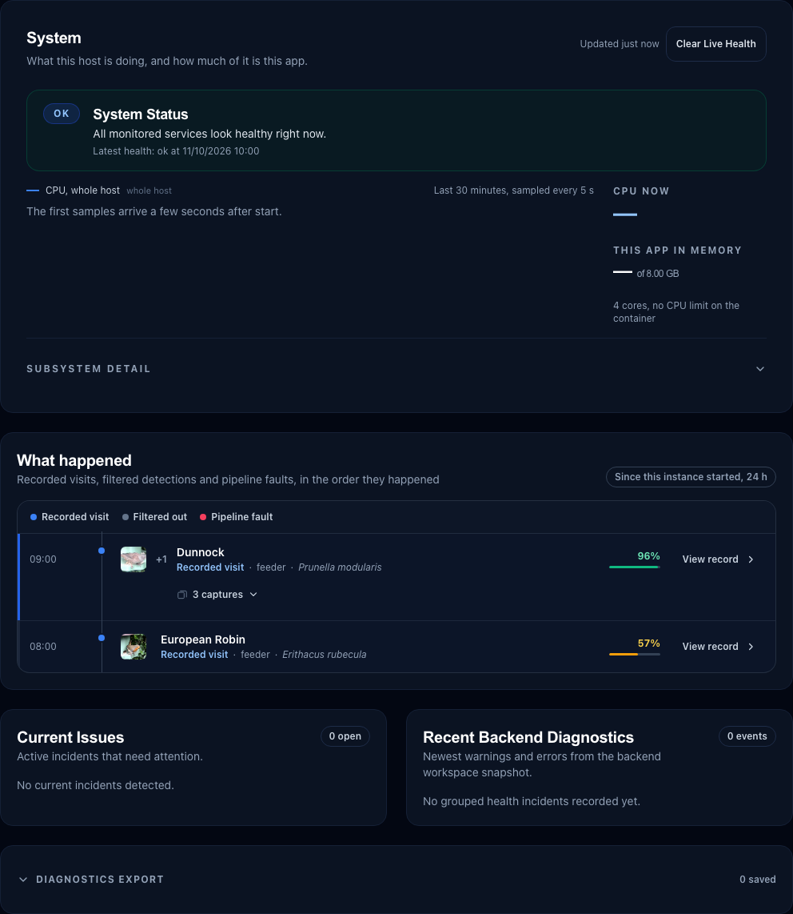

# Configuration

Configure YA-WAMF under **Settings**. Saved choices persist in `/config/config.json`;
supported [environment overrides](environment-variables.md) take precedence on restart.

## How Settings is laid out

Settings is organised by the task you came to do, in six sections. On a wide screen they are listed
in a rail beside the settings, so a section's first setting is at the top of the page; a **Skip to
the settings** link moves keyboard focus past it. On a phone or a narrow window a **Settings
section** list names the section you are in. A section holding unsaved changes is marked "unsaved"
in both. **Setup wizard** is a button under the list.

**Search settings** is the first thing in that navigation, on every screen size. Type a setting's
name, what it does, or a word such as "password", "GPU" or "backup", in the language the interface
is in. Each result says where the setting lives ("Alerts › More options"). Choosing one opens that
section, opens **More options** and any advanced group around the setting, scrolls to it and puts
the keyboard on its control, with an outline for a moment. A setting that only appears while a
switch is on takes you to that switch and says so. Press **/** anywhere on Settings to reach the
search; the arrow keys move through the results, Enter opens one and Escape closes the list.
Searching never changes or discards anything: unsaved changes wait as before.

The section you are in is named above its settings and stays at the top of the window as you
scroll. Under it each group of settings has its own heading and its own raised card.

Each section opens with a **Status** line read from the system's live status: one chip per part
it depends on, such as Frigate, MQTT and BirdNET-Go for Cameras & connection, with **Details in
Health** for the cause. A part not measured yet says so rather than showing a state. Then come
the choices most owners need, and one **More options** disclosure holds the rest of the section.

The page uses the width it has. From a tablet in landscape the section list sits beside the
settings; on a wide monitor the Status line and the section's parts move to a column of their
own beside the controls. Sentences keep a readable line length at every width, and a phone never
scrolls sideways.

In that column each chip says what the part is for and its cause in words, saying only what was
measured ("Frigate answers, and no camera is reported offline"), never a code. While the reading is
out of date the causes are left out and the column says so. Frigate, MQTT, BirdNET-Go and Alerts
have tests of their own. YA-WAMF keeps no test result, so a result is shown only for a test run
during this visit, with the time it ran; a reload forgets it. A test runs with the values on the
page: when they are not saved yet, the result says so, and an edit, **Discard changes** or **Save
changes** after it removes it. Until then the column says "Test results aren't kept. Run the test
to check now." with **Run the test**, or **Go to the test** when the test is under More options
or is one of the channel tests. Above the settings on a phone the column stays short: the chips,
with words only for a part that needs a look.

| Section | What lives there |
|---|---|
| **Cameras & connection** | Where events come from: Frigate, its MQTT broker, the cameras to watch, and BirdNET-Go for audio. |
| **Identifying birds** | How sure a name must be, the models that find and name birds, the hardware they run on, and features still in Beta. |
| **Alerts** | When you hear about a visit, and the channels the message goes to. |
| **Sharing & integrations** | Other services YA-WAMF reads from or reports to, your location, AI descriptions, who can open this install, and what leaves it. |
| **Storage & upkeep** | What is kept and for how long, a backup of these settings, and the jobs that repair or fill in the history, then deleting it. |
| **Display** | How YA-WAMF looks and names birds, and contrast, a reading font, motion and spoken updates. |

**Health** is a page of its own under **Manage** in the sidebar, not a Settings section: it reports
on the system and has nothing to save (see [Health](#health)).

### Where did it go

Settings used to have twelve tabs, one per part of the system. Each is now a part of the section
for its task, with every setting it held. An older address such as `/settings/models` still works:
it opens the section, scrolled to that part.

| Former tab | Now in | Address |
|---|---|---|
| Connection | Cameras & connection | `/settings/cameras#connection` |
| Detection | Identifying birds | `/settings/identification#detection` |
| Models | Identifying birds | `/settings/identification#models` |
| Beta features | Identifying birds | `/settings/identification#beta` |
| Notifications | Alerts | `/settings/alerts#notifications` |
| Integrations (with species information sources) | Sharing & integrations | `/settings/sharing#integrations` |
| AI | Sharing & integrations | `/settings/sharing#ai` |
| Security (with telemetry) | Sharing & integrations | `/settings/sharing#security` |
| Data | Storage & upkeep | `/settings/storage#data` |
| Maintenance | Storage & upkeep | `/settings/storage#maintenance` |
| Appearance | Display | `/settings/display#appearance` |
| Accessibility | Display | `/settings/display#accessibility` |

Some settings have since moved within that map:

| Setting | Was in | Now in |
|---|---|---|
| BirdNET-Go (connection, MQTT topic, audio buffer, source mapping, **Test Audio detection**) | Integrations | Cameras & connection, under **More options** |
| Your feeder's location | Integrations | Sharing & integrations, first |
| **Display units** | Integrations (Location) | Display (**Units**) |
| eBird, iNaturalist, BirdWeather, Home Assistant weather, species information sources, AI, telemetry | Sharing & integrations | Sharing & integrations, under **More options** |
| Garden's **Name animals automatically** and its naming threshold | Beta features (Garden, Automatic checks) | Identifying birds, **Naming threshold** card, marked Beta |
| Blocked labels, range filter, Frigate and video, **Hardware** (with the runtime report), Beta features | Identifying birds | Identifying birds, under **More options** |
| Garden animal alerts | Beta features (Garden, Alerts) | Alerts, under **More options**, marked Beta |
| Notification cooldown, language, link and species filter | Alerts | Alerts, under **More options** |
| When Frigate loses a visit; the repair and fill-in jobs, with **Jobs at once** | Storage & upkeep | Storage & upkeep, under **More options** |
| Date and time format, naming style, Explorer layout, fonts and colours, Units | Display | Display, under **More options** |
| The accessibility switches, saved for everyone | Display | Display, under **More options**, as **Defaults for everyone**; Display first is **Accessibility on this device** |

Edits wait in one draft across every section. While anything differs from what is saved, a short
bar at the bottom of the page counts the changes, with **Discard changes** (puts every saved value
back) and **Save changes**. On a phone it is two short lines at most, whatever the text size; a
label too long for it ends in an ellipsis and keeps its whole name for a screen reader.
**Details** opens a panel above the bar that names the changed sections, with a link to each, and
says that settings wait for **Save changes**, while buttons such as Test, Run and Download act
straight away. While a refused value, a conflict or restored changes need a look, the panel stays
open and the button, then named **Go to details**, takes you to it.
While the bar shows, the page keeps a focused control above it. Choosing another page with unsaved
changes asks first, offering **Save and leave** (it leaves only once the save goes through) as well
as **Leave without saving**; reloading or closing the tab asks too, and moving between sections keeps
them. A section holding a refused value is marked **needs a fix** in the navigation. Back and Forward are not
held up: the unsaved changes are kept in memory and put back when you return to Settings, with a
line saying so. Passwords and keys are never kept; that line names any you need to type again.
Kept changes belong to the session that made them: signing out, an expired session or another
sign-in drops them. On return Settings reads the saved values afresh. A setting changed elsewhere
that you had not touched shows its new value; one you had also changed is not overwritten either
way. It is marked, the details name it with **Use the saved value** and **Use my change**, and Save
waits until each is decided. When a save is refused, nothing
is stored: each refused field is marked with the reason in plain words, and the details list them
with a link to each, opening **More options** first when the field is inside it. Model activation, configuration import
and setup-wizard steps save immediately. Wizard saves refresh untouched fields in an
open form while preserving other unsaved edits. Remove an environment override if
you want the UI to control that field.

---

## Cameras & connection

Where events come from: Frigate, its MQTT broker, the cameras to watch, and BirdNET-Go for audio.

### Connection

Where bird events come from. The Frigate address, the MQTT broker and the cameras to watch are
shown first. **More options** holds the rest of Frigate's settings (the labels to act on, the
public Frigate URL, the image used for the first identification, and clips) and the
[BirdNET-Go](#birdnet-go) connection.

| Setting | Description |
|---------|-------------|
| **Server URL** | The address YA-WAMF uses to reach Frigate for snapshots and clips, for example `http://frigate:5000`. |
| **Frigate labels to act on** | Comma-separated Frigate labels that should enter the bird pipeline. Defaults to `bird`. |
| **Identify new detections from** | **Detection snapshot** (default) or a higher-resolution retained **Recording frame** with tracked-box alignment. See [initial classification images](../integrations/frigate.md#initial-classification-image). |
| **Initial identification delay (seconds)** | Shown for **Recording frame**. Wait 1 to 120 seconds (default 12) before the first read, using the latest tracked snapshot metadata received during the wait. Notifications arrive later too; saved detections are unchanged. |
| **Public Frigate URL** | The address *your browser* uses to open Frigate, when it differs from the server address above. Used for the "open in Frigate" link on a detection. |
| **Cameras to watch** | One row per Frigate camera choosing what it is watched for: **Off** or **Birds**, plus **Garden animals** and **Both** while the Garden animals beta is on. **Sync Cameras** pulls the list from Frigate; **Preview** shows a live snapshot through the Frigate proxy. See [Cameras to watch](#cameras-to-watch). |
| **Role** | Shown while a camera watches for birds: **Feeder** or **Nest**. Nest cameras use their own de-duplication window. |
| **Collect motion review photos** | Shown while a camera watches for Garden animals. See [Beta features](#beta-features). |
| **MQTT broker** / **Port** / **Use authentication** | The broker Frigate publishes its events to: its hostname, its port (default `1883`), and optional user and pass. |
| **Fetch video clips** | Whether YA-WAMF caches Frigate's short event clip. Turn it off on a metered link. |
| **Full-visit clips** | Ask Frigate for a wider window of recording around each detection. The default window is `30` seconds before and `90` seconds after. |
| **Test Connection** | One staged diagnostic with two checks: **Frigate API**, then **MQTT broker publish**. It tests the values currently in the form, so you can prove a change before saving it. |

#### Cameras to watch

Each choice saves to the same lists the server has always used, so existing configurations need no
migration:

- **Birds** and **Both** put the camera in `frigate.camera`. An empty list means every Frigate
  camera, including cameras added later, and the card says so. Turning one camera to **Off** or
  **Garden animals** while the list is empty first lists every other camera Frigate reports, so
  they keep watching for birds. **Watch every camera for birds** returns to the empty list.
- At least one camera always watches for birds, because an empty list would mean every camera
  again. The last bird camera's **Off** and **Garden animals** choices are unavailable, with the
  reason beside them.
- **Garden animals** and **Both** put the camera in `frigate.garden_cameras`. Leaving Garden also
  removes the camera from `frigate.garden_motion_cameras`; the server drops any motion camera that
  is not a Garden camera when settings are saved.
- Leaving birds drops the camera's **Nest** role, so the nest window is not kept for a camera that
  cannot use it.
- A saved camera that Frigate no longer lists stays in the list marked **Not found in Frigate**
  until you choose **Off**. If the list cannot be read from Frigate, saved cameras are shown
  without that mark.

> **Full-visit clips need continuous recording.** Every selected camera needs an enabled
> FFmpeg `record` role and positive `record.continuous.days` retention. Alert or detection
> retention alone can leave the start or end of the requested window missing. Settings
> checks this coverage and names any camera that needs attention.

#### BirdNET-Go

Under **More options**, because like Frigate it is a source of events: the audio **MQTT Topic**
(default `birdnet/text`), two URLs, the audio buffer and match window, and **BirdNET Source Mapping
(Optional)**, which ties each audio source to a Frigate camera. **BirdNET-Go internal URL** is the
address the backend uses to fetch spectrograms (usually the Docker network name); **BirdNET-Go
browser URL** is the public address dashboard links open, and falls back to the internal one when
empty. **Test Audio detection** runs the broker publish and a mock detection through the real
pipeline. See [BirdNET-Go](../integrations/birdnet-go.md).

## Identifying birds

How sure a name must be and the models that name birds come first. **More options** holds blocked
species, the range filter, video checks, the hardware and the features still in Beta. When video
checks have paused after repeated failures, the alert sits at the top of the section, not inside
More options. An address such as `/settings/identification#beta` opens More options at that part.

### Detection

**Naming threshold** is the first card: the bird naming threshold and the minimum confidence
floor, **Learn from my corrections**, and, while Garden animals is on, Garden's own **Name animals
automatically** switch and naming threshold in a row marked **Beta**, so both thresholds are set in
one place. Under **More options**:

- **Blocked labels**.
- **Range filter**: optional, needs a location and an eBird key.
- **Frigate and video** (starts closed, and opens when a save refuses a value inside it): sublabel
  trust, sublabel write-back and automatic video analysis.

### Models

Which models identify birds and on what hardware. The page opens with one sentence of what names
birds right now, worded from the classifier's own report: for example "Naming birds with Birds
and wildlife, balanced on Intel GPU.", "… will name birds on CPU. It loads with the first
detection." before a worker has loaded it, or "Nothing is naming birds yet: … is not on this
install." when the chosen model's files are missing. The first-run wizard's model step and About
show the same sentence. When the runtime has something to report, a link under it says how many
things to check and opens More options at the **Runtime report**, inside **Hardware**. A new
runtime problem opens More options and the report by itself; closed on that problem, they stay
closed until a different one appears. Then:

- **Models**: **Bird model region**, then the **Identification model**: the model in use (or the
  chosen one, when its files are missing), and at most one **Recommended next** model when the
  install still runs the small starter model or nothing at all. Models are named by what they are
  for ("Birds of your region, quick"), with the catalogue's code name beside it. **Choose another
  model** opens the whole catalogue, grouped (Small and quick, Balanced, Fast on Intel graphics,
  Most accurate, Experimental); a row opens its details and actions in place. Each model states
  its coverage, its download size (or that it is on this install, or comes with the app) and its
  memory in one line. Then the **Bird finder**, which locates birds in the frame so YA-WAMF can
  crop and count them, and a **Compare the installed models** row that opens **Model evaluation**.
- **Hardware**, under **More options**: **Identification model runs on** (the inference provider) and **Check devices on this host**,
  whose button is **Check devices for every installed model**, then the
  folded **Memory and isolation** (which also holds **Discard results the model could not
  compute** with the debug interface on) and **Runtime report** sections. The report opens on its
  own when the runtime has something to report, or when a save refuses a value inside it.

| Setting | Default | Description |
|---------|---------|-------------|
| **Naming threshold** | `0.7` | Minimum local score for a named identification, also subject to the confidence floor, unknown-label policy and blocked-species rules. |
| **Minimum Confidence Floor** | `0.4` | Reject local image results below this score. A usable trusted Frigate sublabel can still provide the configured fallback. |
| **Trust Frigate Sublabels** | Enabled | Accept a species Frigate has already identified when local inference has nothing usable. |
| **Write Labels Back to Frigate** | Enabled | Push YA-WAMF's own identification back to the Frigate event as a sublabel. |
| **Bird Model Region** | `Auto` | Override regional model selection (`Auto`, `Europe`, `North America`) for birds-only model families. |
| **Device** | `Auto` | `Auto`, `CPU`, `NVIDIA CUDA`, `Intel GPU (OpenVINO)`, `Intel CPU (OpenVINO)`, or `Intel NPU (OpenVINO)`. Only providers your image packages, your host exposes, and the active model supports are listed. |
| **Device** (bird finder) | `Automatic` | Device preference for the accurate finder, separate from identification. **Automatic** uses the fastest device that passed its check. A device without a passing check is listed as **not passed on this host**. A saved one stays saved, and the finder runs on CPU until it passes **Check devices for the bird finder**; one that is not saved cannot be chosen until it passes. The **Runs on** row above it states the device in use and why. **Save changes** saves the preference. |
| **Bird finder** | `Standard (YOLOX-Tiny)` | Which detector locates birds before they are identified and counted. **Wide frame (RF-DETR Nano)** is optional. Like every other field on the page, a change is saved by **Save changes**. |
| **Isolation** | `Separate worker processes` | Separate worker processes run inference in isolated workers the app can restart, so a stalled or crashed classification cannot take the interface with it. `In-process` shares one model copy with the app: less memory, but heavy inference competes with the UI. |
| **Models** | — | Download, validate, and activate identification models, and download the bird finders. Activating a model takes effect at once; it is not part of **Save changes**. |
| **Runtime report** | — | **Image**, **Packaged**, **Selected**, **Active**, device probes, backend, and any fallback reason. |
| **Auto Video Analysis** | Disabled | Analyse the clip across multiple frames after the event ends. Frame count defaults to `15`. |
| **Learn from my corrections** | Disabled | Use your manual corrections to re-rank future predictions for the same camera and model. |
| **Range filter** | Disabled | Set aside new automatic identifications of species eBird has never recorded in your region, falling back to the model's best in-range answer. Needs a location and an eBird API key; fails open when the list is missing or stale. See [Range filter](../features/range-filter.md). |
| **Finest region** | `County` | The finest eBird region the range filter uses. An approximate location uses a state list and a country alone uses the country list. |

#### 🛠 How the two thresholds work together

1. **Score at or above both the threshold and floor**
   Saved with its species when the label is usable and not blocked. Optional reporting
   still follows each integration's own enablement and filters.
2. **Score between the Floor and the Threshold**
   *Saved as **Unknown Bird**.* YA-WAMF is confident something was there, but not confident
   enough to name it. The visit is kept; your species statistics stay clean.
3. **Score below the floor**
   The local result is rejected, which can exclude a real bird in an unclear image.

**Trust Frigate Sublabels** allows a usable upstream species to provide a fallback when
local inference cannot name the bird. These scores are model outputs, not calibrated
probabilities: a 70% threshold does not mean every model is correct 70% of the time.
Keep the floor at or below the threshold for a useful Unknown Bird band.

#### 🎯 Personalized re-ranking details

- **Scope:** feedback is isolated by **camera + active model ID**. Corrections on one camera or
  model never affect another.
- **Activation:** re-ranking stays inactive until at least **20** manual corrections exist for
  that camera/model pair.
- **Time decay:** newer corrections outweigh older ones, so stale patterns fade.
- **Safety:** adjustments are bounded and fail open. If feedback is unavailable, YA-WAMF uses
  the base classifier scores.

> **A downloaded model is not yet a proven one.** A model that has never been validated on
> this host shows **Validate to enable** instead of **Use this model**, and the API refuses to
> activate it. Compatibility proves finite, CPU-consistent execution on this installation,
> not species accuracy. See [AI Models & Performance](../features/ai-models.md).

Registered classifiers read their ordered output names from the species catalogue, bound
to the exact model checksum. Integrated downloads need no separate `labels.txt`; legacy
or custom models can still use the file fallback. See the
[October model catalogue](../features/model-catalogue-2026-10.md) for new models, coverage
and measured tradeoffs. These additions require an application build containing their
integration; the rolling model release alone does not update an older application.

### Debug section

Optional developer tools, hidden unless you enable them:

- Environment variable: `SYSTEM__DEBUG_UI_ENABLED=true`
- Config file: `"system": { "debug_ui_enabled": true }`
- Compose: `DEBUG_UI_ENABLED=true`

This adds a troubleshooting switch, **Discard results the model could not compute**, to
**Settings → Identifying birds → More options → Hardware → Memory and isolation**, and shows the iNaturalist submission preview in a
detection's details. The **Model evaluation** page is linked from the same card for every owner.

### Beta features

Features that are still being tested. Each is a card with its own switch and a status line in
words. A feature is off until you turn it on, and may change or be removed. A switch is staged
with the rest of the page and takes effect on **Save changes**; turning a feature off keeps
what it has already recorded. While Garden animals is on, its settings are grouped into
collapsible sections (**Cameras**, **Automatic checks**, **Models**, **Domestic birds you keep**,
**Alerts**, **Where captures go**), and **Still to set up** lists anything it still needs. Beta
features are under the section's **More options**; Garden's naming switch and threshold are in the
**Naming threshold** card at the top of the section.

| Setting | What it does |
|---------|-------------|
| **Garden animals** | Off by default (`SYSTEM__BETA_GARDEN_ANIMALS`). Collects non-bird visitors for owner review, separately from bird history. Turning it off stops collection, hides Garden in the Explorer, stops Garden alerts and records kept birds as ordinary birds; saved captures and the settings below are kept and return when it is turned on again. See [Garden animals](../features/garden-animals.md). |
| **Models** | Status and explicit downloads for Garden's own models: the required 224 MB automatic check model (SpeciesNet 4.0.3a), an optional 224 MB species suggestion model (4.0.3b) and the 101 MB motion detector (MegaDetector v1000 Cedar), required only for motion review photos. Shown after **Save changes** has switched Garden on. A download saves no settings and does not change the bird model. Not a saved setting. |
| **Cameras to watch** | A summary of the cameras watched for Garden animals, none by default (`frigate.garden_cameras: []`), with **Choose cameras in Connection**. Each camera's **Garden animals** or **Both** choice is made in [Connection → Cameras to watch](#cameras-to-watch), beside its bird role. |
| **Collect motion review photos** | Set per camera in Connection while it watches for Garden animals, off by default (`frigate.garden_motion_cameras: []`). Requires retained motion recordings and the **Motion detector** under **Models**. Bounded CPU scans create private review candidates. |
| **Frigate animal labels** | Defaults to `cat, dog`. Animal labels for Garden review; the Frigate detector must already track them. Birds, people and vehicles are excluded; kept birds are declared below. |
| **Domestic birds you keep** | None by default (`FRIGATE__GARDEN_DOMESTIC_BIRDS`, a JSON list such as `["chicken"]`). Chickens, domestic ducks and geese, turkeys, guineafowl, peafowl, domestic pigeons or doves and quail you add here are recorded as Garden animals on every camera, never as bird detections, and are never sent to eBird, BirdWeather or iNaturalist. Mallards, Greylag Geese, Wild Turkeys and Rock Doves also live wild, so add a bird only if you keep it. See [Domestic birds](../features/garden-animals.md#domestic-birds). |
| **Animal proposal threshold** | Cedar's minimum animal score for new motion photos, shown as 50% to 95% (default 50%, saved as 0.5 to 0.95, `FRIGATE__GARDEN_MOTION_CONFIDENCE`). Higher values reduce proposals but can miss animals. Existing photos are not reclassified. |
| **Name animals automatically** | In the **Naming threshold** card, marked Beta. On by default (`FRIGATE__GARDEN_AUTOMATIC_NAMING`). Confirms and names an animal when the automatic check's species score reaches the naming threshold, marked as automatic. Off: every animal waits for your review. |
| **Naming threshold** | In the **Naming threshold** card, below the switch. Shown as 70% to 99% (default 80%, saved as 0.7 to 0.99, `FRIGATE__GARDEN_NAMING_THRESHOLD`). Higher values name fewer animals and leave more for you. A photo below it is dismissed and can be restored from Dismissed. Existing captures are not renamed. |

## Alerts

When you hear about a visit, and the channels the message goes to.

### Notifications

Which visits earn an alert, then where alerts go. The delivery sentence and the **Channels** card
come first. **More options** holds the cooldown, the notification language, the link and the
species filter, and while Garden animals is on, Garden's own alerts. The sentence's species words
open More options at the species filter.

The filter reads as a sentence — *Tell me about **new visits** that are at least **70% sure**
of **any species** on **Discord*** — and each highlighted part is a control.

| Control | Default | Description |
|---|---|---|
| **Channels** | Off | Discord, Pushover, Telegram and Email, each with its switch and a test that sends one real message. |
| **Notification mode** | Standard | `Final-only`, `Standard`, `Realtime`, `Silent`, or `Advanced (custom)` triggers. |
| **Minimum confidence** | `0.7` | Only notify at or above this score. Raise it to reduce alerts for lower-confidence identifications. |
| **Audio confirmed only** | Off | Notify only when BirdNET-Go heard the same species within the configured correlation window. |
| **Species filter** | No species filter | Under More options. `No species filter`, `Block selected species`, or `Only selected species`. The sentence states the filter in words; this is the one control. |
| **Notification cooldown** | Off | Under More options. A switch; when on, the minutes to wait after an alert before sending another (saved as `0` when off). |
| **Notification language** | English | Under More options. The language used in message text, independent of the UI language. |
| **Instance address** | _(blank)_ | Under More options. The address you use to open YA-WAMF. When set, every notification links to the detection it announces; blank means no link. |
| **Notification link opens** | This YA-WAMF | Under More options. `This YA-WAMF` opens the detection here; `Frigate` opens the tracked object in Frigate's Explore page via **Public Frigate URL** under **Connection** (Frigate 0.15+). |

Destinations are Discord, Pushover, Telegram, and Email (Gmail/Outlook OAuth or plain SMTP).
See [Notifications](../features/notifications.md) for per-platform setup.

### Garden notifications

Garden alerts are off by default. While the beta is on they are set in **Settings → Alerts → More
options → Garden animal alerts**, marked Beta, beside the channels they send through; the Garden
card links there. The channels themselves are set up once, in Alerts. They follow
the bird channels that are switched on and configured, or channels you choose;
save with **Save changes**. See
[Garden notifications](../features/garden-animals.md#send-garden-notifications)
for eligibility, photos, privacy and delivery status.

| Environment override | Default | Meaning |
|---|---|---|
| `FRIGATE__GARDEN_NOTIFICATIONS_ENABLED` | `false` | Allow separate Garden alerts while the Garden beta is enabled. |
| `FRIGATE__GARDEN_NOTIFICATIONS_USE_BIRD_CHANNELS` | _(derived)_ | `true` follows the enabled, configured bird channels; `false` uses the channel array below. Unset, a saved choice wins, otherwise it is `true` unless channels were chosen. |
| `FRIGATE__GARDEN_NOTIFICATION_CHANNELS` | `[]` | JSON array of `discord`, `telegram`, `pushover`, `email`, for example `["telegram"]`, used when not following the bird channels. |
| `FRIGATE__GARDEN_NOTIFICATIONS_INCLUDE_PHOTO` | `true` | Attach the saved animal crop or capture photo. |

Environment overrides take precedence on restart. Without overrides, the Garden
notification choices persist in `/config/config.json`.

## Sharing & integrations

Your feeder's location and who can open this install come first. **More options** holds the other
services YA-WAMF reads from or reports to, where species pages get their information, AI
descriptions and telemetry. An address such as `/settings/sharing#ai` opens More options at that
part.

### Your feeder's location

Your latitude and longitude, used for the weather recorded with each visit, nearby eBird sightings,
the range filter, location-aware models such as DINOv2, and observations sent to iNaturalist.
**Auto-detect** resolves it from your network; **Manual entry** pins exact coordinates. The place
looked up for the point fills the optional `state` and `country` used by the eBird export. DINOv2
uses both saved coordinates, including a valid zero, or neutral metadata when either is absent or
invalid. It does not receive a capture date or location uncertainty. Saving changed coordinates
reloads the classifier workers. This is the same location configured in the model step of the
setup wizard.

### Integrations

Under **More options**: other services YA-WAMF talks to. Credentials are redacted as `***REDACTED***` once saved, and
a saved credential can be re-tested without typing it again.

- **BirdNET-Go** is set up with the cameras, under
  [Cameras & connection → More options](#birdnet-go).
- **BirdWeather** — enter your Station Token to contribute identified detections to the
  community project. **Test connection** sends a mock House Sparrow to your station.
- **eBird** — an API key enables nearby and notable sightings. Enable the integration to show
  the CSV export controls here; exporting your detections does not require an API key.
- **iNaturalist** — owner-reviewed submissions over OAuth. Needs App Owner approval from
  iNaturalist first.
- **Home Assistant weather** — use selected HA sensors instead of a regional forecast.
  Readings are reused for up to 30 seconds; unavailable sensors stay unknown rather
  than borrowing forecast values. An optional **Illuminance entity** stores a lux sensor's
  reading with each new detection. See
  [Home Assistant](../integrations/home-assistant.md#weather-and-light-from-your-own-sensors).
- **Location** is its own card, first in the section: see [Your feeder's location](#your-feeders-location).

### Species information sources

At the end of **Integrations**, a read-only summary of which source currently answers each
question about a species, so you can see in one place where the description on a species card
came from. The old `/settings/enrichment` address opens Integrations. Nearby sightings,
seasonality and rarity need eBird: while eBird has no API key they read "Not shown: needs an eBird
API key", with **Set up eBird** beside them.

| Question | Default source |
|---|---|
| **Summary** | Wikipedia |
| **Taxonomy and common names** | iNaturalist |
| **Nearby sightings** | Disabled |
| **Seasonality** | Disabled |
| **Rarity** | Disabled |
| **External links** | Wikipedia and iNaturalist |

Each source is `wikipedia`, `inaturalist`, `ebird`, or `disabled`. There are no controls on
this page: the choices are made with the `ENRICHMENT__*` environment variables or the
`enrichment` block in `config.json`. `ENRICHMENT__MODE` is `per_enrichment` (the default, one
source per question) or `single` (one source, named by `ENRICHMENT__SINGLE_PROVIDER`, for
everything). See [Environment variables](environment-variables.md).

### AI

Connect a Large Language Model for the naturalist notes on a detection and the chart analysis
on the leaderboard.

- **Provider:** Google Gemini (default), OpenAI, Claude, or OpenRouter.
- **Model:** the UI lists current presets per provider and shows the recommended one.
  OpenRouter also accepts any model ID you type.
- **Test AI Connection:** a staged panel that checks configuration, provider availability,
  vision support, multi-frame admission, and response generation. It sends five generated
  1280×720 frames to check that the provider accepts a multi-frame image request. A pass
  confirms this test request succeeded; it does not guarantee every later analysis will succeed.
- **Usage:** calls, tokens, and estimated cost per feature, with the reference pricing the
  estimate used. A cost is shown only for models that have a price: a model without one reads
  "Not priced", and the total says how many requests it covers and which models it leaves out.

### Security

Who can reach YA-WAMF, and what a visitor can see.

- **Authentication** — enable login, set the owner username and password, and choose the
  session lifetime. Saved passwords display as `***REDACTED***` and are preserved when you
  save other settings.
- **Public Access** — a read-only, rate-limited guest view. **Show camera names**, **Share
  audio**, **Share photographs**, and **Share video** are separate switches, all enforced at
  the server. You also choose how far back the public history reaches. Public history and
  media windows use UTC calendar days; “today only” runs from 00:00 UTC to the next midnight,
  independent of the server timezone and local capture-time display.
- **Trusted Proxy Hosts** — if you run behind a reverse proxy, list its IPs, CIDR ranges, or
  container/DNS names so client IP addresses are trusted correctly.

> **Enable authentication before you expose YA-WAMF beyond your own network.** The UI and API
> are administrative surfaces. See [Authentication & Access](../features/authentication.md).

See [Reverse Proxy](reverse-proxy.md) for routing, HTTPS headers and live-stream requirements.

## Storage & upkeep

What is kept and for how long, and a backup of these settings, come first. **More options** holds
what happens when Frigate loses a visit, and the jobs that repair or fill in the history (an
address such as `/settings/maintenance` opens it at the jobs). **Delete data** is last, outside
More options.

### Data

What YA-WAMF keeps and for how long: retention, photos and video, what happens when Frigate
loses a visit, and the configuration backup. Repair and fill-in jobs, and the actions that delete
history, are in [Maintenance](#maintenance). Telemetry, what leaves this installation, is in
Security (see [Telemetry](../features/telemetry.md)).

- **Retention Policy** — **History Duration** sets how long sightings are kept
  (`maintenance.retention_days`; **Keep everything** is the default). Cleanup runs once at
  startup and then every 24 hours from that point, so the time of day it lands on follows when the
  container last started. Choosing a shorter window (or any window after **Keep Everything**)
  shows, under the picker, how many detections the next cleanup would delete, and **Save
  changes** asks once more (**Save and delete _N_ detections**) before saving it. Cancelling
  saves nothing. The sentence above the picker states the saved history: how many records, the
  oldest, and how many are due for deletion; it changes only after you apply. **Purge Old Records** runs the same cleanup now, after asking with the
  number of detections it will remove; while it has nothing to do, the line beneath it says why.
  Cleanup **permanently deletes** visual detections, hidden ones included, and BirdNET-Go audio
  older than the window. Purged history cannot be recovered. Favourited
  detections stay. The optional per-species minimum also protects the newest configured
  number of detections per species and their photographs from age cleanup; its default
  is `0`, so there is no species floor until you set one. It does not protect clips.
  **When Frigate loses a visit** holds what to do when upstream media has gone and the periodic
  re-check against Frigate; **Run media integrity scan now** shows in red only while the chosen
  policy deletes local data.
  A failed event lookup is reported as an unsuccessful check, not missing media. Timeouts,
  authentication errors, server errors and unusable responses preserve the saved state for a
  later retry. A manual scan can clear an earlier missing flag only after confirming the media.
  Automatic missing-media deletion checks favourites in its final database decision. A favourite
  accepted before that decision keeps its detection and cached photos, even if a scan is running.
- **Photos and video** — photographs, full-visit clips and previews are YA-WAMF's own record and are
  kept until a retention or size limit removes them; Frigate may delete its copies much sooner.
  **Keep copies of Frigate's event clips** is the one choice, because Frigate already holds those.
  If the media folder cannot be written, the card, system checks and `/health` say so. On upgrade
  from a build with retired media switches off, best-available snapshots and possibly
  full-visit clips are turned off once. Review those choices and follow the
  [one-time migration steps](../../MIGRATION.md#retired-media-switches).
  **Clear Cached Files** asks first, then deletes cached media older than the retention
  period and cached files that no longer belong to a detection. Favourites and each species'
  newest visits covered by a configured minimum are protected from age cleanup; the
  minimum protects photographs, not clips. Photo variants and metadata age together.
  `media_cache.retention_days=0` follows detection retention; it does not independently mean
  unlimited when history retention is finite. Confirmed Garden animals keep their full photograph,
  and their Frigate clip while event-clip copies are on, under the same retention; **Space used**
  includes them and says how much is Garden's. See
  [Kept photographs and clips](../features/garden-animals.md#kept-photographs-and-clips).
- **Best available event snapshots** — start from Frigate's completed clean best frame and
  tracked-object crop, then sample high-quality clip frames. A clip frame replaces the baseline
  only when a compatible species result improves confidence by at least two points. JPEG quality
  is configurable; crop source selection is automatic. A reliable matching portrait can win
  when its species confidence is within five points of the whole scene. A stale cropped photograph
  cannot block a newer confidently matching frame. A photo chosen by the owner stays chosen until
  they explicitly regenerate or choose another one.
- **Automatically find additional birds** — off by default, including upgrades. Normal target
  identification and photo selection continue; the optional wider search, additional crop
  classifications and count rechecks run only when enabled. Existing counts are kept when you
  turn this off. Enable it under **Settings → Storage & upkeep → Snapshot quality** to scan retained whole
  frames automatically. This also works with **Best available event snapshots** off when video
  processing retains a whole frame.
  To scan one photograph, open it as the owner and choose **Find more birds**. The action scans
  the retained whole frame from that photo's exact recording moment, without changing the chosen
  photo or primary species. A cropped Frigate image, thumbnail or expired scene is insufficient;
  the control explains when a whole frame is unavailable. Scans run one at a time and survive
  a restart. A completed scan with no birds is distinct from a photo never scanned. An empty
  retry keeps earlier counted-bird records and says so. With the RF-DETR Nano bird finder the
  count includes only confident boxes; weaker ones are listed as not counted and the result
  says **At least N birds confirmed**.
- **Bird scanning effort** — applies to automatic and requested additional-bird scans. **Standard** uses one detector scan per sampled frame and up to three
  classified crop choices. **Intensive** additionally searches nine overlapping tiles in large
  high-resolution frames and classifies up to eight crop choices. Intensive remains the effort default; automatic scanning is off unless enabled. Both count all usable detector boxes from the selected scene;
  neither promises to find every bird in the clip, and uncertain species remain Unknown Bird.
  Regeneration preserves per-bird corrections and exclusions, retaining the existing
  frame when a reviewed bird cannot be matched safely. This does not track individual
  birds between frames. See [Video analysis](../features/video-analysis.md).

- **Limit the space photos and video use** — a switch, with the limit in GB beside it once it is
  on; the line under it says what the rules add up to. It periodically removes the oldest
  non-favourite cached visits until ordinary cached snapshots, choices, thumbnails, clips,
  previews and metadata, and confirmed Garden animals' kept photos and clips, fit the budget.
  Off means unlimited (stored as `media_cache.max_size_mb: 0`; the limit is stored in MiB).
- **Show advanced options · Per-species limits**: **Keep photos of each species' newest visits**
  (the per-species floor) and **Limit visits per species with photos and video**, each a switch
  with its number beside it. The second keeps media for the newest configured number of visits of
  each canonical species; favourites are exempt. Off means unlimited (stored as `0`). It removes
  cached media, including alternate photos and clips, while keeping visits and counted-bird records. Favourites and their archive are protected; active work is deferred, so the
  cache can temporarily exceed the budget, or stay above it if protected media alone exceed it.
  Limits run at startup and every five minutes, and when **Clear Cached Files** is used. The budget
  and species maximum take priority over the minimum kept through age cleanup.
  Orphaned published files are retried on the same schedule even with both limits at
  `0`; active writes, referenced files and favourite archives are protected.

  Environment equivalents are `MEDIA_CACHE__AUTOMATIC_MULTI_BIRD_SCAN=true|false`,
  `MEDIA_CACHE__BIRD_SCAN_MODE=standard|intensive`,
  `MEDIA_CACHE__PER_SPECIES_MAXIMUM=0..10000`, and `MEDIA_CACHE__MAX_SIZE_MB=0..1048576`.
  Models, backups, and archived favourites do not count towards the ordinary cache budget.

### Maintenance

Under **More options**: jobs that repair or fill in the history. The actions that delete it are
in **Delete data**, the last card of the section. Every button here acts
straight away; only **Run automatically (daily)** and **Jobs at once** wait for **Save changes**.
Each job says when to run it and what it changes, and has a line for its last run ("Last run
15/11/2026 09:30: 7 of 120 names repaired.", or "No run recorded yet."), read from the server's
maintenance history so it survives a restart. **Apply timezone repair** stays disabled until a
scan finds something, and says so beside the button.

- **Missed detections** — import bird events Frigate still retains, over a day, week, month, or a
  custom range. Import is idempotent by Frigate event ID, so running it twice is safe.
  Photo requests are saved when the memory queue is full and recovered after a restart. A finished
  detection import can still have photo work pending in Jobs. Saved counters survive a restart;
  an interrupted import is marked failed rather than reported as completed. Restarting the import
  is explicit. Historical missing photo output is checked in pages of 100 every five minutes,
  with bounded retries when Frigate no longer retains the source media.
- **Batch Analysis** — re-run classification over detections currently saved as Unknown Bird,
  either on demand or automatically each day.
- **Taxonomy Repair** — normalise species names across your whole history against iNaturalist.
  It fills in missing names only and commits each detection as it goes, so live detections keep
  saving while it waits on lookups.
- **Timezone Repair** — owner-only fix for legacy detections affected by a UTC timestamp shift.
  It previews the change first and needs explicit confirmation, and it is only offered when
  affected rows exist.
- **Migration backups** — before applying database migrations YA-WAMF writes a timestamped
  restore point beside `speciesid.db`, keeping the newest 10 by default. Set
  `DB_PRE_MIGRATION_BACKUP_RETENTION` to keep more. At least one restore point is always kept,
  and manual backups are never removed.

**Delete data** (the last part of Storage & upkeep) lists one action per row, narrowest first,
each with its consequence beside its button: **Delete corrections**, **Delete all favourites**,
then **Delete all history**. Only these buttons are red.

> **These actions permanently delete data.** **Delete all history** permanently deletes
> *every* detection and clears the media cache; **Delete corrections** deletes every
> manual correction the re-ranker learned from. Both ask first in YA-WAMF's own confirmation
> dialog, and neither can be undone. There
> is no automatic backup tied to these actions. Take a backup of `/data` and `/config` before
> using them; migration restore points may not contain your latest history.

#### Jobs at once

**Jobs at once** sets `maintenance_max_concurrent` (default `1`) controls how many jobs of the *same* maintenance
kind may overlap — backfill, weather backfill, video classification, taxonomy repair, timezone
repair, and analyse-unknowns each get that many slots. Different kinds already run
independently, subject to `maintenance.total_max_concurrent` (default `3`) across all kinds.
`maintenance.per_kind_capacity` can override the limit for an individual kind. Keep the per-kind
default at `1` to limit competition with live event processing.

Video-analysis concurrency is separate, and no longer has its own setting. It follows the
background worker count (`CLASSIFICATION__BACKGROUND_WORKER_COUNT`) — one clip per worker.
`video_classification_max_concurrent` remains readable and writable for compatibility, but is
ignored.

## Display

How YA-WAMF looks and names birds, and contrast, a reading font, motion and spoken updates.

### Appearance

How the interface reads. **Theme**, **Text size** and **Language** come first and change at once on
this device; this device's accessibility follows. **More options** holds the choices saved for
everyone: the date and time formats, how birds are named, the Explorer layout, fonts and colours,
the accessibility defaults, and **Units**.

| Setting | Options |
|---|---|
| **Bird Naming Style** | Under More options. **Standard** (common name primary, scientific subtitle), **Hobbyist** (scientific primary, common subtitle), or **Strictly Scientific** (scientific only). |
| **Explorer layout** | Under More options. **Cards** shows a snapshot per detection; **List** shows one compact row each, with times aligned for scanning. |
| **Theme** | Light or dark, plus the colour and font themes. |
| **Text size** | Smallest (75%), Smaller (81%), **Standard** (87.5%, default), Large (100%), Larger (112.5%), Extra large (125%) or Largest (150%). Saved separately on each device. |
| **Language** | The interface language. Notifications have their own language setting. |
| **Date format** | Under More options. Follow browser language (default), United Kingdom (DD/MM/YYYY), United States (MM/DD/YYYY), or Japan/China (YYYY-MM-DD). Date and time choices are saved independently. |
| **Time format** | Under More options. 12 hour, 24 hour, or **Follow browser language**. |
| **Units** | Under More options. **Display units**: `Metric`, `Imperial`, or `British` (°C with mph and mm). Temperature, wind, rain and distances across the UI follow it. Saved for everyone who opens this install, not only this device. |

### Accessibility

- **High contrast** (one black scheme with white and yellow text, used in place of the light or
  dark theme), **Reading font: OpenDyslexic**, and **Reduced motion** for readability and
  motion sensitivity.
- **Live announcements**: screen reader announcements when new detections arrive.

Each is chosen per device, with a default for everyone:

- **Accessibility on this device**, first in Display, changes this browser at once and needs no
  saving. It is kept in this browser and outlasts a reload and signing out. Each switch says
  whether it follows the default for everyone or was set here; **Use the default** goes back to
  following it.
- **Defaults for everyone**, under More options, is saved with the rest of Settings. Guests and
  devices with no choice of their own follow it; a device with its own choice keeps it. Until you
  save, the device you are editing on previews the defaults it follows, and its own card says
  "Previewing the unsaved default". **Discard changes** or leaving Settings ends the preview. The
  `ACCESSIBILITY__*` [environment variables](environment-variables.md) set these defaults.

A device's own choice applies from the first moment a page loads, before the interface has
finished loading. OpenDyslexic has Latin letters only: in Japanese, Chinese and Russian its row
shows only while the font is on, so it can always be turned off.

## Setup wizard

Reopens guided setup as a section map. Completing, skipping, or backing out of a section
returns to the map. Continuing saves that section; it does not reset unrelated settings.
**Skip step** leaves the remaining choices unsaved, and a disabled **Continue** states its reason. A location saved before a hardware
check stays saved if you leave, and leaving does not cancel the running backend check.
See [first-run setup](getting-started.md#4-verify) for provider and location behaviour.

## Health

**Health** is its own page, under **Manage** in the sidebar (older links to Settings → Health open
it). Inspect system load, service health, frame decisions, inference and naming sources,
or download a support bundle. **System** shows the last thirty minutes of load and
YA-WAMF process usage; unrelated processes are grouped as **Other on this host**.
Accelerator labels state whether usage covers this app or the whole device.
An unreadable counter is reported explicitly.

This is the first place to look when detections stop arriving or the interface feels slow. See
[Diagnostics & Logs](../troubleshooting/diagnostics.md).

## Saving settings safely

**Save changes** and configuration backup imports save a private candidate before
publishing it to the running application. A rejected request or failed file write
leaves the active settings unchanged and schedules no worker reload or settings
notification. Concurrent settings saves and imports run in order; a partial update
starts from the last successfully saved configuration.

The other changes YA-WAMF makes to its own configuration go through the same
ordered save: activating a classifier model, replacing a retired model on
startup, first-run setup and the anonymous telemetry identity. None of them can be
undone by a settings save that was already in progress. **Test** in the
notification settings sends with the credentials typed into the form without
storing them, so an unapplied webhook, token or key is never written to
`/config/config.json` by a save that happens at the same moment.
