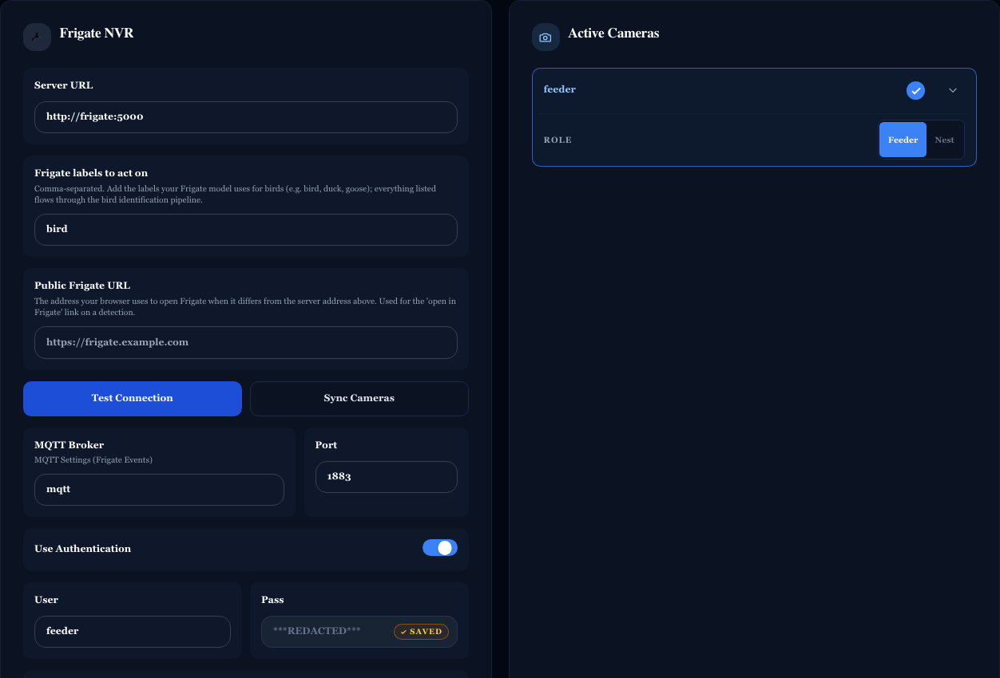
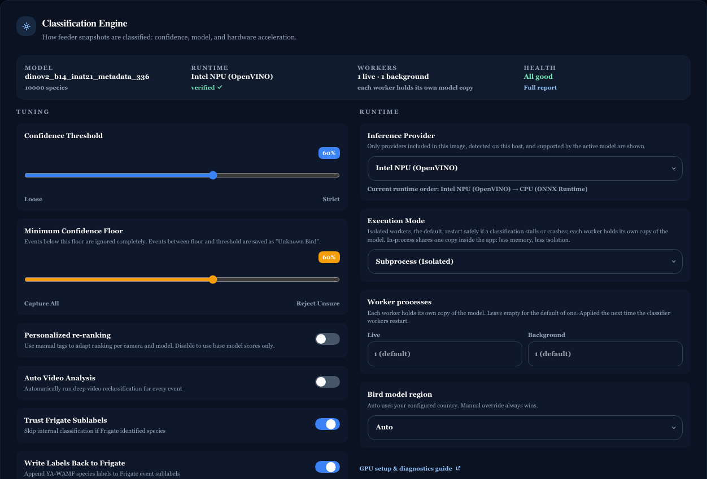
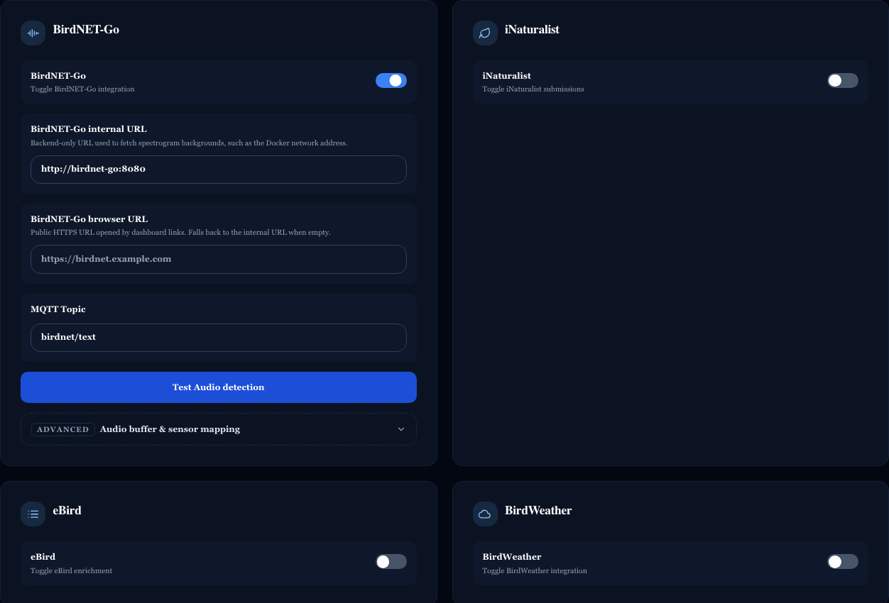
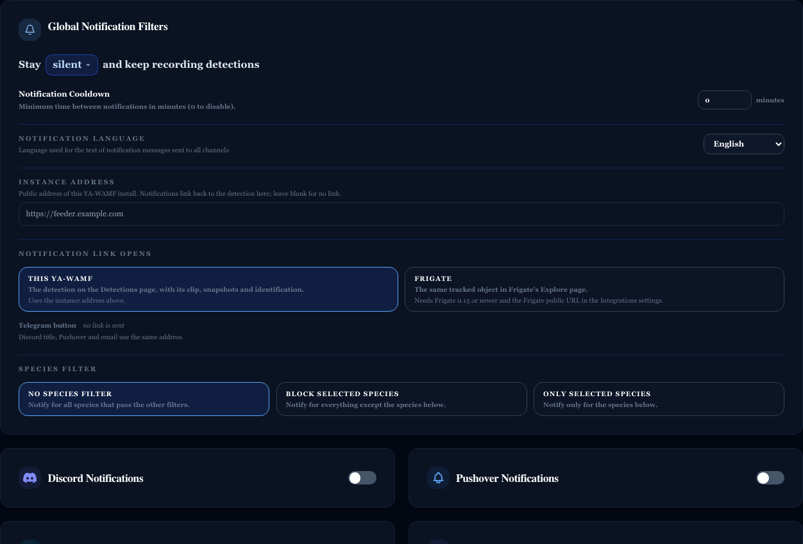
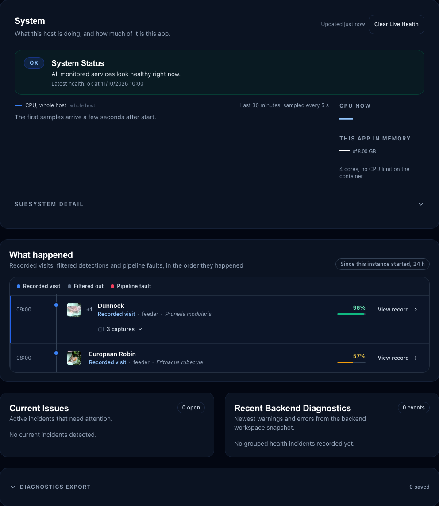
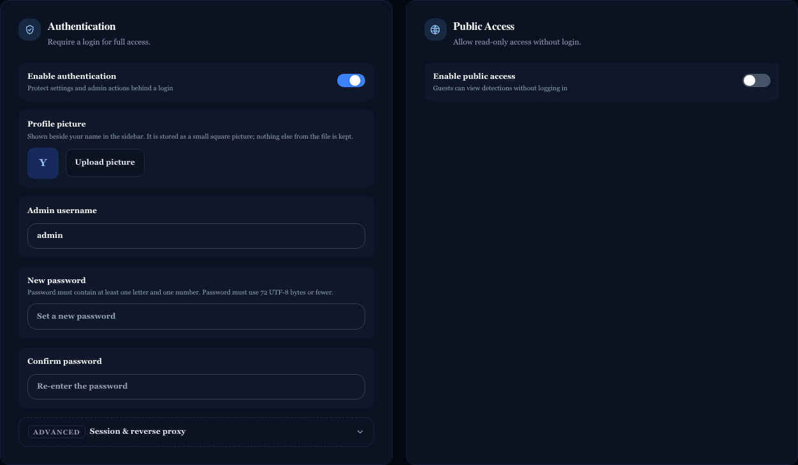
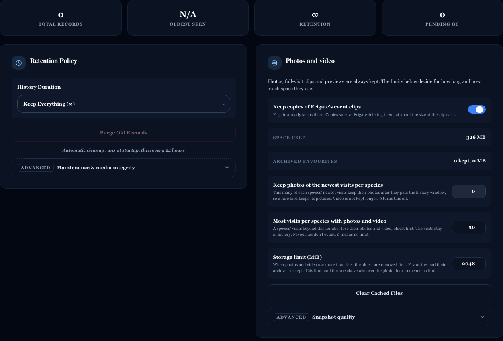
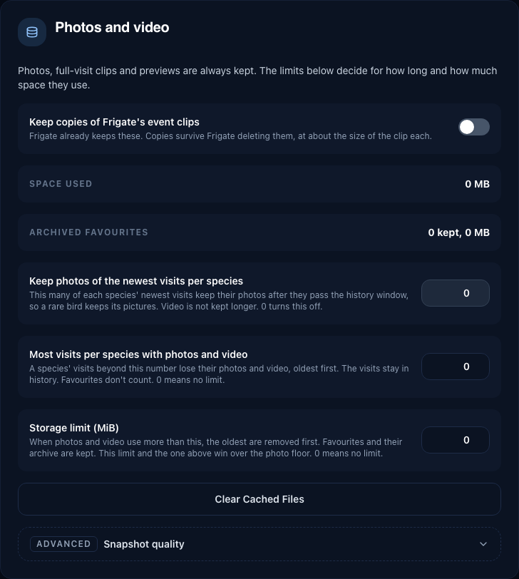

# Configuration

Configure YA-WAMF under **Settings**. Saved choices persist in `/config/config.json`;
supported [environment overrides](environment-variables.md) take precedence on restart.

## How Settings is laid out

Use the navigation grid to switch sections:

| Group | Sections | What lives there |
|---|---|---|
| **Feeder pipeline** | Connection, Detection | Where events come from, and how they are identified. |
| **Intelligence & sharing** | Integrations, Enrichment, AI, Notifications | Other services YA-WAMF talks to, and what it sends out. |
| **Operations** | Health, Security, Beta features, Data, Setup wizard | Running it: diagnostics, access, features still being tested, retention, and re-running setup. |
| **Interface** | Appearance, Accessibility | How the app looks and reads for you. |

A **Debug** section appears alongside them when debug UI is enabled (see
[Debug section](#debug-section)).

Select **Apply settings** to save form edits. Model activation, configuration import
and setup-wizard steps save immediately. Wizard saves refresh untouched fields in an
open form while preserving other unsaved edits. Remove an environment override if
you want the UI to control that field.

---

## Connection

Where bird events come from.

| Setting | Description |
|---------|-------------|
| **Server URL** | The address YA-WAMF uses to reach Frigate for snapshots and clips, for example `http://frigate:5000`. |
| **Frigate labels to act on** | Comma-separated Frigate labels that should enter the bird pipeline. Defaults to `bird`. |
| **Identify new detections from** | **Detection snapshot** (default) or a higher-resolution retained **Recording frame** with tracked-box alignment. See [initial classification images](../integrations/frigate.md#initial-classification-image). |
| **Initial identification delay (seconds)** | Shown for **Recording frame**. Wait 1 to 120 seconds (default 12) before the first read, using the latest tracked snapshot metadata received during the wait. Notifications arrive later too; saved detections are unchanged. |
| **Public Frigate URL** | The address *your browser* uses to open Frigate, when it differs from the server address above. Used for the "open in Frigate" link on a detection. |
| **Active Cameras** | Which Frigate cameras YA-WAMF monitors. **Sync Cameras** pulls the list from Frigate; **Preview** shows a live snapshot through the Frigate proxy. |
| **Camera role** | Mark each camera as a **feeder** or a **nest** camera. Nest cameras use their own de-duplication window. |
| **MQTT Broker** / **Port** / **Use Authentication** | Under **MQTT Settings (Frigate Events)**: your broker's hostname, its port (default `1883`), and optional user and pass. |
| **Fetch video clips** | Whether YA-WAMF caches Frigate's short event clip. Turn it off on a metered link. |
| **Full-visit clips** | Ask Frigate for a wider window of recording around each detection. The default window is `30` seconds before and `90` seconds after. |
| **Telemetry** | Optional anonymous usage metrics and health diagnostics, both off by default. See [Telemetry](../features/telemetry.md). |
| **Test Connection** | One staged diagnostic with two checks: **Frigate API**, then **MQTT broker publish**. It tests the values currently in the form, so you can prove a change before saving it. |

> **Full-visit clips need continuous recording.** Every selected camera needs an enabled
> FFmpeg `record` role and positive `record.continuous.days` retention. Alert or detection
> retention alone can leave the start or end of the requested window missing. Settings
> checks this coverage and names any camera that needs attention.

## Detection

How a snapshot becomes a species. This is the section that balances accuracy against noise.

| Setting | Default | Description |
|---------|---------|-------------|
| **Confidence Threshold** | `0.7` | Minimum local score for a named identification, also subject to the confidence floor, unknown-label policy and blocked-species rules. |
| **Minimum Confidence Floor** | `0.4` | Reject local image results below this score. A usable trusted Frigate sublabel can still provide the configured fallback. |
| **Trust Frigate Sublabels** | Enabled | Accept a species Frigate has already identified when local inference has nothing usable. |
| **Write Frigate Sublabel** | Enabled | Push YA-WAMF's own identification back to the Frigate event as a sublabel. |
| **Bird Model Region** | `Auto` | Override regional model selection (`Auto`, `Europe`, `North America`) for birds-only model families. |
| **Inference Provider** | `Auto` | `Auto`, `CPU`, `NVIDIA CUDA`, `Intel GPU (OpenVINO)`, `Intel CPU (OpenVINO)`, or `Intel NPU (OpenVINO)`. Only providers your image packages, your host exposes, and the active model supports are listed. |
| **Execution Mode** | `Subprocess` | `Subprocess` runs inference in isolated workers the app can restart, so a stalled or crashed classification cannot take the interface with it. `In-process` shares one model copy with the app: less memory, but heavy inference competes with the UI. |
| **Model Manager** | — | Download, validate, and activate classifier models, and the separate cropped-thumbnail detectors. |
| **Runtime diagnostics** | — | **Image**, **Packaged**, **Selected**, **Active**, device probes, backend, and any fallback reason. |
| **Auto Video Analysis** | Disabled | Analyse the clip across multiple frames after the event ends. Frame count defaults to `15`. |
| **Personalized Re-ranking** | Disabled | Use your manual corrections to re-rank future predictions for the same camera and model. |

### 🛠 How the two thresholds work together

1. **Score at or above both the threshold and floor**
   Saved with its species when the label is usable and not blocked. Optional reporting
   still follows each integration's own enablement and filters.
2. **Score between the Floor and the Threshold**
   *Saved as **Unknown Bird**.* YA-WAMF is confident something was there, but not confident
   enough to name it. The visit is kept; your species statistics stay clean.
3. **Score below the floor**
   The local result is rejected, which can exclude a real bird in an unclear image.

**Trust Frigate Sublabels** allows a usable upstream species to provide a fallback when
local inference cannot name the bird. These scores are model outputs, not calibrated
probabilities: a 70% threshold does not mean every model is correct 70% of the time.
Keep the floor at or below the threshold for a useful Unknown Bird band.

### 🎯 Personalized re-ranking details

- **Scope:** feedback is isolated by **camera + active model ID**. Corrections on one camera or
  model never affect another.
- **Activation:** re-ranking stays inactive until at least **20** manual corrections exist for
  that camera/model pair.
- **Time decay:** newer corrections outweigh older ones, so stale patterns fade.
- **Safety:** adjustments are bounded and fail open. If feedback is unavailable, YA-WAMF uses
  the base classifier scores.

> **A downloaded model is not yet a proven one.** A model that has never been validated on
> this host shows **Validate to enable** instead of **Use this model**, and the API refuses to
> activate it. Compatibility proves finite, CPU-consistent execution on this installation,
> not species accuracy. See [AI Models & Performance](../features/ai-models.md).

Registered classifiers read their ordered output names from the species catalogue, bound
to the exact model checksum. Integrated downloads need no separate `labels.txt`; legacy
or custom models can still use the file fallback. See the
[October model catalogue](../features/model-catalogue-2026-10.md) for new models, coverage
and measured tradeoffs. These additions require an application build containing their
integration; the rolling model release alone does not update an older application.

## Integrations

Other services YA-WAMF talks to. Credentials are redacted as `***REDACTED***` once saved, and
a saved credential can be re-tested without typing it again.

- **BirdNET-Go** — the audio **MQTT Topic** (default `birdnet/text`), two URLs, the audio buffer
  and match window, and **BirdNET Source Mapping (Optional)**, which ties each audio source to a
  Frigate camera. **BirdNET-Go internal URL** is the address the backend uses to fetch
  spectrograms (usually the Docker network name); **BirdNET-Go browser URL** is the public
  address dashboard links open, and falls back to the internal one when empty. **Test Audio
  detection** runs the broker publish and a mock detection through the real pipeline. See
  [BirdNET-Go](../integrations/birdnet-go.md).
- **BirdWeather** — enter your Station Token to contribute identified detections to the
  community project. **Test connection** sends a mock House Sparrow to your station.
- **eBird** — an API key enables nearby and notable sightings. Enable the integration to show
  the CSV export controls here; exporting your detections does not require an API key.
- **iNaturalist** — owner-reviewed submissions over OAuth. Needs App Owner approval from
  iNaturalist first.
- **Home Assistant weather** — use selected HA sensors instead of a regional forecast.
  Readings are reused for up to 30 seconds; unavailable sensors stay unknown rather
  than borrowing forecast values. See [Home Assistant](../integrations/home-assistant.md).
- **Location** — your latitude and longitude for weather enrichment and location-aware classifiers such as DINOv2, optional `state` and
  `country` values for the eBird export, and **Display Units** (`Metric`, `Imperial`, or
  `British` for °C with mph and mm). Distances elsewhere in the UI follow this choice.
  DINOv2 uses both saved coordinates, including a valid zero, or neutral metadata when
  either is absent/invalid. It does not receive a capture date or location uncertainty.
  Saving changed coordinates reloads the classifier workers. This is the same location
  configured in the model step of the setup wizard.

## Enrichment

A read-only summary of which source currently answers each question about a species. It exists
so you can see, in one place, where the description on a species card came from.

| Question | Default source |
|---|---|
| **Summary** | Wikipedia |
| **Taxonomy and common names** | iNaturalist |
| **Nearby sightings** | Disabled |
| **Seasonality** | Disabled |
| **Rarity** | Disabled |
| **External links** | Wikipedia and iNaturalist |

Each source is `wikipedia`, `inaturalist`, `ebird`, or `disabled`. There are no controls on
this page: the choices are made with the `ENRICHMENT__*` environment variables or the
`enrichment` block in `config.json`. `ENRICHMENT__MODE` is `per_enrichment` (the default, one
source per question) or `single` (one source, named by `ENRICHMENT__SINGLE_PROVIDER`, for
everything). See [Environment variables](environment-variables.md).

## AI

Connect a Large Language Model for the naturalist notes on a detection and the chart analysis
on the leaderboard.

- **Provider:** Google Gemini (default), OpenAI, Claude, or OpenRouter.
- **Model:** the UI lists current presets per provider and shows the recommended one.
  OpenRouter also accepts any model ID you type.
- **Test AI Connection:** a staged panel that checks configuration, provider availability,
  vision support, multi-frame admission, and response generation. It sends five generated
  1280×720 frames to check that the provider accepts a multi-frame image request. A pass
  confirms this test request succeeded; it does not guarantee every later analysis will succeed.
- **Usage:** calls, tokens, and estimated cost per feature, with the reference pricing the
  estimate used.

## Notifications

Where alerts go, and which detections earn one.

The filter reads as a sentence — *Tell me about **new visits** that are at least **70% sure**
of **any species** on **Discord*** — and each highlighted part is a control.

| Control | Default | Description |
|---|---|---|
| **Notification mode** | Standard | `Final-only`, `Standard`, `Realtime`, `Silent`, or `Advanced (custom)` triggers. |
| **Minimum confidence** | `0.7` | Only notify at or above this score. Raise it to reduce alerts for lower-confidence identifications. |
| **Audio confirmed only** | Off | Notify only when BirdNET-Go heard the same species within the configured correlation window. |
| **Species filter** | No species filter | `No species filter`, `Block selected species`, or `Only selected species`. |
| **Notification cooldown** | `0` minutes | Minimum gap between notifications. `0` disables the cooldown. |
| **Notification language** | English | The language used in message text, independent of the UI language. |
| **Instance address** | _(blank)_ | The address you use to open YA-WAMF. When set, every notification links to the detection it announces; blank means no link. |
| **Notification link opens** | This YA-WAMF | `This YA-WAMF` opens the detection here; `Frigate` opens the tracked object in Frigate's Explore page via **Public Frigate URL** under **Connection** (Frigate 0.15+). |

Destinations are Discord, Pushover, Telegram, and Email (Gmail/Outlook OAuth or plain SMTP).
See [Notifications](../features/notifications.md) for per-platform setup.

## Health

Inspect system load, service health, frame decisions, inference and naming sources,
or download a support bundle. **System** shows the last thirty minutes of load and
YA-WAMF process usage; unrelated processes are grouped as **Other on this host**.
Accelerator labels state whether usage covers this app or the whole device.
An unreadable counter is reported explicitly.

This is the first place to look when detections stop arriving or the interface feels slow. See
[Diagnostics & Logs](../troubleshooting/diagnostics.md).

## Security

Who can reach YA-WAMF, and what a visitor can see.

- **Authentication** — enable login, set the owner username and password, and choose the
  session lifetime. Saved passwords display as `***REDACTED***` and are preserved when you
  save other settings.
- **Public Access** — a read-only, rate-limited guest view. **Show camera names**, **Share
  audio**, **Share photographs**, and **Share video** are separate switches, all enforced at
  the server. You also choose how far back the public history reaches. Public history and
  media windows use UTC calendar days; “today only” runs from 00:00 UTC to the next midnight,
  independent of the server timezone and local capture-time display.
- **Trusted Proxy Hosts** — if you run behind a reverse proxy, list its IPs, CIDR ranges, or
  container/DNS names so client IP addresses are trusted correctly.

> **Enable authentication before you expose YA-WAMF beyond your own network.** The UI and API
> are administrative surfaces. See [Authentication & Access](../features/authentication.md).

See [Reverse Proxy](reverse-proxy.md) for routing, HTTPS headers and live-stream requirements.

## Beta features

Features that are still being tested. Each is off until you turn it on, and may change
or be removed.

| Setting | What it does |
|---------|-------------|
| **Garden animals** | Off by default (`SYSTEM__BETA_GARDEN_ANIMALS`). Collects non-bird visitors for owner review, separately from bird history. Turning it off stops collection and hides Garden; saved captures and the settings below are kept. See [Garden animals](../features/garden-animals.md). |
| **Cameras to watch** | Per-camera opt-in, none by default (`frigate.garden_cameras: []`). Independent of the camera's Feeder or Nest bird role, which stays in Connection. The camera list comes from **Connection → Sync Cameras**. |
| **Collect motion review photos** | Additional opt-in for a watched camera, off by default (`frigate.garden_motion_cameras: []`). Requires retained motion recordings and the Cedar download. Bounded CPU scans create private review candidates. |
| **Frigate animal labels** | Defaults to `cat, dog`. Animal labels for Garden review; the Frigate detector must already track them. Birds, people and vehicles are excluded. |
| **Animal proposal threshold** | Cedar's minimum animal score for new motion photos, 0.5 to 0.95 (default 0.5, `FRIGATE__GARDEN_MOTION_CONFIDENCE`). Higher values reduce proposals but can miss animals. Existing photos are not reclassified. |
| **Name animals automatically** | On by default (`FRIGATE__GARDEN_AUTOMATIC_NAMING`). Confirms and names an animal when the automatic check's species score reaches the naming threshold, marked as automatic. Off: every animal waits for your review. |
| **Naming threshold** | 0.7 to 0.99 (default 0.8, `FRIGATE__GARDEN_NAMING_THRESHOLD`). Higher values name fewer animals and leave more for you. Existing captures are not renamed. |

## Data

Retention, caching, imports, and the destructive tools.

- **Retention Policy** — **History Duration** sets how long sightings are kept
  (`maintenance.retention_days`; **Keep Everything (∞)** is the default). Cleanup runs once at
  startup and then every 24 hours from that point, so the time of day it lands on follows when the
  container last started. **Purge Old Records** runs the same cleanup now, after asking with the
  number of detections it will remove. Cleanup **permanently deletes** both visual detections and
  BirdNET-Go audio older than the window. Purged history cannot be recovered. Favourited
  detections stay. The optional per-species minimum also protects the newest configured
  number of detections per species and their photographs from age cleanup; its default
  is `0`, so there is no species floor until you set one. It does not protect clips.
  The **Advanced → Maintenance & media integrity** disclosure holds the periodic re-check against
  Frigate and what to do when upstream media has gone.
  A failed event lookup is reported as an unsuccessful check, not missing media. Timeouts,
  authentication errors, server errors and unusable responses preserve the saved state for a
  later retry. A manual scan can clear an earlier missing flag only after confirming the media.
  Automatic missing-media deletion checks favourites in its final database decision. A favourite
  accepted before that decision keeps its detection and cached photos, even if a scan is running.
- **Photos and video** — photographs, full-visit clips and previews are YA-WAMF's own record and are
  always kept, within the retention and size limits; Frigate may delete its copies much sooner.
  **Keep copies of Frigate's event clips** is the one choice, because Frigate already holds those.
  If the media folder cannot be written, the card, system checks and `/health` say so. On upgrade
  from a build with retired media switches off, best-available snapshots and possibly
  full-visit clips are turned off once. Review those choices and follow the
  [one-time migration steps](../../MIGRATION.md#retired-media-switches).
  **Clear Cached Files** asks first, then deletes cached media older than the retention
  period and cached files that no longer belong to a detection. Favourites and each species'
  newest visits covered by a configured minimum are protected from age cleanup; the
  minimum protects photographs, not clips. Photo variants and metadata age together.
  `media_cache.retention_days=0` follows detection retention; it does not independently mean
  unlimited when history retention is finite.
- **Best available event snapshots** — start from Frigate's completed clean best frame and
  tracked-object crop, then sample high-quality clip frames. A clip frame replaces the baseline
  only when a compatible species result improves confidence by at least two points. JPEG quality
  is configurable; crop source selection is automatic. A reliable matching portrait can win
  when its species confidence is within five points of the whole scene. A stale cropped photograph
  cannot block a newer confidently matching frame. A photo chosen by the owner stays chosen until
  they explicitly regenerate or choose another one.
- **Automatically find additional birds** — off by default, including upgrades. Normal target
  identification and photo selection continue; the optional wider search, additional crop
  classifications and count rechecks run only when enabled. Existing counts are kept when you
  turn this off. Enable it under **Settings → Data → Snapshot quality** to scan retained whole
  frames automatically. This also works with **Best available event snapshots** off when video
  processing retains a whole frame.
  To scan one photograph, open it as the owner and choose **Find more birds**. The action scans
  the retained whole frame from that photo's exact recording moment, without changing the chosen
  photo or primary species. A cropped Frigate image, thumbnail or expired scene is insufficient;
  the control explains when a whole frame is unavailable. Scans run one at a time and survive
  a restart. A completed scan with no birds is distinct from a photo never scanned. An empty
  retry keeps earlier counted-bird records and says so.
- **Bird scanning effort** — applies to automatic and requested additional-bird scans. **Standard** uses one detector scan per sampled frame and up to three
  classified crop choices. **Intensive** additionally searches nine overlapping tiles in large
  high-resolution frames and classifies up to eight crop choices. Intensive remains the effort default; automatic scanning is off unless enabled. Both count all usable detector boxes from the selected scene;
  neither promises to find every bird in the clip, and uncertain species remain Unknown Bird.
  Regeneration preserves per-bird corrections and exclusions, retaining the existing
  frame when a reviewed bird cannot be matched safely. This does not track individual
  birds between frames. See [Video analysis](../features/video-analysis.md).

- **Most visits per species with photos and video** — keep media for the newest configured number of visits
  of each canonical species. Favourites are exempt. `0` means unlimited. This removes cached media,
  including alternate photos and clips, while keeping visits and counted-bird records.
- **Storage limit (MiB)** — periodically remove the oldest non-favourite cached visits until
  ordinary cached snapshots, choices, thumbnails, clips, previews and metadata fit the budget.
  `0` means unlimited. Favourites and their archive are protected; active work is deferred, so the
  cache can temporarily exceed the budget, or stay above it if protected media alone exceed it.
  Limits run at startup and every five minutes, and when **Clear Cached Files** is used. The budget
  and species maximum take priority over the minimum kept through age cleanup.
  Orphaned published files are retried on the same schedule even with both limits at
  `0`; active writes, referenced files and favourite archives are protected.

  Environment equivalents are `MEDIA_CACHE__AUTOMATIC_MULTI_BIRD_SCAN=true|false`,
  `MEDIA_CACHE__BIRD_SCAN_MODE=standard|intensive`,
  `MEDIA_CACHE__PER_SPECIES_MAXIMUM=0..10000`, and `MEDIA_CACHE__MAX_SIZE_MB=0..1048576`.
  Models, backups, and archived favourites do not count towards the ordinary cache budget.
- **Missed Detections** — import bird events Frigate still retains, over a day, week, month, or a
  custom range. Import is idempotent by Frigate event ID, so running it twice is safe.
  Photo requests are saved when the memory queue is full and recovered after a restart. A finished
  detection import can still have photo work pending in Jobs. Saved counters survive a restart;
  an interrupted import is marked failed rather than reported as completed. Restarting the import
  is explicit. Historical missing photo output is checked in pages of 100 every five minutes,
  with bounded retries when Frigate no longer retains the source media.
- **Batch Analysis** — re-run classification over detections currently saved as Unknown Bird,
  either on demand or automatically each day.
- **Taxonomy Repair** — normalise species names across your whole history against iNaturalist.
  It fills in missing names only and commits each detection as it goes, so live detections keep
  saving while it waits on lookups.
- **Timezone Repair** — owner-only fix for legacy detections affected by a UTC timestamp shift.
  It previews the change first and needs explicit confirmation, and it is only offered when
  affected rows exist.
- **Migration backups** — before applying database migrations YA-WAMF writes a timestamped
  restore point beside `speciesid.db`, keeping the newest 10 by default. Set
  `DB_PRE_MIGRATION_BACKUP_RETENTION` to keep more. At least one restore point is always kept,
  and manual backups are never removed.

> **These actions permanently delete data.** **Reset Database & Cache** permanently deletes
> *every* detection and clears the media cache; **Clear Personalization Data** deletes every
> manual correction the re-ranker learned from. Both ask first in YA-WAMF's own confirmation
> dialog, and neither can be undone. There
> is no automatic backup tied to these actions. Take a backup of `/data` and `/config` before
> using them; migration restore points may not contain your latest history.

### Maintenance concurrency

`maintenance_max_concurrent` (default `1`) controls how many jobs of the *same* maintenance
kind may overlap — backfill, weather backfill, video classification, taxonomy repair, timezone
repair, and analyse-unknowns each get that many slots. Different kinds already run
independently, subject to `maintenance.total_max_concurrent` (default `3`) across all kinds.
`maintenance.per_kind_capacity` can override the limit for an individual kind. Keep the per-kind
default at `1` to limit competition with live event processing.

Video-analysis concurrency is separate, and no longer has its own setting. It follows the
background worker count (`CLASSIFICATION__BACKGROUND_WORKER_COUNT`) — one clip per worker.
`video_classification_max_concurrent` remains readable and writable for compatibility, but is
ignored.

## Appearance

How the interface reads.

| Setting | Options |
|---|---|
| **Bird Naming Style** | **Standard** (common name primary, scientific subtitle), **Hobbyist** (scientific primary, common subtitle), or **Strictly Scientific** (scientific only). |
| **Explorer view** | **Cards** shows a snapshot per detection; **List** shows one compact row each, with times aligned for scanning. |
| **Theme** | Light or dark, plus the colour and font themes. |
| **Text size** | Smallest (75%), Smaller (81%), **Standard** (87.5%, default), Large (100%), Larger (112.5%), Extra large (125%) or Largest (150%). Saved separately on each device. |
| **Language** | The interface language. Notifications have their own language setting. |
| **Date format** | Follow browser language (default), United Kingdom (DD/MM/YYYY), United States (MM/DD/YYYY), or Japan/China (YYYY-MM-DD). Date and time choices are saved independently. |
| **Time format** | 12 hour, 24 hour, or **Follow browser language**. |

## Accessibility

- **High contrast**, **Dyslexia-friendly font**, and **Reduced motion** for readability and
  motion sensitivity.
- **Live announcements** — screen reader announcements when new detections arrive.

## Setup wizard

Reopens guided setup as a section map. Completing, skipping, or backing out of a section
returns to the map. Continuing saves that section; it does not reset unrelated settings.
**Skip step** leaves the remaining choices unsaved. A location saved before a hardware
check stays saved if you leave, and leaving does not cancel the running backend check.
See [first-run setup](getting-started.md#4-verify) for provider and location behaviour.

## Debug section

Optional developer tools, hidden unless you enable them:

- Environment variable: `SYSTEM__DEBUG_UI_ENABLED=true`
- Config file: `"system": { "debug_ui_enabled": true }`
- Compose: `DEBUG_UI_ENABLED=true`

This reveals a **Debug** section in the Settings navigation, holding things like the
iNaturalist preview toggle and the LLM prompt editors.
