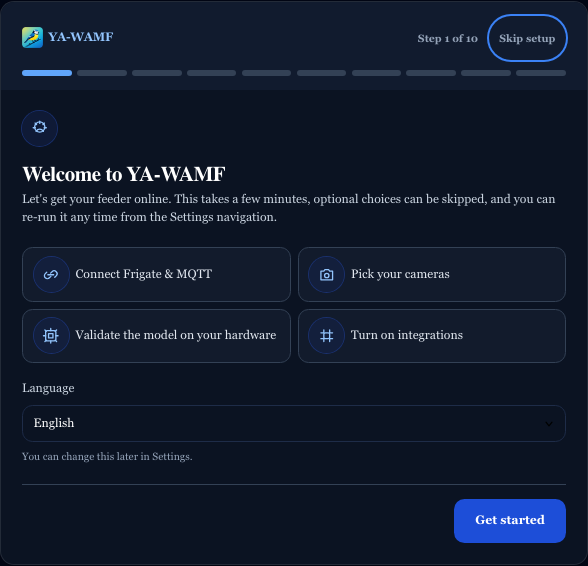
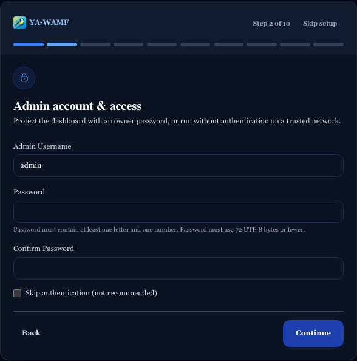
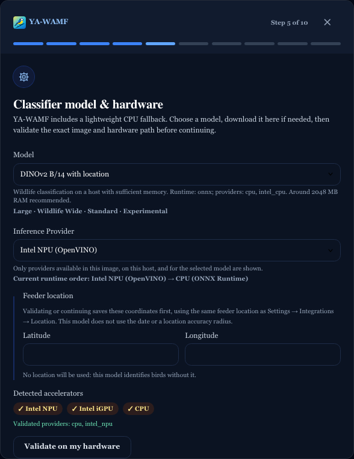
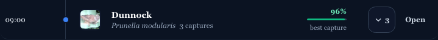
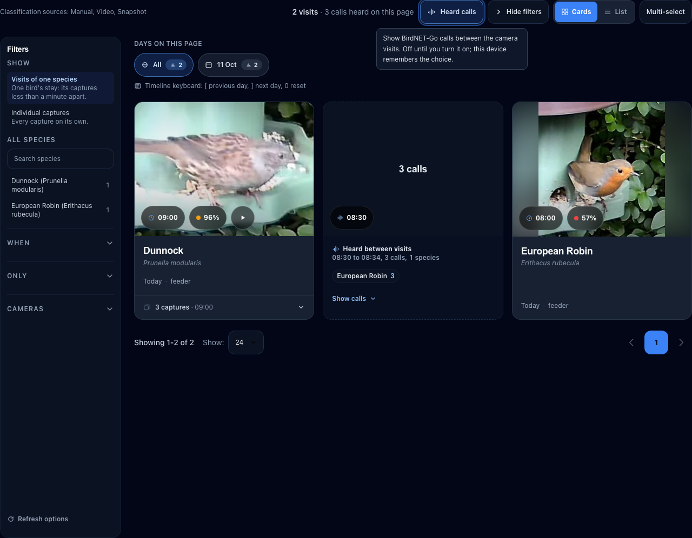

# Getting Started

Install YA-WAMF with Docker Compose, connect it to Frigate and MQTT, and verify your
first saved bird visit. For a stable image, use documentation at its matching release tag.

Use the single-container deployment, `ghcr.io/jellman86/yawamf-monalithic`.
Existing split installations can follow [the migration guide](migrate-split-to-monolith.md).
For Raspberry Pi 4/5, use [the ARM64 setup](raspberry-pi.md).

## Prerequisites

- Docker and Docker Compose.
- A reachable Frigate NVR, connected to an MQTT broker.
- For optional GPU/NPU inference, complete [hardware setup](hardware-acceleration.md)
  before the wizard's compatibility check.

## Quick Install

### 1. Download the core files

```bash
mkdir ya-wamf && cd ya-wamf
curl -fLO https://raw.githubusercontent.com/Jellman86/YetAnother-WhosAtMyFeeder/main/docker-compose.monolith.yml
curl -fLO https://raw.githubusercontent.com/Jellman86/YetAnother-WhosAtMyFeeder/main/.env.example
cp .env.example .env
```

### 2. Configure Environment

Edit `.env` with your connection details:

| Variable | What to enter |
|---|---|
| `DOCKER_NETWORK` | Existing Docker network used by Frigate. Container names need a shared user-defined network. |
| `FRIGATE_URL` | Reachable Frigate API URL, for example `http://192.168.1.10:5000`. |
| `MQTT_SERVER` | Broker hostname or IP; set its port and credentials if needed. |
| `PUID` / `PGID` | Your host user's numeric UID/GID; prepare writable directories below. |
| `TZ` | Your local timezone, for example `Europe/London`. |

Keep `YAWAMF_MONALITHIC_TAG=latest` for stable releases; use `dev` only for
development builds. After the first successful start, you can
[choose a smaller provider-specific image](hardware-acceleration.md#choose-an-image-flavor).
See [Environment variables](environment-variables.md) for other overrides.

#### Prepare non-root permissions

From your stack directory:

```bash
mkdir -p config data
PUID=$(id -u)
PGID=$(id -g)
echo "PUID=$PUID"
echo "PGID=$PGID"
sudo chown -R "$PUID:$PGID" config data
sudo chmod -R u+rwX,g+rwX config data
```

Copy the printed numbers into `.env`. Compose uses them in `user:`; incorrect
ownership prevents settings, database and media writes. For custom host mounts,
prepare those actual directories instead.

### 3. Launch

```bash
docker compose -f docker-compose.monolith.yml up -d
```

In Portainer, create a Stack from the same Compose file and supply its environment
values. Use that platform's redeploy workflow for later updates.

### 4. Verify

Open `http://<your-ip>:9852`. A fresh installation opens the setup wizard:



Set an owner password in **Admin account & access** before exposing YA-WAMF
outside your trusted network. Later account changes belong in **Settings → Security**;
first-run account setup cannot be reused.



Follow the connection, cameras, model and optional integration steps. Connection
tests use the values in the form. Optional history import runs in **Jobs** after
setup and can recover only bird events Frigate still retains, not missing BirdNET-Go audio.

In **Classifier model & hardware**, download missing models before validating them.
**Continue** waits for the check to finish. It measures provider compatibility and
speed, not species accuracy; review any fallback explanation. After setup, check
**Settings → Detection → Runtime diagnostics** for the actual active provider.



For **Feeder location**, enter both coordinates or leave both empty; zero is valid.
These are the same saved coordinates used in [Location settings](configuration.md#integrations).
Integrated models need no separate `labels.txt`.

**Continue** saves each section; **Skip step** leaves its remaining choices unsaved.
Leaving a hardware check does not cancel it or undo coordinates already saved.
Reopen **Settings → Setup wizard** later to review individual sections.

**You should see:** the **Dashboard**, with last-24-hour counts and a field log.
The log stays empty until Frigate sends a bird event.


Frigate can send several captures of one bird at a feeder. YA-WAMF groups them into
**visits** for the field log and leaderboard:



**3 captures** means three captures grouped into that visit. Choose its time to
expand them, or **Open** to see the photograph. Use **Explorer** (headed **Events**)
to filter visits by time, species, camera, favourites and audio matches.
See [Explorer](../features/explorer.md) for grouping and review controls.



**If nothing appears:** check the container logs and confirm Frigate publishes to
`frigate/events`. See [Diagnostics](../troubleshooting/diagnostics.md).

### 5. (Optional) Share a read-only public view

Set an owner password, then enable **Settings → Security → Public Access** and
review the separate media and history permissions. Follow
[Authentication & Access](../features/authentication.md) before sharing the URL.

## Timezone and clock

`TZ` controls server-local time. Keep host clocks synchronised: audio correlation
uses UTC timestamps, so matching display timezones cannot correct a wrong clock.
Guest history/media windows use UTC calendar days.

## Data Persistence

Keep both mounts on persistent storage:

- `/config`: settings and credentials in `config.json`, plus retained photographs
  and clips in the default `media_cache/` directory.
- `/data`: detection history, species catalogue, models, manual-observation uploads
  and migration backups.

If you override `MEDIA_CACHE_DIR`, persist and back up that directory too.
Photographs and generated visit media follow your [retention and size limits](configuration.md#data);
Frigate event-clip copies are optional. Keep mounts unchanged and back up both
before upgrades or destructive maintenance. See [the upgrade guide](../../MIGRATION.md).
