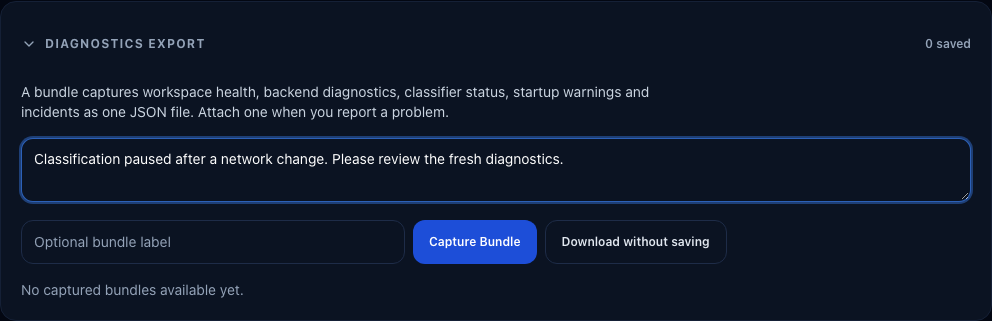

# Troubleshooting & Diagnostics

If detections or integrations are misbehaving, start at **Settings → Health**. It reports live
system status, what happened to every recent frame and why it was or was not recorded, inference
health, where your species names come from, and it is where you capture a diagnostics bundle to
attach to a bug report.


## Capture current evidence for a report

1. Sign in as the owner and open **Settings → Health**. The **Health · Diagnostics export** link
   under **Notifications → Jobs** takes you to the same page.
2. Expand **Diagnostics export** and add the approximate time, camera, action and expected result
   in the notes. Include recent network or camera changes when relevant.
3. Select **Capture Bundle** to save a named bundle in this browser, or **Download without saving**
   to download one immediately.
4. Check the capture time and attach the JSON file to the report after reviewing its contents.



Both actions request fresh server health, classifier status, startup warnings and backend
incident evidence even when the browser has no local errors. If that refresh fails, the export
shows an error; a saved older bundle remains its original snapshot rather than becoming fresh
because you downloaded it again. Saved bundles can be downloaded while the server is unavailable.
The direct server endpoint is `GET /api/diagnostics/bundle` and requires owner access; public
visitors cannot export it. An instance with authentication disabled treats visitors as owners,
so enable authentication before exposing it remotely.

Notes are included in the file. Redacted settings do not make everything you type private: omit
credentials and review event identifiers, camera names and other operational context before
posting publicly. Diagnostics export is a deliberate local download, separate from optional
anonymous health reporting; it does not automatically send a support report.

## Container startup takes time

The monolithic container serves the YA-WAMF web shell before the backend is ready. During startup,
the service screen shows the current phase and phase-based progress while YA-WAMF:

1. checks which inference hardware is available
2. loads the selected bird model and runs its bounded accelerator self-test when applicable
3. prepares the detection database
4. starts event, media, notification, and maintenance services

This is not the full hardware-validation sweep. YA-WAMF runs that larger, multi-model comparison
only when you start it from setup or diagnostics. The synthetic accelerated-versus-CPU startup
benchmark is also off by default unless you set `CLASSIFIER_RUNTIME_BENCHMARK_ENABLED=true`.

To inspect the same non-sensitive status outside the browser:

```bash
curl -fsS http://localhost:9852/startup-status.json
```

The progress percentage represents completed startup phases, not an elapsed-time estimate. If the
screen reports a startup issue or switches to **Not responding**, check the container health and
startup logs; the UI keeps a failed startup distinct from normal model-loading work.

`model_unavailable` is recoverable: the web/backend startup continues so an owner can open the
setup wizard, keep the bundled MobileNet fallback, or download and validate another model. It does
not mean a missing classifier was reported as ready. Published images are gated by a model-load and
inference smoke test, so seeing this phase on a clean image should be treated as a model/storage
problem and included in a diagnostic bundle.

## Which build is this container?

Every published image carries its commit in an OCI label, so you can name the exact build
without opening the app:

```bash
docker inspect yawamf-monalithic \
  --format '{{index .Config.Labels "org.opencontainers.image.revision"}} {{index .Config.Labels "org.opencontainers.image.version"}} {{index .Config.Labels "io.yawamf.image.flavor"}}'
```

You should see the full git SHA, the base version, and the image flavour (`full`, `cpu`,
`intel`, `cuda`, or `rpi`). `GET /api/version` reports the same commit in short form. Quote the
SHA in a bug report alongside the diagnostics bundle.

The in-app update prompt does not read these labels: it compares the commit baked in at build
time with the newest published commit for your channel.

## MQTT pipeline
If detections are not appearing, prove the path from Frigate to the broker:

1. Go to **Settings → Connection**.
2. Select **Test Connection**. It runs two stages: **Frigate API**, then **MQTT broker publish**.
   The probe uses the values currently in the form, so you can test an edit before saving it.
3. Check the backend logs. You should see "Published MQTT message".
4. Use an external tool like `mosquitto_sub` to confirm the message reached the broker:
   ```bash
   mosquitto_sub -h localhost -t "yawamf/test" -v
   ```

**If it fails at the MQTT stage:** the broker hostname, port, or credentials are wrong, or the
container cannot reach the broker on the Docker network. See
[MQTT Broker Setup](../setup/mqtt-broker.md).

## 🔊 Audio Correlation Issues
If camera visits appear but never have the **Audio confirmed** badge:

1.  **Check the mapped source:** Open **Settings → Integrations → BirdNET-Go → Audio buffer &
    sensor mapping** and inspect **Recently Detected BirdNET Sources**. Map the camera to the stable
    source name that is actually arriving; multiple names can be comma-separated. A blank mapping
    is not a wildcard, and a different microphone's call does not confirm this camera's visit.
2.  **Verify clocks and timestamps:** Confirm Frigate and BirdNET-Go report the correct moment, with
    Unix timestamps or ISO timestamps carrying the intended offset. YA-WAMF compares times in UTC;
    a different display `TZ` alone does not break correlation. A timestamp without an offset is
    interpreted as UTC, so a sender incorrectly emitting local wall time can shift the match.
    Keep host clocks synchronised.
3.  **Buffer Window:** Correlation only works for events within your configured `audio_correlation_window_seconds` (default ±300 seconds).

## 🌐 Network Connectivity
Since YA-WAMF runs in a Docker network, it must be able to reach your other services. You can test this from inside the container:

```bash
# Test connection to Frigate (monolithic deployment)
docker exec yawamf-monalithic curl -fsS http://frigate:5000/api/version

# Test connection to MQTT
docker exec yawamf-monalithic ping -c 1 mosquitto
```

Replace `yawamf-monalithic` with `yawamf-backend` if you are on the legacy split deployment.

A shared Docker network is one option; a reachable LAN address is another. Check the addresses
saved in YA-WAMF, container DNS, routing and firewall rules. A successful ping does not prove that
MQTT authentication or its TCP port works; use **Test Connection** for that check. After a switch,
PoE supply or camera change, compare the error times with that outage and verify fresh Frigate
frames before treating old connectivity incidents as an active classifier fault.

## 🔒 Permission Issues
If you see `PermissionError` in your backend logs or the container fails to start after an update:

1.  **Get exact UID/GID values to use:**
    ```bash
    id -u
    id -g
    ```
2.  **Set `.env` values to match those exact numbers:**
    ```env
    PUID=1000
    PGID=1000
    ```
3.  **Fix host directory ownership/permissions:**
    ```bash
    mkdir -p config data
    sudo chown -R "${PUID}:${PGID}" config data
    sudo chmod -R u+rwX,g+rwX config data
    ```
4.  **Verify your compose/stack mounts and user are correct:**
    ```yaml
    services:
      backend:
        user: "${PUID}:${PGID}"
        volumes:
          - ./config:/config
          - ./data:/data
    ```
5.  **Test write access from inside the running container:**
    ```bash
    # Monolithic deployment:
    docker compose exec yawamf sh -lc 'id && ls -ld /config /data && touch /data/.perm_test && rm -f /data/.perm_test'
    # Legacy split deployment:
    # docker compose exec yawamf-backend sh -lc 'id && ls -ld /config /data && touch /data/.perm_test && rm -f /data/.perm_test'
    ```
6.  **Check logs for remaining denials:**
    ```bash
    # Monolithic deployment:
    docker compose -f docker-compose.monolith.yml logs yawamf | grep -n "Permission denied\|EACCES"
    # Legacy split deployment:
    # docker compose logs yawamf-backend | grep -n "Permission denied\|EACCES"
    ```

If step 5 fails, the most common cause is editing one path but mounting a different host path in Portainer. Fix ownership on the actual mounted source path shown in the stack volume mapping.

## ⚡ Inference acceleration diagnostics

YA-WAMF exposes image, runtime, and device diagnostics under
**Settings → Detection → Runtime diagnostics** and at
`GET /api/classifier/status`.

### What to check first (UI)

Check these in order:

- **Image** — the packaged runtime family (`full`, `cpu`, `intel`, `cuda`, or `rpi`)
- **Packaged** — providers intentionally included in that image
- **CUDA**, **OpenVINO**, **Intel GPU**, and **Intel NPU** — runtime/device probe results
- **Selected** — the saved provider preference
- **Active** and **Backend** — what the loaded model is actually using
- **Fallback** or the image/provider mismatch warning
- **OpenVINO diagnostics** — shown when OpenVINO is unavailable or a device plugin fails

This usually tells you whether the problem is:

- an image that does not package the selected runtime
- missing runtime/library support inside a matching image
- device pass-through (`/dev/dri`)
- group permissions
- provider fallback at runtime

### Quick API check

On an authenticated instance, use an owner bearer token for protected API requests, as described
in the [API authentication reference](../api.md#authentication). Do not paste tokens into a public
report. The examples below show service addresses without credentials.

From the host (monolithic deployment):

```bash
curl -fsS http://localhost:9852/api/classifier/status
```

From inside the Docker network or within the container (monolithic):

```bash
docker exec yawamf-monalithic curl -fsS http://127.0.0.1:8000/api/classifier/status
```

Legacy split deployment (from the Docker network):

```bash
curl -fsS http://yawamf-backend:8000/api/classifier/status
```

The status response names the image family in `image_flavor`, eligible providers in
`packaged_inference_providers` and any image/provider mismatch in `image_flavor_warning`.
It also includes host probes, worker evidence, fallback reasons and model-install warnings. **Selected** is a preference;
**Active** needs a loaded worker. A planned provider has not established actual inference yet.

For `selected_provider_not_packaged`, switch to the matching image using the
[safe flavour procedure](../setup/hardware-acceleration.md#switch-safely-between-flavors).
For model-config or mapping warnings, repair the download in **Model Manager** and validate again.
Do not install packages into the running container or copy labels from another model.

See [model validation](../features/ai-models.md#validate-before-you-select-post-install-gate) for
installation-specific evidence and [DINOv2 location and catalogue labels](../features/ai-models.md#october-experimental-options)
for their input requirements. A compatibility pass does not establish species accuracy.

### Intel iGPU (OpenVINO) checklist

Replace `yawamf-monalithic` below with `yawamf-backend` if you are on the legacy split deployment.

1. **Confirm the image packages OpenVINO.** **Image** must be `full` or `intel`,
   and **Packaged** must include `intel_gpu`. If not, switch image before
   debugging the device.
2. **Confirm `/dev/dri` is mounted**
   ```bash
   docker exec yawamf-monalithic sh -lc 'ls -l /dev/dri'
   ```
3. **Confirm container user/group can access the device nodes**
   ```bash
   docker exec yawamf-monalithic sh -lc 'id && ls -ln /dev/dri'
   ```
   The backend user/group list must include the numeric GIDs shown on `/dev/dri/card0` and `/dev/dri/renderD128` (often `video`/`render`, but IDs vary by host).
4. **Check OpenVINO GPU plugin errors**
   - If `openvino_gpu_probe_error` mentions `libOpenCL.so.1`, the image is missing OpenCL runtime libraries.
   - If it reports no supported devices, the Intel GPU userspace/driver stack is not available to the container.

### ConvNeXt reports unsupported ONNX sequence operators

`SequenceEmpty`, `SequenceInsert` or `ConcatFromSequence` can indicate an older export/runtime
combination. Update to a matching application image and repair the model through **Model Manager**,
then validate again. Current registered model identities are bound to the weights checksum;
patching the active graph in place can invalidate its catalogue mapping and install integrity.
Keep any old export and report the model checksum and runtime rather than silently replacing its
operators on a running feeder. The source patch script is a maintainer tool for reviewed exports,
not a substitute for installing the published artifact.

### NVIDIA CUDA checklist

1. **Confirm the image packages CUDA.** **Image** must be `full` or `cuda`, and
   **Packaged** must include `cuda`.
2. **Confirm CUDA status fields**
   - `cuda_provider_installed: true`
   - `cuda_available: true`
3. **Confirm container GPU passthrough is configured**
   - Docker host has **NVIDIA Container Toolkit** installed
   - Backend container is started with NVIDIA GPU access (`gpus: all` or equivalent runtime settings)
4. **If `cuda_provider_installed=true` but `cuda_available=false`**
   - The CUDA-capable ONNX Runtime wheel is present, but YA-WAMF could not access a real NVIDIA CUDA device.
5. **If `cuda_available=true` but `Active` falls back to CPU**
   - YA-WAMF now validates the actual ONNX Runtime session providers and will report a CPU fallback if the session initializes without `CUDAExecutionProvider`.
6. **Native Windows inference fails after CUDA loaded successfully**
   - The packaged NVIDIA DLL directories are added to the application's own search path before preloading. This lets cuDNN find the additional libraries it loads during inference, without changing the host's saved environment.
   - A failed CUDA execution is passed to the application's recovery policy. During inference, ONNX Runtime cannot silently retry the whole session on CPU and have that work reported as CUDA. CPU execution for individual unsupported graph nodes is still allowed.
   - Check a completed model or video test, including its active providers. A successful provider load alone does not establish successful GPU inference.

### Startup Health Signals
Use these endpoints and lifecycle logs to quickly pinpoint startup failures:

- `GET /health`: includes `startup_warnings` and sets `status=degraded` if a non-fatal startup
  phase failed.
- `GET /ready`: returns `200` only when backend startup is ready for traffic; returns `503` with
  details when DB or startup phases are not ready. Use the same public host and port as the web app;
  both supported frontend proxies forward this exact path to the backend.
- Health and readiness responses use `Cache-Control: no-store, max-age=0`, so reverse proxies and
  browsers do not retain stale operational state.
- Backend logs now emit per-phase lifecycle events:
  - `Lifecycle phase starting`
  - `Lifecycle phase completed`
  - `Lifecycle phase failed`

If startup fails, search logs for `phase=` to identify the exact failing step (`db_init`, `telemetry_start`, `auto_video_classifier_start`, etc.).

## 🖥 UI Issues
If the dashboard is blank or buttons don't work:

1. **Refresh once:** YA-WAMF revalidates its application document after every deploy and recovers
   automatically from most stale page chunks. If a tab stayed open through several updates, refresh it.
2. **Check API reachability:** Open **Settings** or request `/api/version` directly. If `/api/*`
   calls fail with `401`, `404`, `500`, or `502`, the UI can appear empty. Make sure the reverse
   proxy routes `/api` to the backend.
3. **Check the live connection:** YA-WAMF uses Server-Sent Events (SSE) for live updates. If the
   header says **Offline**, confirm the reverse proxy allows long-lived responses and preserves
   the forwarding headers.
4. **Check page-file requests:** Browser developer tools should show fingerprinted `/assets/*`
   files returning `200` (or a cached response), with JavaScript and CSS compressed. Repeated `404`
   responses usually mean an upstream proxy cached `index.html`; configure that proxy to revalidate
   HTML while allowing the bundled YA-WAMF cache headers on fingerprinted assets.
5. **Check the console:** A failed page download now shows an in-place retry. If retry continues to
   fail, inspect the browser console for the requested asset URL and the HTTP status.
6. **Reset an installed PWA only as a last resort:** If an old installed Progressive Web App (PWA)
   remains stale after a normal refresh, clear the site's data once and reopen it.

## Frigate "Event Not Found" Detections

If a detection shows `video_classification_error: event_not_found` or **Notifications → Errors** shows diagnostic entries with `reason_code: event_not_found` or `reason_code: precheck_cache_bypass`, see the dedicated explanation:

→ [Frigate "Event Not Found" Explained](frigate-event-not-found.md)

## Missed Detections (Backfill)
If the Backfill tool is skipping events you expected to see, check the **Skipped Breakdown** table in the settings page after a scan.

If a backfill reports repeated classifier-unavailable errors, YA-WAMF stops after three
consecutive failures instead of consuming the rest of the range. "Classifier busy" results are
admission pressure (video snapshot fallbacks share the same background capacity), so they
neither count towards those three nor reset them; ten busy results in a row still stop the job.
The result keeps the number of events already processed, so you can check **Settings → Health**,
restart the container if an in-process runtime is still stalled, and rerun the same range
safely. Existing events are not duplicated; a better classification can update an existing
detection.

An individual event can still report `background_image_overloaded` after its
bounded admission retries while other background work is completing normally.
Check progress and competing work before treating that result as a native-runtime
stall. Cancelling a caller removes its request if it is still waiting for a
classification slot. Once admitted, the work keeps its slot until completion or
the existing lease cleanup; cancellation does not interrupt native inference or
make its capacity immediately available.

After native-runtime recovery, **Settings → Detection** shows the actual execution mode and
whether isolated workers have resumed classification. Restart advice remains visible because
switching to workers cannot release a native thread that is still stalled in the parent process.
Model changes reload the workers without cleaning up the model that the stalled thread may use.
Wildlife reclassification also uses isolated workers when subprocess execution is active.

### Crop detector process failures

Crop detector model loading and inference run in persistent child processes,
including high-quality snapshots, bird scans and video crop searches. The API
and classifier workers keep tensor data and crop geometry, without owning the
native detector session or its exceptions. A failed child is stopped and reaped
before the existing CPU fallback can load another detector. Normal repeated
frames reuse a warm child. Each cached detector adds a process and IPC tensor
copies, so cold loading and memory use can increase. Intel crop workers decline
OpenVINO vendor telemetry inside their own process: its optional forked helper
can inherit a locked input pipe and survive detector exit. This does not edit
host consent files or YA-WAMF's separate telemetry preference.

A native crop crash or recognised GPU device error retains a separate incident
under `/config/native-crashes`, with `operation: crop_detector` and the actual
crop model, artifact and provider. Diagnostic reasons are `native_crop_crash`
or `crop_worker_retired`. The bird classifier's selected provider may differ
from the crop detector's provider; a classifier NPU setting does not prove that
the crop detector used the NPU. Inspect the crop detector's completed execution
and incident evidence separately.

A quarantined crop configuration is skipped on later loads, allowing the
existing CPU fallback where permitted. CPU detector failures are contained too.
A timed-out or ordinarily exited child is reaped; the next request can reload
it after checking quarantine. The 45-second inference deadline starts after
queue admission. Queue waiting has a separate 60-second bound; expiry leaves
the active inference alone. Initial loading has a 180-second deadline.

If cleanup cannot be confirmed, new detector launches are blocked for that owner
process. Crop status reports `runtime_cleanup_unconfirmed`, and error diagnostics
record `crop_cleanup_unconfirmed`. A retained wait clears the block only after
the child is reaped. Shutdown joins owned children. An owner-pipe monitor exits
the child when its API or classifier worker disappears; Linux also uses a kernel
parent-death signal, which works if native code holds the Python lock. A process
in uninterruptible kernel sleep may still require host-level recovery. This does
not repair a driver hang or qualify the failed accelerator for reuse.

Hardware crop validation uses the same containment and quarantine. A failed
probe can therefore retain an incident and block later probes of that exact
configuration. There is no automatic crop quarantine reset or crop-specific
approval action. Preserve the evidence and follow the manual investigation
procedure below. Older classifier-level incidents cannot establish the exact
crop profile: they remain blocking for classification but are not converted
into crop incidents. Before deploying after a known crop failure, verify the
current crop provider recommendation separately. A new process boundary does
not authorize another attempt on a known failing accelerator.

### Confirmed native worker crashes

If an isolated worker exits with SIGSEGV, SIGABRT, SIGBUS, SIGILL or SIGFPE,
YA-WAMF retains a record under `/config/native-crashes`. The same launch
configuration is blocked across live, background and video pools, including after
a restart. Logs and worker diagnostics identify `native_runtime_quarantined`.
There is no automatic in-process fallback for this condition. A deadline kill,
normal termination or possible out-of-memory SIGKILL is not classified as a native
crash by this safeguard.

The record identifies a configuration, not the native library that caused the failure. A
quarantined accelerator can attempt the same model in one shared isolated CPU worker. Queueing,
cold load and inference must all fit the workload deadline. CPU may be unavailable, quarantined or
too slow; a successful load alone is not recovery. Successful CPU inference leaves health degraded
and preserves the original crash evidence. The saved accelerator preference is unchanged.

Queued live detections take the next available CPU recovery turn ahead of queued
background or video work. An active native call is not interrupted for priority
alone. Background and video requests retain arrival order with each other and
can still expire while waiting during sustained live traffic; queueing remains
inside each request's existing deadline. This does not increase CPU capacity.

For ONNX models, recovery prefers OpenVINO Intel CPU when the current host and
packaged runtime have passing validation for that exact artifact. Otherwise it
uses standard CPU recovery. A previously crashed Intel CPU configuration remains
quarantined and is skipped. Recovery keeps crop detection on isolated standard
CPU; it does not retry the failed accelerator or change its saved settings.

Caller cancellation permits a later attempt; a completed failed attempt is not repeatedly retried
for that workload until configuration changes or the process restarts. A native CPU crash is also
quarantined. Selecting another independently validated provider can be a mitigation. Restarting or
changing execution mode alone does not clear quarantine, and this safeguard cannot prevent a first
crash in legacy in-process mode.

Keep the evidence and use the [local reproducer](../development/testing.md#native-openvino-crash-reproducer)
to investigate. Do not clear quarantine because one retry passed. After addressing
the cause and validating the exact combination, an operator can stop the service,
move only the matching fingerprint JSON outside `native-crashes` to retain it,
then start the service. The stop/start clears its in-memory block too. Follow your
deployment manager's lifecycle workflow. Never delete the config directory or
detection database. If evidence cannot be persisted, the current process remains
blocked and logs `native_crash_quarantine_persistence_failed`; fix config-volume
permissions before relying on persistence across restarts.

On Linux, current qualification records include the bound GPU or NPU driver,
alongside the existing kernel, device and runtime context. Changing from `i915`
to `xe` invalidates Intel GPU qualification even when optional module version
files are absent. It does not invalidate current CPU or CUDA provider evidence.
An unavailable driver binding stays unknown. Runtime identities are cached for
the process lifetime; restart through your deployment manager after a host driver
change, then revalidate the accelerator.

The binding identity conservatively includes every visible device in the relevant
GPU or NPU category, so another card's binding change can also expire Intel
qualification. If sysfs device information is not exposed inside the container,
the binding remains unknown; this check cannot detect a driver change it cannot
observe. Revalidate explicitly after a host change in that case.

Automatic startup revalidation checks native crash quarantine before starting a
probe. A blocked profile is skipped, including blocks retained from older
versions; that skip preserves crash evidence and consumes no automatic attempt.
It does not implement the explicit owner revalidation/release workflow.

### Intel CPU is missing after switching image flavors

The `intel` image includes OpenVINO CPU support. The provider selector also
depends on detected hardware and the active model's current validation results.
For example, `intel_cpu_available: true` and Intel CPU in
`host_available_providers`, but not in `available_providers`, means hardware
detection succeeded and the model's current provider list excludes it.

Switching from `dev` to `dev-intel` expires validation tied to the old image.
Earlier startup checks retested only ONNX CPU and the selected accelerator;
that partial result could hide OpenVINO CPU without testing it. When a previously
validated, selected accelerator needs its unused startup revalidation attempt,
the check also tests OpenVINO CPU when qualification is missing or expired and the
route is packaged, supported by the model and detected on the host. Current Intel CPU
qualification is retained without another probe. Only passing results become
selectable and eligible for recovery.

Each automatic provider probe checks the current native crash quarantine before
starting. Blocked targets are skipped without removing their evidence. Passing
CPU results are kept even if the accelerator fails, but that failed accelerator
is not selected or reloaded. A CPU-selected configuration, an already-current
accelerator or a consumed attempt does not trigger this startup check.

For an already-saved partial result, use **Settings → Detection → Run
compatibility check** and inspect Intel CPU's result. Leave **test all models**
off to avoid downloading and testing the entire registry. This check still tests
installed models and temporarily changes the active model, so run it when the
extra inference work is acceptable. See [Model Evaluation](../features/model-evaluation.md).
An upgrade or restart does not repeat a consumed automatic attempt. A failed
Intel CPU result remains excluded; preserve the diagnostics rather than editing
validation files or clearing crash quarantine.

This startup change adds at most one sequential provider probe to a previously
eligible accelerator refresh. It uses the existing subprocess timeout (up to
five minutes for that additional probe), so slow CPU compilation can delay
accelerator revalidation. It does not validate sustained live/backfill capacity
or establish the cause of an earlier GPU fault.

Older crash records remain blocking after this identity upgrade. They did not
record a binding, so a driver change alone cannot establish that an old fault is
resolved. Preserve that evidence and follow the exact-profile investigation
procedure above; there is no new quarantine-reset action.

**Audio context note:** Backfill reprocesses **Frigate** events only. BirdNET-Go audio confirmations are not backfilled unless you have a separate historical audio source to import. After a database reset, audio context will only appear for new detections once BirdNET-Go is running again.

| Reason | Explanation |
|--------|-------------|
| **Already in Database** | The event ID already exists and the AI score was not improved by this scan. |
| **Below Confidence Threshold** | The AI identified a bird but the score was lower than your "Threshold" setting. |
| **Below Minimum Floor** | The score was so low it was discarded as a potential false positive. |
| **Filtered (Blocked Label)** | The species is on your Blocklist. |
| **Frigate Snapshot Missing** | Frigate returned a 404 or empty file for the snapshot request. |

## Logs
For deep inspection, view the container logs:
```bash
# Monolithic deployment:
docker compose -f docker-compose.monolith.yml logs yawamf -f
# Legacy split deployment:
# docker compose logs yawamf-backend -f
```
Look for lines like:
- `Processing MQTT event`: Backend saw a bird event.
- `Saved detection`: A bird was successfully identified and stored.
- `Taxonomy lookup`: The system is fetching names from iNaturalist.


## GPU graph gaps and CPU activity

**Not measured** means no utilisation value was available for that sample. A
measured idle device shows **0.0%**. Neither CPU activity nor a missing GPU counter
establishes a classifier fallback: video decoding, crop detection and other work
can also use CPU. Check the worker rows for the loaded accelerator and the model
runtime diagnostics for fallback, restart and quarantine evidence.

Owner diagnostic exports include the existing bounded System history (normally
30 minutes at five-second intervals), process CPU/memory attribution and loaded
worker accelerator names alongside classifier diagnostics. Missing measurements
stay null; they are not converted to zero. Export while the symptom is visible,
and record the approximate time it began. The graph history resets on restart.
Exporting reads that history without starting a classification or a new sample.
The bundle is owner-only and can contain private operational details; review it
before sharing.


### GPU utilisation says Not measured

Capture a fresh bundle while the symptom is present, before restarting. Include the
local time and whether processing slowed or the queue grew. A missing utilisation
reading does not establish CPU fallback; worker runtime evidence is separate.

The bundle includes the last two DRM probe samples, normally five seconds apart,
under `system_telemetry.drm_diagnostics`. These contain read/error counts, parsed
client counts and client arrivals/departures, plus up to 64 counter observations
per sample. Each observation records an allow-listed driver, PCI device identity,
engine and counter unit, current and previous counters, and a bounded reason such
as `baseline`, `missing_total`, `total_not_advancing` or `counter_regressed`.
Cycle observations include current and previous total cycles. This evidence can
distinguish counter access failures, unsupported counters and client turnover.
It does not establish whether the GPU is stable or why processing became slower.

A GPU's total-cycle clock can wrap independently of its cumulative busy counters.
For example, Xe hardware with a 36-bit clock at 19.2 MHz wraps about every 59.6
minutes. YA-WAMF leaves that discontinuous interval unmeasured, then uses the new
clock baseline for the next valid interval. It does not guess a counter width or
restart inference. Busy counters still keep their previous high-water mark across
temporary regressions so recovered work is not counted twice. Standard Xe engine
names (`rcs`, `bcs`, `vcs`, `vecs`, `ccs`) remain visible in support diagnostics;
unrecognised names are still replaced with `other`.

No raw fdinfo, file paths, process arguments, environment variables, client IDs or
exception messages are added to this evidence. Capturing a bundle uses existing
in-memory samples and does not start inference, change devices or restart workers.
